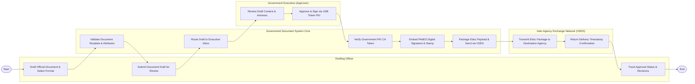

# Swimlane Diagram — Government Document Management System

## Mermaid Code

## Flow Description | Mô tả luồng

| Lane | Actor | Role in Flow |
|------|-------|-------------|
| 1 | Drafting Officer | Soạn thảo văn bản hành chính theo thể thức chuẩn, đính kèm phụ lục và trình duyệt lên lãnh đạo cấp trên. |
| 2 | Government Document System Core | Tự động kiểm tra mẫu thể thức, luân chuyển văn bản, xác thực Token chữ ký số PKI, vẽ hình chữ ký số và phát hành VDES. |
| 3 | Government Executive (Approver) | Xem xét nội dung dự thảo, bấm ký số phê duyệt bằng USB Token/SIM PKI chuyên dùng Chính phủ. |
| 4 | Inter-Agency Exchange Network (VDES) | Truyền tải gói tin văn bản điện tử sang cơ quan nhận và trả về thời gian xác nhận đã giao văn bản. |
