# Action Tree — Government Document Management System

## Mermaid Code

```mermaid
graph TD
    Root["Government Document Management System"]

    Root --> M1["Drafting & Template Management"]
    Root --> M2["Workflow Routing & PKI Digital Signature"]
    Root --> M3["Inter-Agency Document Exchange VDES"]
    Root --> M4["Access Control & Security Classification"]
    Root --> M5["Archival & Records Management"]
    Root --> M6["System SLA & Compliance Audit"]

    M1 --> A11["Draft Official Documents Decree 30"]
    M1 --> A12["Manage Standard Government Templates"]
    M1 --> A13["Link Related Incoming Dispatches"]
    M1 --> A14["Upload Document Annex Attachments"]

    M2 --> A21["Route Multi-level Approval Workflows"]
    M2 --> A22["Apply Government PKI Digital Signatures"]
    M2 --> A23["Apply Electronic Official Seal Stamp"]
    M2 --> A24["Track Executive Processing Deadlines"]

    M3 --> A31["Dispatch Outgoing Edoc Payload VDES"]
    M3 --> A32["Ingest Incoming Dispatches VDES API"]
    M3 --> A33["Generate National Edoc ID Codes"]
    M3 --> A34["Manage Agency Distribution Matrix"]

    M4 --> A41["Classify State Secret Confidentiality"]
    M4 --> A42["Redact Sensitive Document Sections"]
    M4 --> A43["Issue Document QR Barcode Labels"]
    M4 --> A44["Audit Classified Access Security Logs"]

    M5 --> A51["Package Archival SIP Packets OAIS"]
    M5 --> A52["Transfer Digital Archives National Records"]
    M5 --> A53["Full-Text Document OPAC Search"]
    M5 --> A54["Grant Archive Reading Approvals"]

    M6 --> A61["Audit Executive Processing SLA Deadlines"]
    M6 --> A62["Export VPCP National Document Analytics"]
    M6 --> A63["Log System Immutable Data Access"]
    M6 --> A64["Monitor VDES Connection Health"]
```

## Module Description | Mô tả Module

| # | Module | Description | Actions |
|---|--------|-------------|---------|
| 1 | Drafting & Template Management | Soạn thảo văn bản hành chính theo thể thức Nghị định 30/2020/NĐ-CP, quản lý biểu mẫu chuẩn và liên kết phụ lục | Draft Official Documents Decree 30, Manage Standard Government Templates, Link Related Incoming Dispatches, Upload Document Annex Attachments |
| 2 | Workflow Routing & PKI Digital Signature | Luân chuyển trình ký đa cấp, ký số chữ ký chuyên dùng Chính phủ (PKI CA), đóng dấu tròn điện tử và theo dõi hạn xử lý | Route Multi-level Approval Workflows, Apply Government PKI Digital Signatures, Apply Electronic Official Seal Stamp, Track Executive Processing Deadlines |
| 3 | Inter-Agency Document Exchange VDES | Phát hành văn bản đi và tiếp nhận văn bản đến qua Trục liên thông Văn bản Quốc gia VDES, quản lý ma trận nơi nhận | Dispatch Outgoing Edoc Payload VDES, Ingest Incoming Dispatches VDES API, Generate National Edoc ID Codes, Manage Agency Distribution Matrix |
| 4 | Access Control & Security Classification | Phân loại độ mật bí mật nhà nước (Thường/Mật/Tối mật/Tuyệt mật), che mờ thông tin nhạy cảm và in mã vạch QR theo dõi | Classify State Secret Confidentiality, Redact Sensitive Document Sections, Issue Document QR Barcode Labels, Audit Classified Access Security Logs |
| 5 | Archival & Records Management | Đóng gói hồ sơ lưu trữ điện tử tiêu chuẩn OAIS, nộp lưu trữ lịch sử vào Cục Văn thư Lưu trữ và tra cứu toàn văn | Package Archival SIP Packets OAIS, Transfer Digital Archives National Records, Full-Text Document OPAC Search, Grant Archive Reading Approvals |
| 6 | System SLA & Compliance Audit | Kiểm toán thời gian xử lý công việc SLA của cán bộ, trích xuất báo cáo Văn phòng Chính phủ và theo dõi đường truyền VDES | Audit Executive Processing SLA Deadlines, Export VPCP National Document Analytics, Log System Immutable Data Access, Monitor VDES Connection Health |
