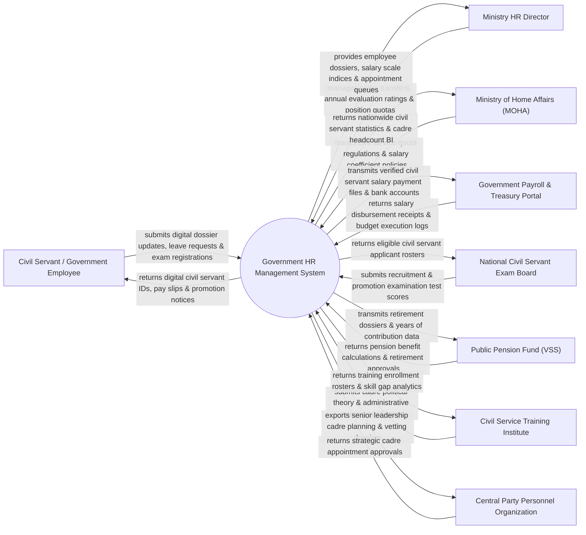

# Context Diagram — Government HR Management System

## Mermaid Code

## Actor & Interaction Table | Bảng Actor & Tương tác

| # | Actor | Actor Type | Data Sent TO System | Data Received FROM System | Notes |
|---|-------|------------|---------------------|---------------------------|-------|
| 1 | Civil Servant / Government Employee | Primary | Digital dossier updates, leave applications, promotion exam forms | Digital civil servant IDs, pay slips, promotion notices, training credits | Cán bộ, công chức, viên chức trong các cơ quan nhà nước |
| 2 | Ministry HR Director | Primary | Cadre transfer orders, annual KPI evaluation ratings, position quotas | Employee dossiers, salary scale indices, appointment queues | Vụ trưởng Vụ Tổ chức Cán bộ / Trưởng phòng Nhân sự |
| 3 | Ministry of Home Affairs (MOHA) | Primary | Civil service quota regulations, salary coefficient policies | Nationwide civil servant statistics, cadre headcount BI dashboards | Bộ Nội vụ quản lý nhà nước về cán bộ công chức |
| 4 | Government Payroll & Treasury Portal | Supporting | Salary disbursement receipts, budget execution logs | Verified civil servant salary payment files, bank accounts | Kho bạc Nhà nước chi trả lương cho cán bộ công chức |
| 5 | National Civil Servant Exam Board | Supporting | Recruitment & promotion examination test scores | Eligible civil servant applicant rosters, exam manifests | Hội đồng Thi tuyển / Thi nâng ngạch công chức quốc gia |
| 6 | Public Pension Fund (VSS) | Supporting | Pension benefit calculations, retirement approval certificates | Retirement dossiers, years of service contribution data | Bảo hiểm Xã hội Việt Nam giải quyết chế độ hưu trí |
| 7 | Civil Service Training Institute | Supporting | Cadre political theory & administrative training certificates | Training enrollment rosters, skill gap analytics | Học viện Hành chính Quốc gia / Học viện Chính trị Quốc gia |
| 8 | Central Party Personnel Organization | Regulatory | Strategic cadre appointment approvals, vetting directives | Senior leadership cadre planning, vetting dossiers | Ban Tổ chức Trung ương quản lý cán bộ cấp chiến lược |

## System Boundary Description | Mô tả Phạm vi Hệ thống

Hệ thống Government HR Management System (Hệ thống Quản lý Cán bộ, Công chức, Viên chức Quốc gia / National Civil Servant HRMS) chịu trách nhiệm tự động hóa quy trình quản lý nhân sự trong bộ máy hành chính nhà nước: Số hóa 100% Hồ sơ cán bộ công chức liên thông VNeID, quản lý thi tuyển và thi nâng ngạch công chức, tự động tính lương theo hệ số lương/ngạch bậc và kết nối Kho bạc Nhà nước chi trả lương, đánh giá phân loại cán bộ hàng năm theo KPI, quản lý điều động/luân chuyển cán bộ, theo dõi đào tạo lý luận chính trị và xử lý thủ tục nghỉ hưu. Tuy nhiên, hệ thống KHÔNG trực tiếp tổ chức coi thi tuyển dụng thực địa và KHÔNG thay thế việc bỏ phiếu kín của Hội đồng Nhân sự.
