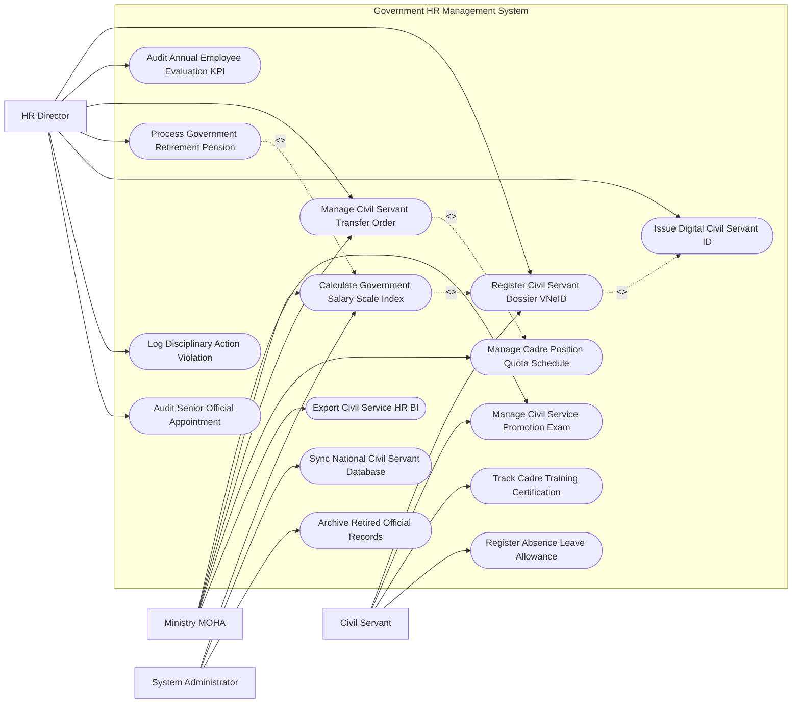

# Use Case Diagram — Government HR Management System

## Mermaid Code

## Actor Table | Bảng Actor

| # | Actor | Actor Type | Role Description | Related Use Cases |
|---|-------|------------|------------------|-------------------|
| 1 | Civil Servant | Primary | Cán bộ công chức cập nhật sơ yếu lý lịch, đăng ký thi nâng ngạch, theo dõi chứng chỉ và nghỉ phép | UC01, UC02, UC06, UC12 |
| 2 | HR Director | Primary | Trưởng phòng Nhân sự duyệt hồ sơ, đánh giá KPI hàng năm, điều động cán bộ, xử lý kỷ luật và nghỉ hưu | UC01, UC04, UC05, UC07, UC08, UC09, UC11 |
| 3 | Ministry MOHA | Regulatory | Bộ Nội vụ quản lý ngạch bậc công chức, phê duyệt chỉ tiêu biên chế, điều động cấp bộ và xuất báo cáo | UC02, UC03, UC05, UC10, UC13 |
| 4 | System Administrator | System | Quản trị viên quản lý bảng lương tự động Kho bạc, đồng bộ CSDL Quốc gia và đóng gói lưu trữ | UC03, UC14, UC15 |

## Use Case Table | Bảng Use Case

| # | UC ID | Use Case Name | Primary Actor | Secondary Actor | Description | Priority |
|---|-------|---------------|---------------|-----------------|-------------|----------|
| 1 | UC01 | Register Civil Servant Dossier VNeID | Servant, Director | VNeID | Số hóa và đồng bộ 109 trường thông tin Sơ yếu lý lịch cán bộ công chức qua VNeID | High |
| 2 | UC02 | Manage Civil Service Promotion Exam | Servant, MOHA | ExamBoard | Quản lý kỳ thi tuyển công chức và thi nâng ngạch (Chuyên viên, Chuyên viên chính, Chuyên viên cao cấp) | High |
| 3 | UC03 | Calculate Government Salary Scale Index | Admin, MOHA | Treasury | Tự động tính tiền lương theo hệ số ngạch/bậc, phụ cấp thâm niên và xuất file chuyển tiền Kho bạc | High |
| 4 | UC04 | Audit Annual Employee Evaluation KPI | Director | Servant | Đánh giá xếp loại chất lượng cán bộ công chức hàng năm (Hoàn thành xuất sắc, Tốt, Hoàn thành, Không HT) | High |
| 5 | UC05 | Manage Civil Servant Transfer Order | Director, MOHA | - | Quản lý điều động, luân chuyển, biệt phái cán bộ công chức giữa các cơ quan hành chính | High |
| 6 | UC06 | Track Cadre Training Certification | Servant | TrainingInst | Theo dõi lịch sử đào tạo bồi dưỡng lý luận chính trị, quản lý nhà nước, ngoại ngữ, tin học | Medium |
| 7 | UC07 | Process Government Retirement Pension | Director | PensionFund | Làm thủ tục nghỉ hưu, chốt sổ BHXH và trao Quyết định hưởng chế độ hưu trí cho công chức | High |
| 8 | UC08 | Issue Digital Civil Servant ID | Director | Servant | Cấp Thẻ công chức điện tử tích hợp chip NFC / Mã QR xác thực danh tính công vụ | High |
| 9 | UC09 | Log Disciplinary Action Violation | Director | - | Lập biên bản kỷ luật cán bộ vi phạm (Khiển trách, Cảnh cáo, Hạ bậc lương, Buộc nghỉ việc) | High |
| 10 | UC10 | Manage Cadre Position Quota Schedule | MOHA | Director | Quản lý vị trí việc làm và chỉ tiêu biên chế (Headcount Quota) giao cho từng Bộ/Ngành/Tỉnh | High |
| 11 | UC11 | Audit Senior Official Appointment | Director | PartyOrganizing | Thẩm định hồ sơ bổ nhiệm cán bộ lãnh đạo quản lý (Vụ trưởng, Giám đốc Sở, Thứ trưởng) | High |
| 12 | UC12 | Register Absence Leave Allowance | Servant | Director | Đăng ký nghỉ phép hàng năm, nghỉ ốm đau, thai sản trực tuyến trên ứng dụng di động | Medium |
| 13 | UC13 | Export Civil Service HR BI | MOHA | Executive | Trích xuất báo cáo thống kê cơ cấu công chức theo độ tuổi, trình độ nộp Thủ tướng Chính phủ | Low |
| 14 | UC14 | Sync National Civil Servant Database | Admin | NationalDB | Đồng bộ dữ liệu nhân sự thời gian thực về Cơ sở Dữ liệu Quốc gia về Cán bộ, Công chức | High |
| 15 | UC15 | Archive Retired Official Records | System | Archives | Đóng gói và lưu trữ vĩnh viễn hồ sơ cán bộ công chức đã nghỉ hưu hoặc từ trần | Low |

## Use Case Specification | Đặc tả Use Case

---

### UC01 — Register Civil Servant Dossier VNeID

| Field | Detail |
|-------|--------|
| **UC ID** | UC01 |
| **Use Case Name** | Register Civil Servant Dossier VNeID |
| **Actor(s)** | Primary: Civil Servant, Ministry HR Director / Secondary: VNeID System |
| **Description** | Số hóa và đồng bộ 109 trường thông tin Sơ yếu lý lịch cán bộ công chức (Mẫu 2C-BNV/TG99) xác thực qua VNeID. |
| **Precondition** | 1. Cán bộ công chức có tài khoản VNeID định danh mức 2 và được tuyển dụng vào cơ quan nhà nước. |
| **Main Flow** | 1. CivilServant đăng nhập Phân hệ Quản lý Hồ sơ Cán bộ Công chức Quốc gia.   2. System kết nối VNeID trích xuất thông tin định danh: Họ tên, Số định danh cá nhân (CCCD), Ngày sinh, Quê quán, Nơi đăng ký HKTT.   3. CivilServant nạp thông tin Sơ yếu lý lịch điện tử (109 trường thông tin theo chuẩn Bộ Nội vụ): Lịch sử bản thân, Trình độ chuyên môn (Đại học, Thạc sĩ, Tiến sĩ), Trình độ lý luận chính trị (Sơ cấp, Trung cấp, Cao cấp), Ngạch công chức hiện giữ, Ngày vào Đảng.   4. CivilServant nạp các tệp văn bằng, chứng chỉ, quyết định tuyển dụng đính kèm.   5. HRDirector kiểm tra, đối soát hồ sơ gốc và ký số xác nhận tính hợp lệ của hồ sơ cán bộ.   6. System tự động tạo Mã định danh Cán bộ Công chức (Civil Servant ID) duy nhất.   7. System đồng bộ hồ sơ về CSDL Quốc gia về Cán bộ, Công chức, Viên chức (UC14). |
| **Alternative Flow** | **AF1** — Cập nhật biến động hồ sơ (Khen thưởng, kỷ luật, nâng lương): CivilServant gửi yêu cầu cập nhật, HRDirector duyệt và ký số cập nhật hồ sơ. |
| **Exception Flow** | **EX1** — Thông tin khai mâu thuẫn với CSDL Quốc gia về Dân cư: System báo lỗi "Dữ liệu không khớp", yêu cầu cán bộ liên hệ Công an xã/phường để đính chính. |
| **Postcondition** | Hồ sơ cán bộ công chức được số hóa 100%, loại bỏ hoàn toàn sơ yếu lý lịch bản giấy. |
| **Business Rule** | **BR1**: 100% cán bộ công chức trong bộ máy hành chính nhà nước bắt buộc phải chuẩn hóa và định danh hồ sơ VNeID. |

---

### UC03 — Calculate Government Salary Scale Index

| Field | Detail |
|-------|--------|
| **UC ID** | UC03 |
| **Use Case Name** | Calculate Government Salary Scale Index |
| **Actor(s)** | Primary: System Administrator, Ministry MOHA / Secondary: Government Payroll & Treasury |
| **Description** | Tự động tính toán tiền lương, phụ cấp theo hệ số ngạch/bậc công chức và trích xuất file chuyển tiền chi trả qua Kho bạc. |
| **Precondition** | 1. Cán bộ công chức có Hồ sơ hợp lệ (UC01) và đã được xếp Ngạch/Bậc lương chuẩn. |
| **Main Flow** | 1. System định kỳ ngày 20 hàng tháng chạy tiến trình Tính lương tự động (Auto-Payroll Daemon).   2. System trích xuất các thông số tính lương của từng cán bộ:   - Mức lương cơ sở do Chính phủ quy định (Ví dụ: $2,340,000\,VND$).   - Hệ số lương ngạch/bậc hiện hưởng (Ví dụ: Chuyên viên bậc 1 hệ số 2.34; Chuyên viên chính bậc 1 hệ số 4.40).   - Phụ cấp thâm niên vượt khung, Phụ cấp chức vụ lãnh đạo, Phụ cấp thâm niên nghề (Công an, Quân đội, Kiểm toán).   - Phụ cấp khu vực, phụ cấp độc hại (nếu có).   3. System tính Tổng thu nhập: $Lương = (Hệ\_số\_lương + Tổng\_hệ\_số\_phụ\_cấp) \times Lương\_cơ\_sở$.   4. System trừ các khoản đóng góp bắt buộc: BHXH (8%), BHYT (1.5%), BHTN (1%), Kế hoạch hóa Công đoàn (1%) và Thuế TNCN.   5. System xuất Bảng thanh toán tiền lương và phụ cấp đính kèm Mã chữ ký số PKI của Chủ tài khoản cơ quan.   6. System tự động truyền tệp thanh toán lương sang Cổng Kho bạc Nhà nước (Treasury Portal).   7. Kho bạc chuyển tiền trực tiếp vào tài khoản ngân hàng của CivilServant và gửi Phiếu lương điện tử (Pay Slip). |
| **Alternative Flow** | **AF1** — Tự động nâng bậc lương thường xuyên (3 năm/lần đối với đại học): System quét cán bộ đủ thời hạn 36 tháng không vi phạm kỷ luật, tự động đề xuất Quyết định nâng bậc lương. |
| **Exception Flow** | **EX1** — Cán bộ bị kỷ luật kéo dài thời hạn nâng lương (UC09): System tự động cộng thêm 06-12 tháng vào thời gian xét nâng bậc lương tiếp theo. |
| **Postcondition** | Tiền lương công chức được tính toán chính xác, công khai, minh bạch và chuyển chi trả đúng hạn qua Kho bạc. |
| **Business Rule** | **BR1**: Việc tính toán tiền lương cán bộ công chức phải áp dụng chính xác các công thức và hệ số lương do Nghị định Chính phủ ban hành. |

---

### UC04 — Audit Annual Employee Evaluation KPI

| Field | Detail |
|-------|--------|
| **UC ID** | UC04 |
| **Use Case Name** | Audit Annual Employee Evaluation KPI |
| **Actor(s)** | Primary: Ministry HR Director / Secondary: Civil Servant |
| **Description** | Đánh giá, xếp loại chất lượng cán bộ công chức hàng năm dựa trên kết quả thực hiện nhiệm vụ (KPI) và phiếu tự đánh giá. |
| **Precondition** | 1. Đang trong đợt đánh giá xếp loại cán bộ công chức cuối năm (Tháng 12 hàng năm). |
| **Main Flow** | 1. CivilServant đăng nhập hệ thống điền Báo cáo Tự đánh giá công tác năm và tự nhận mức xếp loại.   2. HRDirector mở Phân hệ Đánh giá Xếp loại Cán bộ Công chức Hàng năm.   3. System tự động tổng hợp các chỉ số KPI trong năm của cán bộ: Tỷ lệ hoàn thành nhiệm vụ được giao (% Task Completion), Số lượng văn bản đã xử lý đúng hạn, Số ngày nghỉ phép (UC12), Lịch sử khen thưởng/kỷ luật (UC09).   4. Thủ trực trực tiếp chấm điểm và đưa ra Mức xếp loại chất lượng:   - Hoàn thành xuất sắc nhiệm vụ.   - Hoàn thành tốt nhiệm vụ.   - Hoàn thành nhiệm vụ.   - Không hoàn thành nhiệm vụ.   5. Hội đồng Đánh giá cơ quan họp thông qua và HRDirector ký số phê duyệt Kết quả xếp loại.   6. System tự động cập nhật Kết quả xếp loại vào Hồ sơ cán bộ (UC01).   7. System gửi Thông báo kết quả xếp loại điện tử cho CivilServant. |
| **Alternative Flow** | **AF1** — Công chức 02 năm liên tiếp Không hoàn thành nhiệm vụ: System tự động phát cảnh báo đề xuất xem xét cho nghỉ việc hoặc bố trí công tác khác theo Luật Công chức. |
| **Exception Flow** | **EX1** — Công chức khiếu nại kết quả xếp loại: HRDirector tiếp nhận đơn khiếu nại, chuyển Hội đồng Đánh giá xem xét thẩm định lại. |
| **Postcondition** | Kết quả đánh giá cán bộ phản ánh đúng năng lực thực tế, làm cơ sở xét thi đua khen thưởng, nâng ngạch (UC02) và quy hoạch cán bộ. |
| **Business Rule** | **BR1**: Tỷ lệ công chức xếp loại "Hoàn thành xuất sắc nhiệm vụ" không vượt quá $20\%$ tổng số công chức của cơ quan. |

---

### UC05 — Manage Civil Servant Transfer Order

| Field | Detail |
|-------|--------|
| **UC ID** | UC05 |
| **Use Case Name** | Manage Civil Servant Transfer Order |
| **Actor(s)** | Primary: Ministry HR Director, Ministry MOHA / Secondary: None |
| **Description** | Lập thủ tục và ban hành Quyết định điều động, luân chuyển, biệt phái cán bộ công chức giữa các đơn vị/Bộ/Ngành. |
| **Precondition** | 1. Cán bộ thuộc diện điều động/luân chuyển theo quy hoạch cán bộ hoặc theo yêu cầu nhiệm vụ công tác. |
| **Main Flow** | 1. HRDirector mở Phân hệ Quản lý Điều động & Luân chuyển Cán bộ.   2. HRDirector chọn cán bộ cần điều động và Đơn vị tiếp nhận mới.   3. System tự động kiểm tra Chỉ tiêu biên chế (Headcount Quota - UC10) của đơn vị tiếp nhận: Xác nhận đơn vị mới còn vị trí việc làm trống.   4. HRDirector nạp Lý do điều động/luân chuyển (Luân chuyển định kỳ phòng chống tham nhũng, Bổ nhiệm chức vụ mới, Biệt phái nhiệm vụ khẩn cấp).   5. Bộ trưởng / Chủ tịch UBND Tỉnh ký số PKI ban hành Quyết định Điều động Cán bộ Công chức.   6. System tự động cập nhật lại Cơ quan quản lý mới trong Hồ sơ cán bộ (UC01) và chuyển danh sách chi trả lương sang Kho bạc đơn vị mới (UC03).   7. System gửi Quyết định điều động điện tử cho CivilServant và đơn vị tiếp nhận để làm thủ tục bàn giao công việc trong 15 ngày. |
| **Alternative Flow** | **AF1** — Biệt phái công chức có thời hạn (không quá 03 năm): System ghi nhận trạng thái "Biệt phái", đơn vị cử đi vẫn giữ nguyên biên chế và trả lương. |
| **Exception Flow** | **EX1** — Đơn vị tiếp nhận đã hết chỉ tiêu biên chế (UC10): System từ chối tạo quyết định điều động, yêu cầu MOHA cấp bổ sung biên chế. |
| **Postcondition** | Luân chuyển cán bộ được thực hiện đúng quy định, đúng vị trí việc làm, chống tiêu cực và ùn tắc biên chế. |
| **Business Rule** | **BR1**: Thời hạn luân chuyển cán bộ lãnh đạo quản lý tại một vị trí công tác là từ 03 năm đến 05 năm theo quy định. |
