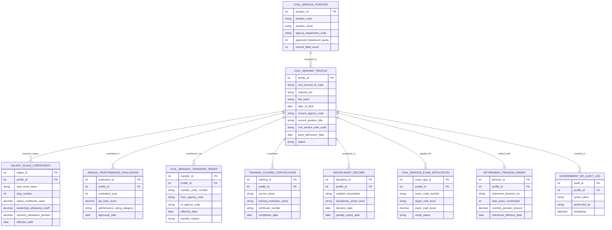

# Conceptual ERD — Government HR Management System

## Mermaid Code

## Entity Description Table | Bảng mô tả Entity

| # | Entity Name | Vietnamese Name | Description | Key Attributes | Main Relationships |
|---|-------------|-----------------|-------------|----------------|-------------------|
| 1 | CIVIL_SERVANT_PROFILE | Hồ sơ Cán bộ Công chức | Hồ sơ sơ yếu lý lịch cán bộ công chức số hóa 109 trường thông tin xác thực VNeID | profile_id, civil_servant_id_code, national_pin, full_name, civil_service_rank_code, status | Assigned to POSITION, receives SALARY |
| 2 | CIVIL_SERVICE_POSITION | Vị trí Việc làm & Biên chế | Quản lý danh mục vị trí việc làm và định mức chỉ tiêu biên chế của cơ quan nhà nước | position_id, position_code, position_name, approved_headcount_quota, current_filled_count | Assigned to CIVIL_SERVANT_PROFILE |
| 3 | SALARY_SCALE_COEFFICIENT | Bảng Hệ số Lương Ngạch Bậc | Chi tiết hệ số lương ngạch/bậc, phụ cấp thâm niên, phụ cấp chức vụ hiện hưởng | salary_id, rank_level_name, step_number, salary_coefficient_value, leadership_allowance_coeff | Belongs to CIVIL_SERVANT_PROFILE |
| 4 | ANNUAL_PERFORMANCE_EVALUATION | Đánh giá Xếp loại Hàng năm | Kết quả điểm KPI và mức xếp loại chất lượng công chức hàng năm (Xuất sắc, Tốt, HT) | evaluation_id, evaluation_year, kpi_total_score, performance_rating_category | Belongs to CIVIL_SERVANT_PROFILE |
| 5 | CIVIL_SERVANT_TRANSFER_ORDER | Quyết định Điều động Luân chuyển | Quyết định điều động, luân chuyển, biệt phái cán bộ công chức giữa các cơ quan | transfer_id, transfer_order_number, from_agency_code, to_agency_code, transfer_reason | Belongs to CIVIL_SERVANT_PROFILE |
| 6 | TRAINING_COURSE_CERTIFICATION | Bồi dưỡng Đào tạo Chứng chỉ | Lịch sử tham gia các khóa đào tạo lý luận chính trị, quản lý nhà nước và chứng chỉ | training_id, course_name, training_institution_name, certificate_number | Belongs to CIVIL_SERVANT_PROFILE |
| 7 | DISCIPLINARY_RECORD | Hồ sơ Kỷ luật Vi phạm | Ghi nhận các hình thức xử lý kỷ luật cán bộ (Khiển trách, Cảnh cáo, Hạ bậc lương) | discipline_id, violation_description, disciplinary_action_level, decision_date | Belongs to CIVIL_SERVANT_PROFILE |
| 8 | CIVIL_SERVICE_EXAM_APPLICATION | Hồ sơ Thi nâng Ngạch | Đơn đăng ký và kết quả điểm thi tuyển công chức / thi nâng ngạch chuyên viên | exam_app_id, exam_code_number, target_rank_level, exam_total_score, result_status | Belongs to CIVIL_SERVANT_PROFILE |
| 9 | RETIREMENT_PENSION_ORDER | Quyết định Hưởng Hưu trí | Quyết định nghỉ hưu, tổng số năm đóng BHXH và mức lương hưu hàng tháng | pension_id, retirement_decision_no, total_years_contributed, monthly_pension_amount | Belongs to CIVIL_SERVANT_PROFILE |
| 10 | GOVERNMENT_HR_AUDIT_LOG | Nhật ký Kiểm toán Nhân sự | Lưu toàn bộ vết nạp hồ sơ VNeID, tính lương Kho bạc, đánh giá KPI, luân chuyển và kỷ luật | audit_id, action_taken, performed_by, timestamp | Belongs to CIVIL_SERVANT_PROFILE |

## Relationship Description | Mô tả Quan hệ

| # | From Entity | Cardinality | To Entity | Relationship Label | Business Explanation |
|---|-------------|-------------|-----------|-------------------|----------------------|
| 1 | CIVIL_SERVICE_POSITION | one-to-many | CIVIL_SERVANT_PROFILE | assigned_to | Một vị trí việc làm được phân công đảm nhận bởi nhiều công chức theo định mức biên chế |
| 2 | CIVIL_SERVANT_PROFILE | one-to-many | SALARY_SCALE_COEFFICIENT | receives_salary | Một cán bộ công chức có lịch sử nâng ngạch/bậc lương qua các thời kỳ công tác |
| 3 | CIVIL_SERVANT_PROFILE | one-to-many | ANNUAL_PERFORMANCE_EVALUATION | evaluated_in | Một công chức được đánh giá xếp loại chất lượng định kỳ hàng năm |
| 4 | CIVIL_SERVANT_PROFILE | one-to-many | CIVIL_SERVANT_TRANSFER_ORDER | transferred_via | Một cán bộ có thể trải qua các đợt điều động, luân chuyển công tác giữa các Bộ/Tỉnh |
| 5 | CIVIL_SERVANT_PROFILE | one-to-many | TRAINING_COURSE_CERTIFICATION | completes | Một cán bộ hoàn thành các khóa bồi dưỡng lý luận chính trị và quản lý nhà nước |
| 6 | CIVIL_SERVANT_PROFILE | one-to-many | DISCIPLINARY_RECORD | penalized_in | Cán bộ vi phạm bị ghi nhận các quyết định xử lý kỷ luật trong hồ sơ |
| 7 | CIVIL_SERVANT_PROFILE | one-to-many | CIVIL_SERVICE_EXAM_APPLICATION | applies_for | Một công chức đăng ký dự thi nâng ngạch qua các kỳ thi nâng ngạch quốc gia |
| 8 | CIVIL_SERVANT_PROFILE | one-to-one | RETIREMENT_PENSION_ORDER | retired_with | Mỗi cán bộ khi đủ tuổi được ban hành duy nhất một Quyết định nghỉ hưu hưởng chế độ |
| 9 | CIVIL_SERVANT_PROFILE | one-to-many | GOVERNMENT_HR_AUDIT_LOG | tracked_in | Mọi thao tác trên hồ sơ công chức được ghi lại nhật ký kiểm toán bất biến minh bạch |
