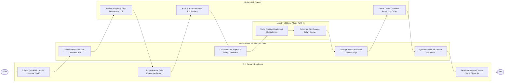

# Swimlane Diagram — Government HR Management System

## Mermaid Code

## Flow Description | Mô tả luồng

| Lane | Actor | Role in Flow |
|------|-------|-------------|
| 1 | Civil Servant Employee | Nộp cập nhật hồ sơ công chức qua VNeID, nộp bản tự đánh giá công tác năm và nhận phiếu lương điện tử. |
| 2 | Government HR Platform Core | Xác thực dữ liệu VNeID, tự động tính lương ngạch bậc, đóng gói file chi trả chuyển Kho bạc và đồng bộ CSDL Quốc gia. |
| 3 | Ministry HR Director | Thẩm định và ký số phê duyệt hồ sơ cán bộ, duyệt xếp loại chất lượng KPI và ban hành quyết định điều động. |
| 4 | Ministry of Home Affairs (MOHA) | Kiểm tra định mức chỉ tiêu biên chế vị trí việc làm và phê duyệt ngân sách lương công chức toàn quốc. |
