# Action Tree — Government HR Management System

## Mermaid Code

```mermaid
graph TD
    Root["Government HR Management System"]

    Root --> M1["Civil Servant Dossier & VNeID Profile"]
    Root --> M2["Recruitment & Promotion Exam Management"]
    Root --> M3["Salary Scale & Treasury Payroll Integration"]
    Root --> M4["Cadre Performance KPI & Disciplinary Action"]
    Root --> M5["Mobility Transfer & Training Certification"]
    Root --> M6["MOHA BI & National Database Sync"]

    M1 --> A11["Register Civil Servant Dossiers VNeID"]
    M1 --> A12["Issue Digital Civil Servant IDs"]
    M1 --> A13["Register Absence Leave Allowances"]
    M1 --> A14["Verify 109 Civil Service Profile Fields"]

    M2 --> A21["Manage Civil Service Promotion Exams"]
    M2 --> A22["Audit Senior Official Appointments"]
    M2 --> A23["Manage Civil Servant Recruitment Screening"]
    M2 --> A24["Process Promotion Exam Test Scores"]

    M3 --> A31["Calculate Government Salary Scale Indices"]
    M3 --> A32["Process Government Retirement Pensions"]
    M3 --> A33["Transmit Treasury Payroll Payment Files"]
    M3 --> A34["Calculate Seniority Allowance Increments"]

    M4 --> A41["Audit Annual Employee Evaluation KPIs"]
    M4 --> A42["Log Disciplinary Action Violations"]
    M4 --> A43["Track Commendation & Award Histories"]
    M4 --> A44["Monitor Unsatisfactory Performance Warnings"]

    M5 --> A51["Manage Civil Servant Transfer Orders"]
    M5 --> A52["Track Cadre Training Certifications"]
    M5 --> A53["Manage Cadre Position Quota Schedules"]
    M5 --> A54["Audit Leadership Rotation Time Limits"]

    M6 --> A61["Export Civil Service HR BI Analytics"]
    M6 --> A62["Sync National Civil Servant Database"]
    M6 --> A63["Log System Immutable HR Audits"]
    M6 --> A64["Archive Retired Official Records"]
```

## Module Description | Mô tả Module

| # | Module | Description | Actions |
|---|--------|-------------|---------|
| 1 | Civil Servant Dossier & VNeID Profile | Số hóa 109 trường sơ yếu lý lịch cán bộ xác thực VNeID, cấp Thẻ công chức điện tử NFC và quản lý nghỉ phép | Register Civil Servant Dossiers VNeID, Issue Digital Civil Servant IDs, Register Absence Leave Allowances, Verify 109 Civil Service Profile Fields |
| 2 | Recruitment & Promotion Exam Management | Quản lý kỳ thi tuyển công chức, thi nâng ngạch chuyên viên và thẩm định hồ sơ bổ nhiệm cán bộ lãnh đạo quản lý | Manage Civil Service Promotion Exams, Audit Senior Official Appointments, Manage Civil Servant Recruitment Screening, Process Promotion Exam Test Scores |
| 3 | Salary Scale & Treasury Payroll Integration | Tự động tính lương theo hệ số ngạch bậc/phụ cấp, kết nối Kho bạc chi trả lương và làm thủ tục nghỉ hưu hưu trí | Calculate Government Salary Scale Indices, Process Government Retirement Pensions, Transmit Treasury Payroll Payment Files, Calculate Seniority Allowance Increments |
| 4 | Cadre Performance KPI & Disciplinary Action | Đánh giá xếp loại chất lượng công chức hàng năm theo KPI, khen thưởng và quản lý các quyết định xử lý kỷ luật | Audit Annual Employee Evaluation KPIs, Log Disciplinary Action Violations, Track Commendation & Award Histories, Monitor Unsatisfactory Performance Warnings |
| 5 | Mobility Transfer & Training Certification | Quản lý điều động, luân chuyển, biệt phái công chức, kiểm soát chỉ tiêu biên chế và theo dõi chứng chỉ đào tạo | Manage Civil Servant Transfer Orders, Track Cadre Training Certifications, Manage Cadre Position Quota Schedules, Audit Leadership Rotation Time Limits |
| 6 | MOHA BI & National Database Sync | Trích xuất báo cáo thống kê công chức nộp Bộ Nội vụ/Thủ tướng, đồng bộ CSDL Quốc gia và lưu trữ hồ sơ vĩnh viễn | Export Civil Service HR BI Analytics, Sync National Civil Servant Database, Log System Immutable HR Audits, Archive Retired Official Records |
