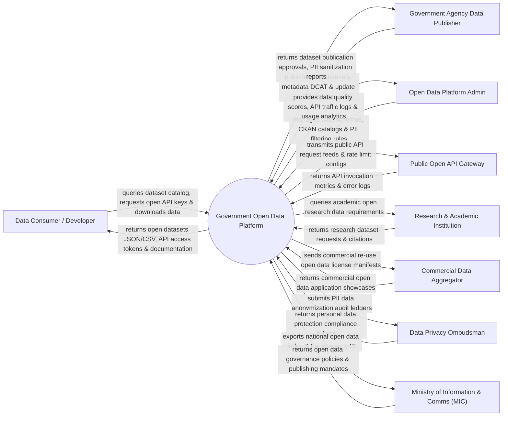

# Context Diagram — Government Open Data Platform

## Mermaid Code

## Actor & Interaction Table | Bảng Actor & Tương tác

| # | Actor | Actor Type | Data Sent TO System | Data Received FROM System | Notes |
|---|-------|------------|---------------------|---------------------------|-------|
| 1 | Data Consumer / Developer | Primary | Dataset search queries, open API key requests, dataset downloads | Open datasets (CSV/JSON/Parquet), API tokens, documentation | Lập trình viên, nhà nghiên cứu và công chúng khai thác dữ liệu mở |
| 2 | Government Agency Data Publisher | Primary | Raw datasets, DCAT metadata, update schedules, data licenses | Dataset publication approvals, AI PII sanitization audit reports | Các Bộ/Ngành, UBND Tỉnh và đơn vị xuất bản dữ liệu mở |
| 3 | Open Data Platform Admin | Primary | Data schemas, CKAN catalog rules, PII filtering parameters | Data quality scores, API traffic logs, usage analytics | Quản trị viên Cổng Dữ liệu Mở Chính phủ (data.gov.vn) |
| 4 | Ministry of Information & Comms (MIC) | Regulatory | Open data governance policies, publishing mandates, index rules | National open data index BI dashboards, agency ranking reports | Bộ Thông tin và Truyền thông quản lý dữ liệu mở quốc gia |
| 5 | Public Open API Gateway | Supporting | API invocation metrics, rate limit hits, error logs | Public API request feeds, rate limit configurations | Cổng kết nối API dữ liệu mở cho lập trình viên (Open API) |
| 6 | Commercial Data Aggregator | Supporting | Commercial open data application showcases, re-use feedback | Commercial re-use open data license manifests | Các doanh nghiệp công nghệ tái sử dụng dữ liệu mở tạo ứng dụng |
| 7 | Data Privacy Ombudsman | Regulatory | Personal data protection compliance rulings, PII guidelines | PII data anonymization audit ledgers, privacy violation logs | Cục An ninh mạng & Phòng chống Tội phạm Hiệp hội Bảo vệ Dữ liệu |
| 8 | Research & Academic Institution | Supporting | Research dataset requests, academic citations | Open research dataset feeds, scholarly data catalogs | Các Viện nghiên cứu và Trường Đại học khai thác dữ liệu mở |

## System Boundary Description | Mô tả Phạm vi Hệ thống

Hệ thống Government Open Data Platform (Nền tảng Dữ liệu Mở Chính phủ Quốc gia / National Open Data Portal - data.gov.vn) chịu trách nhiệm tự động hóa quy trình quản lý, xuất bản và công khai dữ liệu mở của các cơ quan nhà nước: Tiếp nhận và phân loại dữ liệu mở theo chuẩn CKAN / DCAT-AP, sử dụng thuật toán AI tự động làm sạch và che giấu thông tin cá nhân riêng tư (PII Sanitization / Anonymization), cung cấp Cổng kết nối lập trình công khai (Public Open API Gateway), hỗ trợ tải về các định dạng chuẩn (CSV, JSON, XML, Parquet), theo dõi tần suất cập nhật dữ liệu của các Bộ/Ngành và đánh giá chỉ số minh bạch dữ liệu mở quốc gia. Tuy nhiên, hệ thống KHÔNG trực tiếp xuất bản các dữ liệu thuộc danh mục Mật/Bí mật Nhà nước và KHÔNG thay thế CSDL vận hành chuyên ngành.
