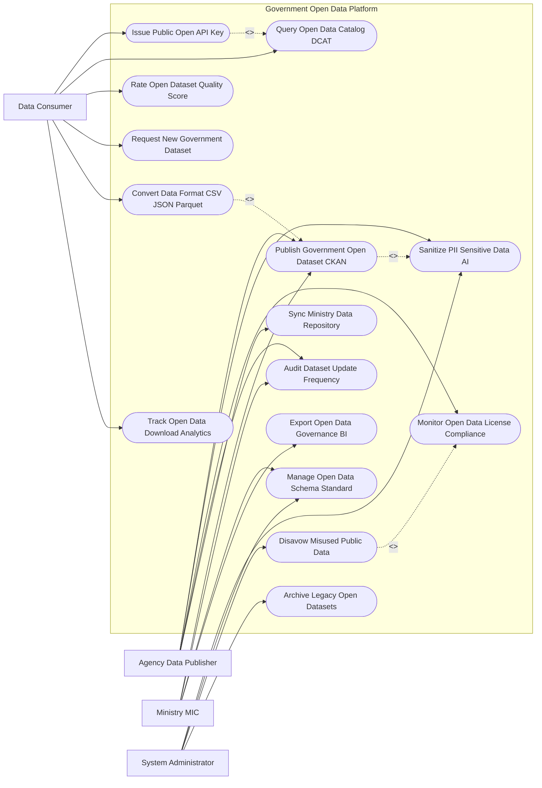

# Use Case Diagram — Government Open Data Platform

## Mermaid Code

## Actor Table | Bảng Actor

| # | Actor | Actor Type | Role Description | Related Use Cases |
|---|-------|------------|------------------|-------------------|
| 1 | Data Consumer | Primary | Lập trình viên/Công chúng tra cứu danh mục dữ liệu mở, xin cấp API key, tải dữ liệu và đánh giá chất lượng | UC03, UC04, UC06, UC07, UC09, UC10 |
| 2 | Agency Data Publisher | Primary | Cán bộ xuất bản dữ liệu mở của Bộ/Ngành nạp tập dữ liệu, làm sạch PII và theo dõi tần suất cập nhật | UC01, UC02, UC05, UC08, UC14 |
| 3 | Ministry MIC | Regulatory | Bộ Thông tin và Truyền thông quản lý chuẩn dữ liệu DCAT, quy định giấy phép dữ liệu mở và xuất báo cáo | UC01, UC08, UC11, UC13 |
| 4 | System Administrator | System | Quản trị viên cổng vận hành AI che giấu PII, quản lý khung schema và thu hồi dữ liệu bị lạm dụng | UC02, UC11, UC12, UC15 |

## Use Case Table | Bảng Use Case

| # | UC ID | Use Case Name | Primary Actor | Secondary Actor | Description | Priority |
|---|-------|---------------|---------------|-----------------|-------------|----------|
| 1 | UC01 | Publish Government Open Dataset CKAN | Publisher, MIC | CKAN Engine | Xuất bản tập dữ liệu mở của cơ quan nhà nước lên Cổng Quốc gia theo chuẩn CKAN / DCAT | High |
| 2 | UC02 | Sanitize PII Sensitive Data AI | Publisher, Admin | AI Engine | Thuật toán AI tự động quét và che giấu/mã hóa các thông tin cá nhân riêng tư (PII / Anonymization) | High |
| 3 | UC03 | Issue Public Open API Key | Consumer | APIGateway | Cấp mã khóa kết nối API (Open API Key) và quản lý hạn mức truy vấn (Rate Limiting) | High |
| 4 | UC04 | Query Open Data Catalog DCAT | Consumer | SearchEngine | Tra cứu và tìm kiếm tập dữ liệu mở theo từ khóa, cơ quan xuất bản, chủ đề và định dạng | High |
| 5 | UC05 | Monitor Open Data License Compliance | Publisher | Legal | Kiểm soát tuân thủ quy định Giấy phép dữ liệu mở công cộng (Open Government License - OGL) | Medium |
| 6 | UC06 | Rate Open Dataset Quality Score | Consumer | System | Công dân và lập trình viên đánh giá sao chất lượng dữ liệu (Độ chính xác, độ tươi mới, định dạng) | Medium |
| 7 | UC07 | Request New Government Dataset | Consumer | Publisher | Gửi yêu cầu cơ quan nhà nước mở thêm các tập dữ liệu mở mới chưa được công khai | Medium |
| 8 | UC08 | Audit Dataset Update Frequency | Publisher, MIC | System | Theo dõi đôn đốc tỷ lệ cập nhật dữ liệu đúng hạn của các Bộ/Tỉnh (Tần suất Hàng ngày/Hàng tháng) | High |
| 9 | UC09 | Convert Data Format CSV JSON Parquet | Consumer | ConvertEngine | Tự động chuyển đổi linh hoạt định dạng tệp dữ liệu mở giữa CSV, JSON, XML, Parquet, GeoJSON | High |
| 10 | UC10 | Track Open Data Download Analytics | Consumer | System | Đo lường và phân tích thống kê lượt tải về, lượt gọi API của từng tập dữ liệu mở | Low |
| 11 | UC11 | Manage Open Data Schema Standard | Admin, MIC | DCAT | Quản lý khung cấu trúc dữ liệu chuẩn (Metadata Schema DCAT-AP) áp dụng toàn quốc | High |
| 12 | UC12 | Disavow Misused Public Data | Admin | Legal | Thu hồi hoặc gắn nhãn cảnh báo đối với các tập dữ liệu bị lạm dụng xuyên tạc thông tin | Medium |
| 13 | UC13 | Export Open Data Governance BI | MIC | Executive | Trích xuất báo cáo Chỉ số Minh bạch Dữ liệu Mở Quốc gia nộp Ủy ban Chuyển đổi số Quốc gia | Low |
| 14 | UC14 | Sync Ministry Data Repository | Publisher | MinistryDB | Đồng bộ tự động các tập dữ liệu mở từ Kho dữ liệu của các Bộ/Ngành về Cổng Quốc gia | High |
| 15 | UC15 | Archive Legacy Open Datasets | System | Archives | Lưu trữ vĩnh viễn các phiên bản tập dữ liệu mở cũ (Historical Data Versions) | Low |

## Use Case Specification | Đặc tả Use Case

---

### UC01 — Publish Government Open Dataset CKAN

| Field | Detail |
|-------|--------|
| **UC ID** | UC01 |
| **Use Case Name** | Publish Government Open Dataset CKAN |
| **Actor(s)** | Primary: Agency Data Publisher, Ministry MIC / Secondary: CKAN Engine |
| **Description** | Cơ quan nhà nước tải lên và xuất bản tập dữ liệu mở công khai trên Cổng Dữ liệu Mở Quốc gia theo chuẩn CKAN/DCAT. |
| **Precondition** | 1. Cán bộ xuất bản có tài khoản cơ quan nhà nước được xác thực trên Cổng Dữ liệu Mở Quốc gia. |
| **Main Flow** | 1. Publisher mở Phân hệ Xuất bản Dữ liệu Mở (Dataset Publishing Portal).   2. Publisher nạp Tệp dữ liệu thô (File CSV, Excel, JSON, GeoJSON) hoặc nhập URL API kết nối trực tiếp.   3. System kích hoạt Tiến trình AI Làm sạch Dữ liệu Cá nhân PII (UC02): Quét và che giấu 100% thông tin cá nhân nhạy cảm.   4. Publisher nhập metadata chuẩn DCAT-AP: Tên tập dữ liệu, Mô tả nội dung, Cơ quan xuất bản, Tần suất cập nhật (Hàng ngày/Hàng tháng), Loại giấy phép (Open Government License).   5. System tự động kiểm tra định dạng tệp và chuẩn hóa bảng mã UTF-8.   6. Trưởng đơn vị ký số PKI phê duyệt xuất bản tập dữ liệu mở.   7. System đưa tập dữ liệu lên Catalog CKAN công khai tại `data.gov.vn`, phát hành công khai qua giao diện Web và Cổng Open API (UC03). |
| **Alternative Flow** | **AF1** — Xuất bản dữ liệu địa lý GIS (GeoJSON/SHP): System tự động tích hợp bản đồ số xem trước (Map Preview) trực quan cho người dùng. |
| **Exception Flow** | **EX1** — Tệp dữ liệu chứa thông tin thuộc danh mục Bí mật Nhà nước: AI phát hiện từ khóa bảo mật, tự động khóa xuất bản và phát cảnh báo an ninh cho Admin. |
| **Postcondition** | Tập dữ liệu mở được công khai minh bạch, sẵn sàng cho cộng đồng khai thác tái sử dụng. |
| **Business Rule** | **BR1**: 100% các tập dữ liệu mở xuất bản bắt buộc phải được xử lý làm sạch PII và gán Giấy phép dữ liệu mở hợp lệ. |

---

### UC02 — Sanitize PII Sensitive Data AI

| Field | Detail |
|-------|--------|
| **UC ID** | UC02 |
| **Use Case Name** | Sanitize PII Sensitive Data AI |
| **Actor(s)** | Primary: System Administrator, Agency Data Publisher / Secondary: AI PII Engine |
| **Description** | Thuật toán AI tự động quét và che giấu/mã hóa các thông tin cá nhân riêng tư (PII) trước khi công khai dữ liệu mở. |
| **Precondition** | 1. Tệp dữ liệu thô được tải lên hệ thống chuẩn bị xuất bản (UC01). |
| **Main Flow** | 1. AI PII Scanner Engine tiếp nhận tệp dữ liệu thô (CSV, JSON, SQL Dump).   2. AI chạy thuật toán Xử lý Ngôn ngữ Tự nhiên (NLP) và Pattern Matching để nhận diện các trường thông tin cá nhân nhạy cảm (Personally Identifiable Information - PII):   - Số Định danh cá nhân (CCCD / Số CMND).   - Họ và tên cá nhân, Ngày tháng năm sinh.   - Địa chỉ nhà riêng chi tiết, Số điện thoại, Email cá nhân.   - Biển số xe cá nhân, Số tài khoản ngân hàng.   - Bệnh án y tế, Thông tin tài chính cá nhân.   3. AI áp dụng các kỹ thuật làm sạch dữ liệu an toàn:   - Masking: Đổi `0903123456` thành `0903***456`.   - Hashing: Mã hóa SHA-256 các trường định danh.   - Generalization: Chuyển Ngày sinh thành Độ tuổi, chuyển Địa chỉ chi tiết thành Cấp Tỉnh/Huyện.   4. System lập Báo cáo Kiểm toán Làm sạch PII (PII Sanitization Audit Report) đính kèm danh sách các trường đã được che giấu.   5. Publisher kiểm tra và xác nhận kết quả làm sạch AI trước khi xuất bản chính thức. |
| **Alternative Flow** | **AF1** — Dữ liệu đã là dữ liệu tổng hợp thống kê: AI kiểm tra không có trường PII cá nhân nào, cấp Chứng nhận "Data Clean & Safe for Public". |
| **Exception Flow** | **EX1** — Tệp dữ liệu bị lọt 01 trường PII cá nhân nhạy cảm: System tự động từ chối phê duyệt xuất bản, gửi thông báo cảnh báo lỗi cho Publisher. |
| **Postcondition** | Dữ liệu mở hoàn toàn sạch thông tin cá nhân riêng tư, bảo vệ 100% quyền riêng tư của công dân theo quy định pháp luật. |
| **Business Rule** | **BR1**: Nghiêm cấm tuyệt đối việc xuất bản các tập dữ liệu mở chứa thông tin cá nhân nhạy cảm chưa qua xử lý PII. |

---

### UC03 — Issue Public Open API Key

| Field | Detail |
|-------|--------|
| **UC ID** | UC03 |
| **Use Case Name** | Issue Public Open API Key |
| **Actor(s)** | Primary: Data Consumer / Developer / Secondary: Public Open API Gateway |
| **Description** | Cấp mã khóa kết nối API công khai (Open API Key) cho lập trình viên và doanh nghiệp khai thác dữ liệu tự động. |
| **Precondition** | 1. DataConsumer có tài khoản đã xác thực trên Cổng Dữ liệu Mở Quốc gia. |
| **Main Flow** | 1. DataConsumer chọn tập dữ liệu mở muốn kết nối API (Ví dụ: API Giá thị trường nông sản, API Tuyến xe buýt GTFS).   2. DataConsumer bấm "Đăng ký sử dụng Open API".   3. DataConsumer nạp mục đích sử dụng (Nghiên cứu khoa học, Phát triển ứng dụng di động, Thương mại) và tên ứng dụng.   4. System tự động khởi tạo Chuỗi khóa API duy nhất (`api_key_v1_8291a82f...`) đính kèm mã chữ ký OAuth2.   5. System áp dụng Quy tắc Hạn mức Truy vấn (Rate Limiting Rules): Mặc định $1,000\,request/giờ$ đối với tài khoản thường.   6. DataConsumer nhận API Key và tài liệu hướng dẫn tích hợp SDK (Swagger / OpenAPI Specification).   7. APIGateway bắt đầu ghi nhận nhật ký lưu lượng truy vấn API của DataConsumer (UC10). |
| **Alternative Flow** | **AF1** — Nâng hạn mức truy vấn API (High-Volume API): Doanh nghiệp công nghệ đăng ký nâng hạn mức lên $100,000\,request/giờ$, Admin duyệt cấp phép trong 24 giờ. |
| **Exception Flow** | **EX1** — API Key vi phạm giới hạn băng thông (DDoS/Spam API): APIGateway tự động khóa tạm thời API Key và trả về lỗi `429 Too Many Requests`. |
| **Postcondition** | Lập trình viên dễ dàng tích hợp dữ liệu mở chính phủ vào các ứng dụng di động, thúc đẩy kinh tế số phát triển. |
| **Business Rule** | **BR1**: 100% các API dữ liệu mở công khai bắt buộc phải được giám sát lưu lượng và kiểm soát hạn mức truy vấn bằng API Gateway. |

---

### UC08 — Audit Dataset Update Frequency

| Field | Detail |
|-------|--------|
| **UC ID** | UC08 |
| **Use Case Name** | Audit Dataset Update Frequency |
| **Actor(s)** | Primary: Agency Data Publisher, Ministry MIC / Secondary: System |
| **Description** | Đôn đốc và kiểm toán tỷ lệ cập nhật dữ liệu đúng hạn của các Bộ/Tỉnh theo đúng cam kết tần suất xuất bản công khai. |
| **Precondition** | 1. Các tập dữ liệu mở đã được đăng ký Tần suất cập nhật cam kết (Hàng ngày, Hàng tuần, Hàng tháng, Hàng quý). |
| **Main Flow** | 1. System chạy tiến trình giám sát tần suất cập nhật dữ liệu (Dataset Freshness Monitor) hàng ngày.   2. System so sánh Ngày cập nhật cuối cùng (Last Updated Date) vs Cam kết tần suất trong DCAT metadata của từng tập dữ liệu mở.   3. System tính toán Chỉ số Độ tươi mới dữ liệu (Data Freshness Score %):   - Đúng hạn (Up-to-date): Cập nhật đúng/trước hạn cam kết.   - Chậm cập nhật (Stale Data): Quá hạn cam kết 15-30 ngày.   - Dữ liệu chết (Dead Dataset): Quá hạn cam kết $> 90$ ngày không có dữ liệu mới.   4. If Tập dữ liệu bị chậm cập nhật: System tự động gửi email đôn đốc nhắc nhở tới Publisher của Bộ/Tỉnh đó.   5. System tính toán Xếp hạng Cải cách Dữ liệu Mở (Open Data Readiness Index) cho từng Bộ, Ngành, Tỉnh.   6. System trích xuất Báo cáo Đôn đốc Cập nhật Dữ liệu nộp Bộ Thông tin và Truyền thông (UC13).   7. MIC công khai Bảng xếp hạng cập nhật dữ liệu mở của các cơ quan trên Cổng Quốc gia. |
| **Alternative Flow** | **AF1** — Cơ quan tạm dừng xuất bản tập dữ liệu do giải thể/thay đổi chính sách: Publisher nộp đơn xin tạm dừng, System cập nhật trạng thái "Dừng cập nhật hợp lệ". |
| **Exception Flow** | **EX1** — Cơ quan dây dưa không cập nhật dữ liệu $> 6$ tháng: System tự động gắn nhãn "Dữ liệu không tươi mới", hạ điểm xếp hạng minh bạch của cơ quan đó. |
| **Postcondition** | Dữ liệu mở trên Cổng Quốc gia luôn luôn tươi mới, đáng tin cậy, chấm dứt tình trạng "đầu bói đuôi chuột" xuất bản xong rồi bỏ trống. |
| **Business Rule** | **BR1**: Các cơ quan nhà nước có nghĩa vụ cập nhật dữ liệu mở đúng tần suất cam kết theo quy định của Nghị định 47/2020/NĐ-CP. |
