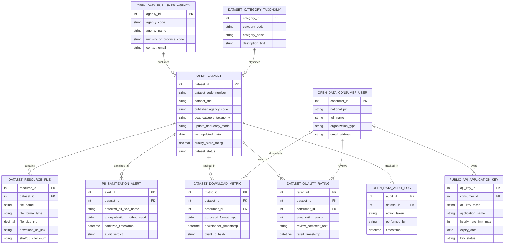

# Conceptual ERD — Government Open Data Platform

## Mermaid Code

## Entity Description Table | Bảng mô tả Entity

| # | Entity Name | Vietnamese Name | Description | Key Attributes | Main Relationships |
|---|-------------|-----------------|-------------|----------------|-------------------|
| 1 | OPEN_DATASET | Tập Dữ liệu Mở | Thông tin tập dữ liệu mở công khai (mã tập, tiêu đề, cơ quan xuất bản, tần suất cập nhật) | dataset_id, dataset_code_number, dataset_title, update_frequency_mode, last_updated_date, dataset_status | Published by AGENCY, contains RESOURCE |
| 2 | DATASET_RESOURCE_FILE | Tệp Dữ liệu Thành phần | Các tệp tài nguyên dữ liệu đính kèm (định dạng CSV, JSON, XML, Parquet, GeoJSON) | resource_id, file_name, file_format_type, file_size_mb, download_url_link | Belongs to OPEN_DATASET |
| 3 | DATASET_CATEGORY_TAXONOMY | Danh mục Chủ đề Dữ liệu | Phân loại chủ đề dữ liệu mở theo chuẩn quốc tế DCAT-AP (Giao thông, Y tế, Giáo dục) | category_id, category_code, category_name, description_text | Classifies OPEN_DATASET |
| 4 | PII_SANITIZATION_ALERT | Kiểm toán Làm sạch PII AI | Bản ghi kiểm toán AI làm sạch và che giấu các trường thông tin cá nhân nhạy cảm | alert_id, detected_pii_field_name, anonymization_method_used, audit_verdict | Sanitized for OPEN_DATASET |
| 5 | PUBLIC_API_APPLICATION_KEY | Khóa Kết nối Open API | Mã khóa kết nối API công khai (API Key) cấp cho lập trình viên đính kèm hạn mức | api_key_id, api_key_token, application_name, hourly_rate_limit_max, key_status | Owned by OPEN_DATA_CONSUMER_USER |
| 6 | OPEN_DATA_PUBLISHER_AGENCY | Cơ quan Xuất bản Dữ liệu | Thông tin Bộ, Ngành hoặc UBND Tỉnh chịu trách nhiệm xuất bản dữ liệu mở | agency_id, agency_code, agency_name, ministry_or_province_code, contact_email | Publishes OPEN_DATASET |
| 7 | OPEN_DATA_CONSUMER_USER | Người Khai thác Dữ liệu | Thông tin lập trình viên, doanh nghiệp hoặc nhà nghiên cứu khai thác dữ liệu mở | consumer_id, national_pin, full_name, organization_type, email_address | Owns API_KEY, downloads METRIC |
| 8 | DATASET_DOWNLOAD_METRIC | Thống kê Lượt Tải & API | Nhật ký đo lường lượt tải tệp dữ liệu hoặc lượt gọi Open API của công chúng | metric_id, accessed_format_type, downloaded_timestamp, client_ip_hash | Belongs to OPEN_DATASET, CONSUMER |
| 9 | DATASET_QUALITY_RATING | Đánh giá Chất lượng Dữ liệu | Kết quả chấm điểm sao hài lòng và nhận xét của cộng đồng về tập dữ liệu mở | rating_id, stars_rating_score, review_comment_text, rated_timestamp | Rated for OPEN_DATASET, CONSUMER |
| 10 | OPEN_DATA_AUDIT_LOG | Nhật ký Kiểm toán Dữ liệu Mở | Lưu toàn bộ vết nạp tệp, che giấu PII, duyệt xuất bản, cấp API key và thu hồi dữ liệu | audit_id, action_taken, performed_by, timestamp | Belongs to OPEN_DATASET |

## Relationship Description | Mô tả Quan hệ

| # | From Entity | Cardinality | To Entity | Relationship Label | Business Explanation |
|---|-------------|-------------|-----------|-------------------|----------------------|
| 1 | OPEN_DATA_PUBLISHER_AGENCY | one-to-many | OPEN_DATASET | publishes | Một cơ quan nhà nước xuất bản nhiều Tập dữ liệu mở công khai trên Cổng Quốc gia |
| 2 | OPEN_DATASET | one-to-many | DATASET_RESOURCE_FILE | contains | Một tập dữ liệu mở chứa các tệp tài nguyên với các định dạng khác nhau (CSV/JSON/Parquet) |
| 3 | DATASET_CATEGORY_TAXONOMY | one-to-many | OPEN_DATASET | classifies | Chủ đề dữ liệu phân loại nhiều tập dữ liệu mở theo đúng lĩnh vực chuyên ngành |
| 4 | OPEN_DATASET | one-to-many | PII_SANITIZATION_ALERT | sanitized_in | Mỗi tập dữ liệu mở được kiểm toán làm sạch các trường PII cá nhân nhạy cảm |
| 5 | OPEN_DATA_CONSUMER_USER | one-to-many | PUBLIC_API_APPLICATION_KEY | owns | Một lập trình viên sở hữu các mã khóa Open API Key để phát triển nhiều ứng dụng |
| 6 | OPEN_DATASET | one-to-many | DATASET_DOWNLOAD_METRIC | tracked_in | Một tập dữ liệu mở ghi nhận hàng ngàn lượt tải về và truy vấn API từ công chúng |
| 7 | OPEN_DATA_CONSUMER_USER | one-to-many | DATASET_DOWNLOAD_METRIC | downloads | Một người dùng thực hiện các lượt tải tệp dữ liệu mở trên cổng |
| 8 | OPEN_DATASET | one-to-many | DATASET_QUALITY_RATING | rated_in | Một tập dữ liệu mở nhận được các lượt đánh giá sao và bình luận chất lượng |
| 9 | OPEN_DATA_CONSUMER_USER | one-to-many | DATASET_QUALITY_RATING | reviews | Một người dùng gửi các đánh giá nhận xét chất lượng về tập dữ liệu mở |
| 10 | OPEN_DATASET | one-to-many | OPEN_DATA_AUDIT_LOG | tracked_in | Mọi thao tác trên tập dữ liệu mở được ghi lại nhật ký kiểm toán bất biến minh bạch |
