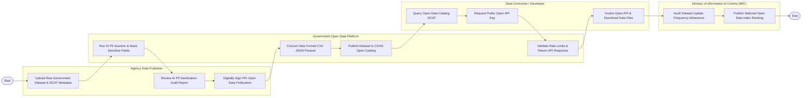

# Swimlane Diagram — Government Open Data Platform

## Mermaid Code

## Flow Description | Mô tả luồng

| Lane | Actor | Role in Flow |
|------|-------|-------------|
| 1 | Agency Data Publisher | Nạp tệp dữ liệu thô và metadata DCAT, xem báo cáo làm sạch PII của AI và ký số PKI xuất bản dữ liệu mở. |
| 2 | Government Open Data Platform | Chạy AI che giấu PII cá nhân, tự động chuyển đổi định dạng CSV/JSON/Parquet và đăng công khai trên catalog CKAN. |
| 3 | Data Consumer / Developer | Tra cứu danh mục dữ liệu mở, xin cấp khóa API Key, gọi lệnh API hoặc tải tệp dữ liệu về máy để phát triển ứng dụng. |
| 4 | Ministry of Information & Comms (MIC) | Kiểm toán tần suất cập nhật dữ liệu đúng hạn của các cơ quan và công khai Bảng xếp hạng Chỉ số Dữ liệu Mở Quốc gia. |
