# Action Tree — Government Open Data Platform

## Mermaid Code

```mermaid
graph TD
    Root["Government Open Data Platform"]

    Root --> M1["Dataset Publishing & CKAN Catalog"]
    Root --> M2["AI PII Sanitization & Data Anonymization"]
    Root --> M3["Open API Gateway & Key Management"]
    Root --> M4["Dataset Request & Citizen Feedback"]
    Root --> M5["Open Data Quality Rating & Format Conversion"]
    Root --> M6["Governance BI & Open Data Archival"]

    M1 --> A11["Publish Government Open Dataset CKAN"]
    M1 --> A12["Sync Ministry Data Repositories"]
    M1 --> A13["Query Open Data Catalog DCAT"]
    M1 --> A14["Manage Open Data Schema Standards"]

    M2 --> A21["Sanitize PII Sensitive Data AI"]
    M2 --> A22["Mask Personal Identity Field Values"]
    M2 --> A23["Apply SHA256 Data Hashing Anonymization"]
    M2 --> A24["Detect State Secret Classified Files"]

    M3 --> A31["Issue Public Open API Keys"]
    M3 --> A32["Enforce Hourly API Rate Limits OAuth2"]
    M3 --> A33["Track Open Data Download Analytics"]
    M3 --> A34["Generate Swagger OpenAPI Specifications"]

    M4 --> A41["Request New Government Datasets"]
    M4 --> A42["Rate Open Dataset Quality Scores"]
    M4 --> A43["Disavow Misused Public Data"]
    M4 --> A44["Monitor Open Data License Compliance"]

    M5 --> A51["Convert Data Format CSV JSON Parquet"]
    M5 --> A52["Preview GIS GeoJSON Interactive Maps"]
    M5 --> A53["Validate UTF-8 Encoding Character Sets"]
    M5 --> A54["Audit Dataset Update Frequency"]

    M6 --> A61["Export Open Data Governance BI"]
    M6 --> A62["Calculate National Open Data Index Ranking"]
    M6 --> A63["Log System Immutable Open Data Audits"]
    M6 --> A64["Archive Legacy Open Datasets"]
```

## Module Description | Mô tả Module

| # | Module | Description | Actions |
|---|--------|-------------|---------|
| 1 | Dataset Publishing & CKAN Catalog | Xuất bản tập dữ liệu mở của cơ quan nhà nước theo chuẩn CKAN/DCAT, đồng bộ CSDL Bộ/Ngành và tra cứu catalog | Publish Government Open Dataset CKAN, Sync Ministry Data Repositories, Query Open Data Catalog DCAT, Manage Open Data Schema Standards |
| 2 | AI PII Sanitization & Data Anonymization | Thuật toán AI tự động quét và che giấu/mã hóa 100% thông tin cá nhân nhạy cảm (PII) và phát hiện file mật bí mật nhà nước | Sanitize PII Sensitive Data AI, Mask Personal Identity Field Values, Apply SHA256 Data Hashing Anonymization, Detect State Secret Classified Files |
| 3 | Open API Gateway & Key Management | Cấp khóa Open API Key cho lập trình viên, quản lý hạn mức truy vấn OAuth2, theo dõi lượt tải và xuất tài liệu Swagger | Issue Public Open API Keys, Enforce Hourly API Rate Limits OAuth2, Track Open Data Download Analytics, Generate Swagger OpenAPI Specifications |
| 4 | Dataset Request & Citizen Feedback | Tiếp nhận yêu cầu mở thêm dữ liệu từ công chúng, chấm điểm sao chất lượng dữ liệu và thu hồi dữ liệu bị lạm dụng | Request New Government Datasets, Rate Open Dataset Quality Scores, Disavow Misused Public Data, Monitor Open Data License Compliance |
| 5 | Open Data Quality Rating & Format Conversion | Tự động chuyển đổi linh hoạt định dạng tệp (CSV, JSON, XML, Parquet, GeoJSON), xem trước bản đồ GIS và kiểm toán tần suất | Convert Data Format CSV JSON Parquet, Preview GIS GeoJSON Interactive Maps, Validate UTF-8 Encoding Character Sets, Audit Dataset Update Frequency |
| 6 | Governance BI & Open Data Archival | Trích xuất báo cáo Chỉ số Minh bạch Dữ liệu Mở Quốc gia nộp Ủy ban Chuyển đổi số, xếp hạng Bộ/Tỉnh và lưu trữ phiên bản cũ | Export Open Data Governance BI, Calculate National Open Data Index Ranking, Log System Immutable Open Data Audits, Archive Legacy Open Datasets |
