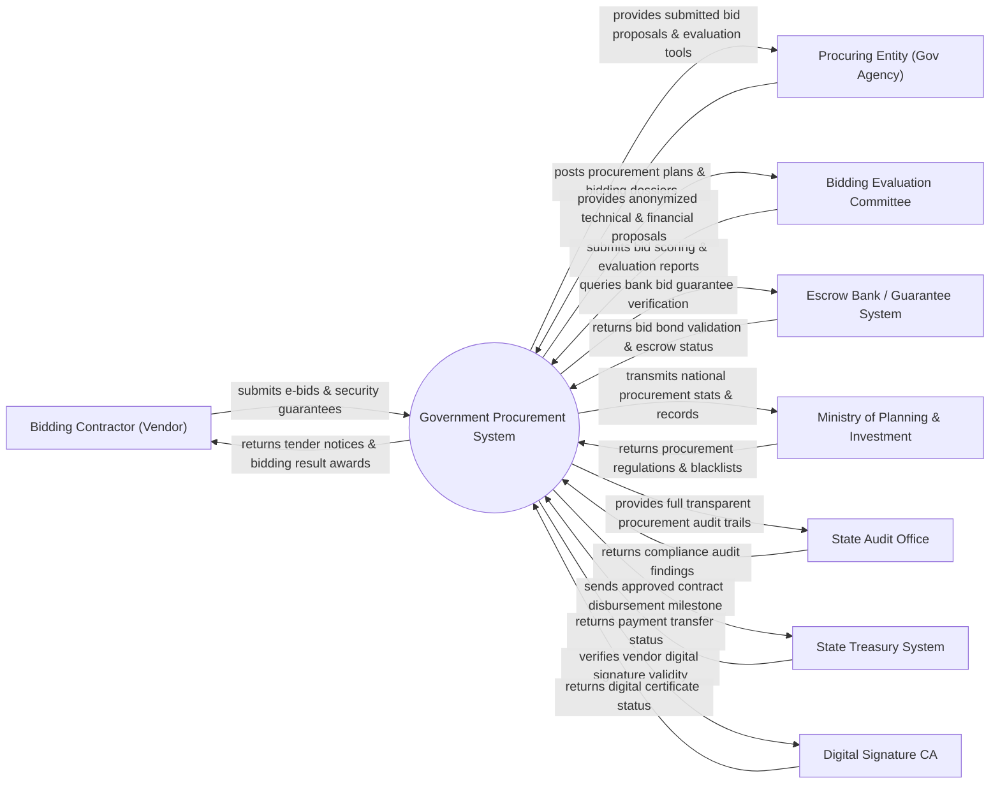

# Context Diagram — Government Procurement System

## Mermaid Code

## Actor & Interaction Table | Bảng Actor & Tương tác

| # | Actor | Actor Type | Data Sent TO System | Data Received FROM System | Notes |
|---|-------|------------|---------------------|---------------------------|-------|
| 1 | Bidding Contractor (Vendor) | Primary | Bidding proposals, technical specs, financial quotes, bid bonds | Tender notices, bidding document packages, award results | Nhà thầu tham gia đấu thầu các dự án mua sắm công |
| 2 | Procuring Entity (Gov Agency) | Primary | Procurement plans, invitation to bid, bidding requirements | Submitted bid packages, contractor capacity profiles, reports | Chủ đầu tư / Bên mời thầu thuộc cơ quan nhà nước |
| 3 | Bidding Evaluation Committee | Primary | Technical scores, financial evaluations, ranking reports | Decrypted bid proposals, comparison matrix, criteria | Hội đồng chấm thầu thẩm định hồ sơ dự thầu |
| 4 | Escrow Bank / Guarantee System | Supporting | Digital bid bond certificates, guarantee status updates | Bid security verification queries, forfeiture orders | Ngân hàng phát hành bảo lãnh dự thầu điện tử |
| 5 | Ministry of Planning & Investment | Regulatory | Procurement laws, contractor blacklists, standard form templates | National procurement statistics, system audit summaries | Cơ quan quản lý nhà nước về hoạt động đấu thầu |
| 6 | State Audit Office | Regulatory | Audit schedules, compliance inspection demands | Full procurement audit logs, bidding history data | Cơ quan Kiểm toán Nhà nước kiểm tra tính minh bạch |
| 7 | State Treasury System | Supporting | Disbursement updates, contract payment vouchers | Approved contract milestones, payment disbursement orders | Kho bạc Nhà nước thực hiện thanh toán hợp đồng |
| 8 | Digital Signature CA | Supporting | Certificate validity status, public key verification | Digital signature validation requests | Tổ chức chứng thực chữ ký số chuyên dùng đấu thầu |

## System Boundary Description | Mô tả Phạm vi Hệ thống

Hệ thống Government Procurement System (Hệ thống Mua sắm Công / Mạng Đấu thầu Quốc gia) chịu trách nhiệm quản lý toàn bộ vòng đời của quy trình mua sắm công từ công bố kế hoạch lựa chọn nhà thầu, phát hành hồ sơ mời thầu, tiếp nhận hồ sơ dự thầu mã hóa, mở thầu công khai, chấm thầu điện tử đến công bố kết quả và ký kết hợp đồng. Hệ thống đảm bảo tính minh bạch, chống gian lận và tuân thủ Luật Đấu thầu. Tuy nhiên, hệ thống KHÔNG trực tiếp tổ chức thi công công trình vật lý và KHÔNG trực tiếp cấp vốn ngân sách (chuyển qua Kho bạc Nhà nước thanh toán).
