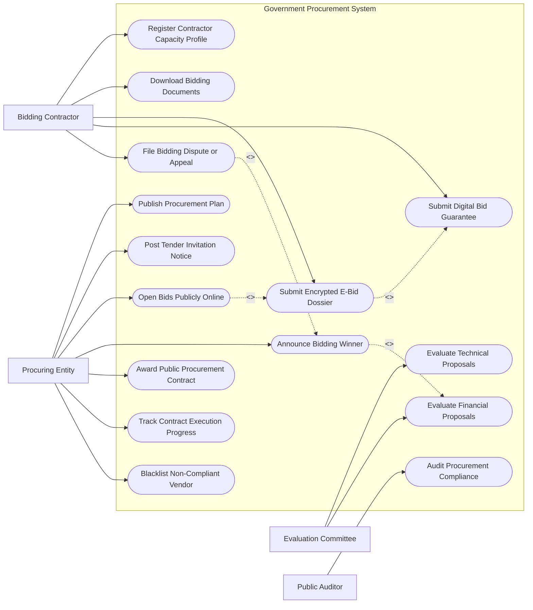

# Use Case Diagram — Government Procurement System

## Mermaid Code

## Actor Table | Bảng Actor

| # | Actor | Actor Type | Role Description | Related Use Cases |
|---|-------|------------|------------------|-------------------|
| 1 | Bidding Contractor | Primary | Nhà thầu đăng ký năng lực, nộp hồ sơ dự thầu và thư bảo lãnh | UC01, UC04, UC05, UC06, UC11 |
| 2 | Procuring Entity | Primary | Bên mời thầu đăng kế hoạch, mời thầu, mở thầu và ký hợp đồng | UC02, UC03, UC07, UC10, UC12, UC13, UC14 |
| 3 | Evaluation Committee | Primary | Tổ chuyên gia chấm thầu đánh giá kỹ thuật và tài chính | UC08, UC09 |
| 4 | Public Auditor | Secondary | Cơ quan kiểm toán/thanh tra truy xuất nhật ký giám sát minh bạch | UC15 |

## Use Case Table | Bảng Use Case

| # | UC ID | Use Case Name | Primary Actor | Secondary Actor | Description | Priority |
|---|-------|---------------|---------------|-----------------|-------------|----------|
| 1 | UC01 | Register Contractor Capacity Profile | Contractor | - | Đăng ký thông tin năng lực tài chính, nhân sự, kinh nghiệm | High |
| 2 | UC02 | Publish Procurement Plan | ProcuringEntity | - | Đăng tải công khai kế hoạch lựa chọn nhà thầu được duyệt | High |
| 3 | UC03 | Post Tender Invitation Notice | ProcuringEntity | - | Phát hành thông báo mời thầu (TBMT) kèm hồ sơ mời thầu (HSMT) | High |
| 4 | UC04 | Download Bidding Documents | Contractor | - | Tải về miễn phí bộ hồ sơ mời thầu điện tử | Medium |
| 5 | UC05 | Submit Encrypted E-Bid Dossier | Contractor | CA System | Mã hóa và nộp hồ sơ dự thầu điện tử (E-HSDT) trước giờ đóng thầu | High |
| 6 | UC06 | Submit Digital Bid Guarantee | Contractor | Escrow Bank | Đính kèm thư bảo lãnh dự thầu điện tử do ngân hàng phát hành | High |
| 7 | UC07 | Open Bids Publicly Online | ProcuringEntity | Contractor | Tự động giải mã và công khai biên bản mở thầu trực tuyến | High |
| 8 | UC08 | Evaluate Technical Proposals | Evaluator | - | Chấm điểm đáp ứng yêu cầu kỹ thuật của hồ sơ dự thầu | High |
| 9 | UC09 | Evaluate Financial Proposals | Evaluator | - | Chấm và xếp hạng giá dự thầu, chi phí vòng đời dịch vụ | High |
| 10 | UC10 | Announce Bidding Winner | ProcuringEntity | Contractor | Đăng tải phê duyệt và thông báo kết quả lựa chọn nhà thầu | High |
| 11 | UC11 | File Bidding Dispute or Appeal | Contractor | MinistryPlanning | Gửi kiến nghị về kết quả lựa chọn nhà thầu khi phát sinh khiếu nại | Medium |
| 12 | UC12 | Award Public Procurement Contract | ProcuringEntity | Contractor | Hoàn thiện, ký kết hợp đồng điện tử mua sắm công | High |
| 13 | UC13 | Track Contract Execution Progress | ProcuringEntity | StateTreasury | Theo dõi tiến độ thực hiện và nghiệm thu giải ngân hợp đồng | Medium |
| 14 | UC14 | Blacklist Non-Compliant Vendor | ProcuringEntity | MinistryPlanning | Đưa nhà thầu vi phạm vào danh sách đen cấm tham gia đấu thầu | High |
| 15 | UC15 | Audit Procurement Compliance | PublicAuditor | - | Trích xuất nhật ký audit hệ thống để kiểm tra gian lận đấu thầu | Medium |

## Use Case Specification | Đặc tả Use Case

---

### UC05 — Submit Encrypted E-Bid Dossier

| Field | Detail |
|-------|--------|
| **UC ID** | UC05 |
| **Use Case Name** | Submit Encrypted E-Bid Dossier |
| **Actor(s)** | Primary: Bidding Contractor / Secondary: Digital Signature CA |
| **Description** | Nhà thầu thực hiện đóng gói, mã hóa dữ liệu hồ sơ dự thầu bằng khóa công khai của gói thầu và nộp lên Mạng Đấu thầu Quốc gia. |
| **Precondition** | 1. Gói thầu đang trong thời gian nộp hồ sơ (trước thời điểm đóng thầu).   2. Nhà thầu đã đăng ký tài khoản hợp lệ và có chứng thư số đấu thầu còn hạn. |
| **Main Flow** | 1. Contractor mở giao diện nộp hồ sơ cho gói thầu đã chọn.   2. System hiển thị các thành phần yêu cầu: Đơn dự thầu, Đề xuất kỹ thuật, Đề xuất tài chính, Bảo lãnh dự thầu.   3. Contractor điền biểu mẫu giá dự thầu và tải lên các tệp tài liệu số hóa.   4. Contractor đính kèm Thư bảo lãnh dự thầu điện tử (UC06).   5. Contractor chọn "Ký số và Nộp HSDT".   6. System kích hoạt thuật toán mã hóa công khai (Public Key Cryptography) mã hóa toàn bộ tệp dữ liệu HSDT.   7. System ghi nhận thời gian nộp (Timestamp), cấp Mã nộp thầu (Receipt Code) và gửi xác nhận cho Contractor. |
| **Alternative Flow** | **AF1** — Rút hoặc thay thế HSDT trước giờ đóng thầu: Contractor chọn "Rút HSDT", System cho phép hủy bản cũ và nộp lại bản HSDT mới trước thời điểm đóng thầu. |
| **Exception Flow** | **EX1** — Nộp trễ giờ đóng thầu (dù chỉ 1 giây): System tự động khóa cổng tiếp nhận, thông báo "Đã quá thời điểm đóng thầu" và từ chối nộp.   **EX2** — Lỗi mã hóa dữ liệu tệp: System cảnh báo tệp bị hỏng, yêu cầu Contractor chọn tệp thay thế. |
| **Postcondition** | Hồ sơ dự thầu được lưu trữ ở trạng thái mã hóa tuyệt đối, không ai (kể cả quản trị viên hệ thống) có thể mở xem nội dung trước giờ mở thầu. |
| **Business Rule** | **BR1**: Dữ liệu HSDT phải được mã hóa kép sử dụng chứng thư số của gói thầu để đảm bảo tính bảo mật và chống can thiệp. |

---

### UC07 — Open Bids Publicly Online

| Field | Detail |
|-------|--------|
| **UC ID** | UC07 |
| **Use Case Name** | Open Bids Publicly Online |
| **Actor(s)** | Primary: Procuring Entity / Secondary: Bidding Contractor |
| **Description** | Hệ thống tự động giải mã các hồ sơ dự thầu và công khai Biên bản mở thầu trên cổng thông tin ngay sau thời điểm đóng thầu. |
| **Precondition** | 1. Thời điểm đóng thầu đã qua.   2. Có ít nhất 01 hồ sơ dự thầu được nộp thành công. |
| **Main Flow** | 1. ProcuringEntity chọn "Tiến hành Mở thầu" trên hệ thống.   2. System sử dụng Khóa giải mã bí mật của gói thầu để tự động giải mã toàn bộ các E-HSDT đã nộp.   3. System trích xuất các thông tin cốt lõi: Tên nhà thầu, Giá dự thầu, Hiệu lực HSDT, Giá trị bảo lãnh dự thầu, Thời gian gian thực hiện.   4. System tổng hợp và sinh Biên bản mở thầu (Bid Opening Record).   5. ProcuringEntity và đại diện nhà thầu thực hiện ký số xác nhận vào Biên bản mở thầu.   6. System tự động xuất bản Biên bản mở thầu công khai lên Cổng Mạng đấu thầu quốc gia. |
| **Alternative Flow** | **AF1** — Số lượng nhà thầu nộp ít hơn 3 (đối với gói thầu quy định tối thiểu 3 nhà thầu): System đưa ra cảnh báo tình huống, ProcuringEntity quyết định gia hạn thời điểm đóng thầu hoặc cho phép mở thầu ngay theo quy định. |
| **Exception Flow** | **EX1** — Lỗi giải mã hồ sơ do tệp bị lỗi khóa từ phía nhà thầu: System đánh dấu hồ sơ đó là "Không thể giải mã - Không hợp lệ" và ghi rõ vào Biên bản mở thầu. |
| **Postcondition** | Biên bản mở thầu được công khai minh bạch toàn quốc, dữ liệu HSDT được chuyển sang phân hệ chấm thầu (UC08). |
| **Business Rule** | **BR1**: Biên bản mở thầu phải được tự động công khai trong vòng tối đa 2 giờ kể từ thời điểm đóng thầu. |

---

### UC08 — Evaluate Technical Proposals

| Field | Detail |
|-------|--------|
| **UC ID** | UC08 |
| **Use Case Name** | Evaluate Technical Proposals |
| **Actor(s)** | Primary: Evaluation Committee / Secondary: None |
| **Description** | Tổ chuyên gia chấm thầu thực hiện đánh giá mức độ đáp ứng về mặt kỹ thuật, năng lực nhân sự, thiết bị và giải pháp thi công của từng nhà thầu. |
| **Precondition** | 1. Hồ sơ dự thầu đã được giải mã thành công trong lễ mở thầu (UC07).   2. Thành viên Tổ chuyên gia được phân quyền truy cập danh mục chấm thầu. |
| **Main Flow** | 1. Evaluator đăng nhập hệ thống và mở Bảng chấm thầu kỹ thuật của gói thầu.   2. System hiển thị tiêu chí đánh giá kỹ thuật (Đạt/Không đạt hoặc Thang điểm 100/1000) được cấu hình từ HSMT.   3. Evaluator truy cập tài liệu đề xuất kỹ thuật của từng nhà thầu.   4. Evaluator nhập điểm/kết quả đánh giá cho từng tiêu chí thành phần và ghi chú nhận xét.   5. System tự động tính tổng điểm kỹ thuật và xác định danh sách các nhà thầu "Đạt yêu cầu kỹ thuật".   6. Tổ trưởng Tổ chuyên gia tổng hợp bảng chấm, ký số phê duyệt Báo cáo đánh giá hồ sơ đề xuất kỹ thuật. |
| **Alternative Flow** | **AF1** — Yêu cầu làm rõ HSDT: Evaluator phát hiện thông tin kỹ thuật chưa rõ ràng, chọn "Gửi yêu cầu làm rõ". System gửi thông báo cho nhà thầu phản hồi trực tuyến trong thời hạn quy định. |
| **Exception Flow** | **EX1** — Điểm chấm giữa các chuyên gia lệch quá 20%: System tự động bật cảnh báo độ chênh lệch, yêu cầu Tổ trưởng tổ chức họp đối thoại chấm lại trước khi chốt kết quả. |
| **Postcondition** | Danh sách các nhà thầu vượt qua bước đánh giá kỹ thuật được phê duyệt để tiếp tục mở đề xuất tài chính. |
| **Business Rule** | **BR1**: Các nhà thầu không đạt ngưỡng điểm kỹ thuật tối thiểu (ví dụ < 70%) sẽ bị tự động loại khỏi bước đánh giá tài chính. |

---

### UC10 — Announce Bidding Winner

| Field | Detail |
|-------|--------|
| **UC ID** | UC10 |
| **Use Case Name** | Announce Bidding Winner |
| **Actor(s)** | Primary: Procuring Entity / Secondary: Bidding Contractor |
| **Description** | Phê duyệt và đăng tải công khai Quyết định phê duyệt kết quả lựa chọn nhà thầu kèm danh sách nhà thầu trúng thầu và giá trúng thầu. |
| **Precondition** | 1. Đã hoàn thành đánh giá tài chính và thương thảo hợp đồng với nhà thầu xếp hạng thứ nhất.   2. Quyết định phê duyệt kết quả trúng thầu đã được người có thẩm quyền ký. |
| **Main Flow** | 1. ProcuringEntity tải lên Quyết định phê duyệt kết quả lựa chọn nhà thầu (có ký số).   2. ProcuringEntity nhập thông tin nhà thầu trúng thầu, giá trúng thầu, loại hợp đồng và thời gian thực hiện.   3. System phát hành Thông báo kết quả lựa chọn nhà thầu (Notification of Award).   4. System tự động gửi thông báo trực tiếp qua email/hệ thống tới tất cả các nhà thầu đã tham dự gói thầu.   5. System công khai kết quả trúng thầu trên Cổng Mạng đấu thầu quốc gia.   6. System chuyển hồ sơ sang trạng thái "Sẵn sàng ký kết hợp đồng". |
| **Alternative Flow** | **AF1** — Hủy thầu: Nếu không có nhà thầu nào đạt hoặc vượt giá gói thầu được duyệt, ProcuringEntity tải lên Quyết định hủy thầu, System cập nhật trạng thái gói thầu "Hủy thầu". |
| **Exception Flow** | **EX1** — Phát sinh kiến nghị/khiếu nại từ nhà thầu không trúng thầu (UC11): System tạm dừng quy trình trao hợp đồng, gửi cảnh báo cho bên mời thầu để giải trình kiến nghị. |
| **Postcondition** | Kết quả trúng thầu được công khai minh bạch, thư mời ký kết hợp đồng được gửi tới nhà thầu trúng thầu. |
| **Business Rule** | **BR1**: Thông báo kết quả lựa chọn nhà thầu phải ghi rõ lý do không trúng thầu của từng nhà thầu bị loại để đảm bảo tính công khai. |

---

### UC12 — Award Public Procurement Contract

| Field | Detail |
|-------|--------|
| **UC ID** | UC12 |
| **Use Case Name** | Award Public Procurement Contract |
| **Actor(s)** | Primary: Procuring Entity, Bidding Contractor / Secondary: State Treasury |
| **Description** | Khởi tạo, ký kết hợp đồng điện tử giữa Bên mời thầu và Nhà thầu trúng thầu, đăng ký hợp đồng lên Kho bạc Nhà nước. |
| **Precondition** | 1. Thông báo kết quả lựa chọn nhà thầu đã công bố và hết thời hạn kiến nghị.   2. Nhà thầu trúng thầu đã nộp Bảo lãnh thực hiện hợp đồng. |
| **Main Flow** | 1. ProcuringEntity khởi tạo dự thảo Hợp đồng điện tử trên hệ thống dựa trên mẫu hợp đồng HSMT.   2. ProcuringEntity và Contractor rà soát điều khoản, tiến độ nghiệm thu và giá trị hợp đồng.   3. Contractor thực hiện ký số điện tử vào Hợp đồng mua sắm công.   4. ProcuringEntity thực hiện ký số xác nhận đại diện Chủ đầu tư.   5. System cấp Mã hợp đồng mua sắm công duy nhất và lưu trữ bản hợp đồng gốc số hóa.   6. System tự động đẩy thông tin hợp đồng sang State Treasury để làm căn cứ cam kết chi ngân sách. |
| **Alternative Flow** | **AF1** — Thay đổi nhà thầu do nhà thầu trúng thầu từ chối ký hợp đồng: ProcuringEntity tịch thu bảo lãnh dự thầu, mời nhà thầu xếp hạng thứ 2 vào thương thảo và ký hợp đồng. |
| **Exception Flow** | **EX1** — Nhà thầu không nộp bảo lãnh thực hiện hợp đồng đúng hạn: System hủy tư cách trúng thầu và thông báo vi phạm. |
| **Postcondition** | Hợp đồng mua sắm công điện tử có hiệu lực pháp lý chính thức, sẵn sàng cho khâu triển khai và giải ngân. |
| **Business Rule** | **BR1**: Giá trị hợp đồng ký kết không được vượt quá giá trúng thầu đã được phê duyệt. |
