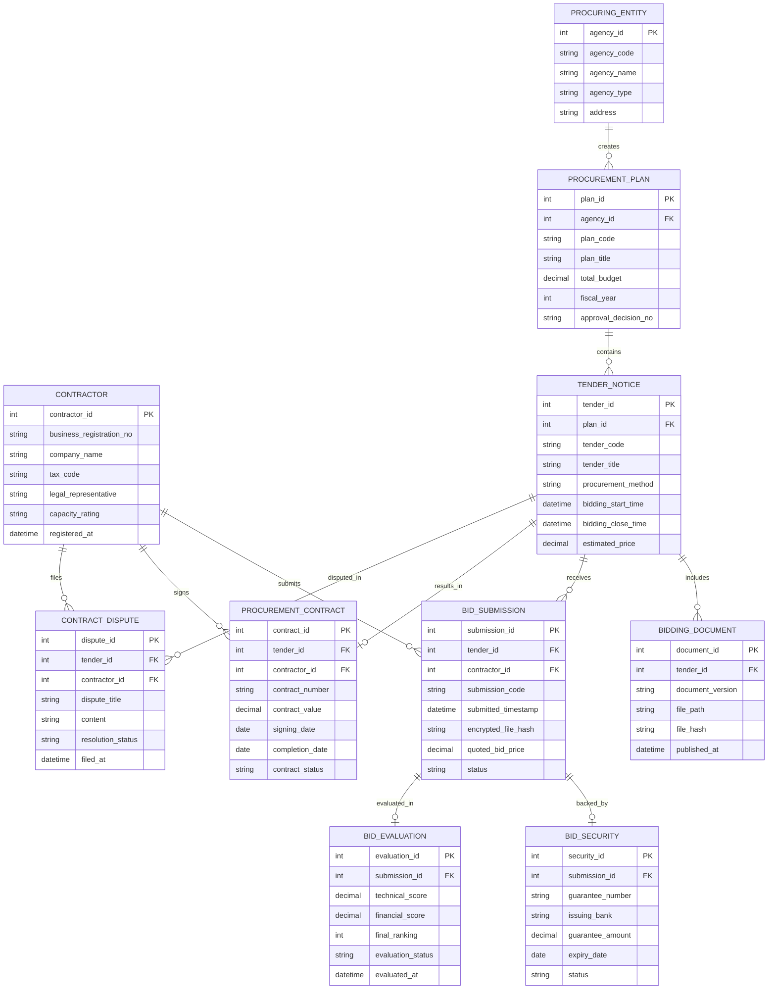

# Conceptual ERD — Government Procurement System

## Mermaid Code

## Entity Description Table | Bảng mô tả Entity

| # | Entity Name | Vietnamese Name | Description | Key Attributes | Main Relationships |
|---|-------------|-----------------|-------------|----------------|-------------------|
| 1 | CONTRACTOR | Nhà thầu Dự thầu | Thông tin năng lực pháp lý, tài chính của doanh nghiệp tham gia đấu thầu | contractor_id, business_registration_no, company_name, tax_code | Submits BID_SUBMISSION, signs PROCUREMENT_CONTRACT |
| 2 | PROCURING_ENTITY | Bên Mời Thầu / Chủ Đầu Tư | Cơ quan nhà nước, đơn vị sự nghiệp phát hành gói thầu | agency_id, agency_code, agency_name, agency_type | Creates PROCUREMENT_PLAN |
| 3 | PROCUREMENT_PLAN | Kế hoạch Lựa chọn Nhà thầu | Kế hoạch tổng thể danh mục dự án và dự toán ngân sách mua sắm | plan_id, plan_code, plan_title, total_budget | Belongs to PROCURING_ENTITY, contains TENDER_NOTICE |
| 4 | TENDER_NOTICE | Thông báo Mời thầu | Gói thầu công khai được mời thầu kèm giá gói thầu và phương thức chọn thầu | tender_id, tender_code, tender_title, bidding_close_time | Belongs to PROCUREMENT_PLAN, receives BID_SUBMISSION |
| 5 | BIDDING_DOCUMENT | Hồ sơ Mời thầu (HSMT) | Bộ tài liệu quy định tiêu chuẩn đánh giá kỹ thuật và tài chính | document_id, document_version, file_path, file_hash | Belongs to TENDER_NOTICE |
| 6 | BID_SUBMISSION | Hồ sơ Dự thầu (E-HSDT) | Bộ hồ sơ đề xuất kỹ thuật và tài chính đã mã hóa do nhà thầu nộp | submission_id, submission_code, quoted_bid_price, status | Belongs to TENDER_NOTICE, CONTRACTOR |
| 7 | BID_SECURITY | Thư Bảo lãnh Dự thầu | Chứng thư bảo lãnh tài chính do ngân hàng phát hành bảo đảm nộp thầu | security_id, guarantee_number, issuing_bank, guarantee_amount | Belongs to BID_SUBMISSION |
| 8 | BID_EVALUATION | Kết quả Đánh giá Hồ sơ Dự thầu | Biên bản chấm điểm kỹ thuật, tài chính và xếp hạng nhà thầu | evaluation_id, technical_score, financial_score, final_ranking | Belongs to BID_SUBMISSION |
| 9 | PROCUREMENT_CONTRACT | Hợp đồng Mua sắm Công | Hợp đồng điện tử ký kết giữa Chủ đầu tư và Nhà thầu trúng thầu | contract_id, contract_number, contract_value, contract_status | Belongs to TENDER_NOTICE, CONTRACTOR |
| 10 | CONTRACT_DISPUTE | Kiến nghị / Khiếu nại Đấu thầu | Đơn kiến nghị về kết quả đấu thầu hoặc vi phạm quy trình | dispute_id, dispute_title, content, resolution_status | Belongs to CONTRACTOR, TENDER_NOTICE |

## Relationship Description | Mô tả Quan hệ

| # | From Entity | Cardinality | To Entity | Relationship Label | Business Explanation |
|---|-------------|-------------|-----------|-------------------|----------------------|
| 1 | PROCURING_ENTITY | one-to-many | PROCUREMENT_PLAN | creates | Một chủ đầu tư tạo nhiều kế hoạch lựa chọn nhà thầu theo năm tài chính |
| 2 | PROCUREMENT_PLAN | one-to-many | TENDER_NOTICE | contains | Một kế hoạch lựa chọn nhà thầu chia thành nhiều gói thầu mời thầu |
| 3 | TENDER_NOTICE | one-to-many | BIDDING_DOCUMENT | includes | Một gói thầu phát hành các phiên bản hồ sơ mời thầu bổ sung |
| 4 | TENDER_NOTICE | one-to-many | BID_SUBMISSION | receives | Một gói thầu tiếp nhận hồ sơ dự thầu từ nhiều nhà thầu tham gia |
| 5 | CONTRACTOR | one-to-many | BID_SUBMISSION | submits | Một nhà thầu nộp nhiều hồ sơ dự thầu cho các gói thầu khác nhau |
| 6 | BID_SUBMISSION | one-to-one | BID_SECURITY | backed_by | Mỗi hồ sơ dự thầu bắt buộc đi kèm một bảo lãnh dự thầu tương ứng |
| 7 | BID_SUBMISSION | one-to-one | BID_EVALUATION | evaluated_in | Mỗi hồ sơ dự thầu sinh ra một kết quả đánh giá chấm thầu |
| 8 | TENDER_NOTICE | one-to-one | PROCUREMENT_CONTRACT | results_in | Một gói thầu sau khi chọn thầu thành công ký kết một hợp đồng chính |
| 9 | CONTRACTOR | one-to-many | PROCUREMENT_CONTRACT | signs | Một nhà thầu trúng thầu có thể ký nhiều hợp đồng mua sắm công |
| 10 | CONTRACTOR | one-to-many | CONTRACT_DISPUTE | files | Một nhà thầu có thể gửi đơn kiến nghị xử lý khiếu nại |
| 11 | TENDER_NOTICE | one-to-many | CONTRACT_DISPUTE | disputed_in | Một gói thầu có thể phát sinh các đơn kiến nghị khiếu nại |
