# Swimlane Diagram — Government Procurement System

## Mermaid Code

```mermaid
flowchart LR
    Start(["Start"])

    subgraph Lane1["Bidding Contractor (Vendor)"]
        A1["Download Bidding Documents (HSMT)"]
        A2["Prepare Technical & Price Proposals"]
        A3["Obtain Digital Bank Guarantee"]
        A4["Sign & Submit Encrypted E-HSDT"]
        A5["Sign Public Procurement Contract"]
    end

    subgraph Lane2["Government Procurement System"]
        S1["Publish Tender Notice & HSMT"]
        S2["Validate Digital Signature & Bond"]
        S3["Store Encrypted E-HSDT in Vault"]
        S4["Publicly Decrypt Bids at Deadline"]
        S5["Generate Public Bid Opening Record"]
        S6["Publish Award Result Notice"]
    end

    subgraph Lane3["Procuring Entity (Agency)"]
        O1["Post Procurement Plan & Notice"]
        O2["Initiate Public Bid Opening Ceremony"]
        O3["Approve Award Decision Result"]
        O4["Finalize & Execute Electronic Contract"]
    end

    subgraph Lane4["Evaluation Committee"]
        E1["Access Decrypted Bid Proposals"]
        E2["Grade Technical Compliance Score"]
        E3{"Technical Score Passed?"}
        E4["Grade Financial Proposal & Rank"]
        E5["Submit Evaluation Summary Report"]
    end

    Finish(["End"])

    Start --> O1 --> S1 --> A1 --> A2 --> A3 --> A4 --> S2 --> S3
    S3 --> O2 --> S4 --> S5 --> E1 --> E2 --> E3
    E3 -->|"No"| E5
    E3 -->|"Yes"| E4 --> E5 --> O3 --> S6 --> O4 --> A5 --> Finish
```

## Flow Description | Mô tả luồng

| Lane | Actor | Role in Flow |
|------|-------|-------------|
| 1 | Bidding Contractor (Vendor) | Tải hồ sơ mời thầu, chuẩn bị đề xuất kỹ thuật/tài chính, lấy thư bảo lãnh ngân hàng, nộp hồ sơ dự thầu mã hóa và ký hợp đồng. |
| 2 | Government Procurement System | Công khai thông báo mời thầu, tiếp nhận và lưu trữ mã hóa hồ sơ dự thầu, tự động mở thầu công khai và xuất bản kết quả trúng thầu. |
| 3 | Procuring Entity (Agency) | Đăng tải kế hoạch và thông báo mời thầu, thực hiện mở thầu, phê duyệt quyết định trúng thầu và hoàn thiện hợp đồng điện tử. |
| 4 | Evaluation Committee | Tiếp nhận hồ sơ giải mã, đánh giá chấm điểm kỹ thuật, kiểm tra điều kiện tài chính và lập báo cáo tổng hợp xếp hạng nhà thầu. |
