# Action Tree — Government Procurement System

## Mermaid Code

```mermaid
graph TD
    Root["Government Procurement System"]

    Root --> M1["Vendor & Agency Registration"]
    Root --> M2["Procurement Planning & Notices"]
    Root --> M3["E-Bidding Submission & Security"]
    Root --> M4["Bid Opening & Evaluation Engine"]
    Root --> M5["Contract Management & Tracking"]
    Root --> M6["Dispute Resolution & Audit"]

    M1 --> A11["Register Contractor Capacity Profile"]
    M1 --> A12["Authenticate Agency Procurement Accounts"]
    M1 --> A13["Manage Digital Certificates CA Keys"]
    M1 --> A14["Maintain National Vendor Blacklist"]

    M2 --> A21["Post Annual Procurement Plan"]
    M2 --> A22["Issue Tender Invitation Notice"]
    M2 --> A23["Publish Bidding Document Package"]
    M2 --> A24["Issue Bidding Document Amendments"]

    M3 --> A31["Encrypt E-Bid Proposal Package"]
    M3 --> A32["Upload Supporting Capacity Documents"]
    M3 --> A33["Attach Digital Bank Guarantee Bond"]
    M3 --> A34["Issue Timestamps Submission Receipt"]

    M4 --> A41["Execute Automated Bid Decryption"]
    M4 --> A42["Generate Public Bid Opening Minutes"]
    M4 --> A43["Evaluate Technical Criteria Score"]
    M4 --> A44["Rank Financial Price Proposals"]

    M5 --> A51["Publish Winner Notification Award"]
    M5 --> A52["Draft Public Procurement Contract"]
    M5 --> A53["Apply Digital Signature to Contract"]
    M5 --> A54["Sync Treasury Disbursement Milestones"]

    M6 --> A61["File Contractor Bidding Dispute"]
    M6 --> A62["Review Dispute Resolution Rulings"]
    M6 --> A63["Log System Immutable Audit Logs"]
    M6 --> A64["Export Procurement Statistics Reports"]
```

## Module Description | Mô tả Module

| # | Module | Description | Actions |
|---|--------|-------------|---------|
| 1 | Vendor & Agency Registration | Quản lý đăng ký năng lực nhà thầu, tài khoản bên mời thầu, chữ ký số và danh sách cấm nộp thầu | Register Contractor Capacity Profile, Authenticate Agency Procurement Accounts, Manage Digital Certificates CA Keys, Maintain National Vendor Blacklist |
| 2 | Procurement Planning & Notices | Công bố kế hoạch lựa chọn nhà thầu, phát hành thông báo mời thầu và hồ sơ mời thầu điện tử | Post Annual Procurement Plan, Issue Tender Invitation Notice, Publish Bidding Document Package, Issue Bidding Document Amendments |
| 3 | E-Bidding Submission & Security | Nộp hồ sơ dự thầu mã hóa hai lớp, đính kèm chứng thư bảo lãnh ngân hàng điện tử và sinh mã tiếp nhận | Encrypt E-Bid Proposal Package, Upload Supporting Capacity Documents, Attach Digital Bank Guarantee Bond, Issue Timestamps Submission Receipt |
| 4 | Bid Opening & Evaluation Engine | Động cơ mở thầu tự động giải mã, xuất bản biên bản mở thầu công khai và chấm điểm kỹ thuật/tài chính | Execute Automated Bid Decryption, Generate Public Bid Opening Minutes, Evaluate Technical Criteria Score, Rank Financial Price Proposals |
| 5 | Contract Management & Tracking | Công bố kết quả trúng thầu, giao kết hợp đồng điện tử và kết nối thanh toán qua Kho bạc | Publish Winner Notification Award, Draft Public Procurement Contract, Apply Digital Signature to Contract, Sync Treasury Disbursement Milestones |
| 6 | Dispute Resolution & Audit | Tiếp nhận giải quyết kiến nghị đấu thầu, kiểm toán hệ thống đảm bảo minh bạch không gian lận | File Contractor Bidding Dispute, Review Dispute Resolution Rulings, Log System Immutable Audit Logs, Export Procurement Statistics Reports |
