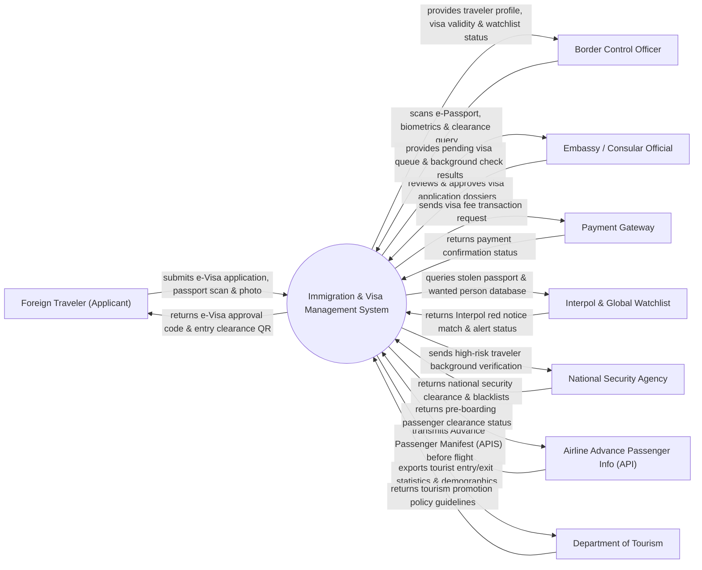

# Context Diagram — Immigration & Visa Management System

## Mermaid Code

## Actor & Interaction Table | Bảng Actor & Tương tác

| # | Actor | Actor Type | Data Sent TO System | Data Received FROM System | Notes |
|---|-------|------------|---------------------|---------------------------|-------|
| 1 | Foreign Traveler (Applicant) | Primary | Passport details, travel itinerary, biometric photo, visa fee | E-Visa electronic approval letter, entry QR code, visa status | Khách du lịch/thương gia nước ngoài xin thị thực nhập cảnh |
| 2 | Border Control Officer | Primary | Passport scan data, live fingerprint/facial photo, entry port ID | Visa verification, watchlist hit alerts, entry/exit stamp permission | Cán bộ quản lý xuất nhập cảnh tại cửa khẩu (sân bay/đường bộ) |
| 3 | Embassy / Consular Official | Primary | Visa approval decisions, interview notes, visa sticker issuance | Visa application dossiers, background screening reports | Cán bộ lãnh sự tại đại sứ quán/lãnh sự quán ở nước ngoài |
| 4 | Payment Gateway | Supporting | Payment transaction reference, fee payment status | Visa processing fee amount, applicant reference code | Cổng thanh toán quốc tế (Visa/Mastercard) xử lý phí e-Visa |
| 5 | Interpol & Global Watchlist | Supporting | Stolen passport database updates, wanted persons (Red Notices) | Passport number queries, biometric search parameters | Cơ sở dữ liệu Cảnh sát Quốc tế Interpol tra cứu hộ chiếu mất |
| 6 | National Security Agency | Supporting | Security threat intelligence, blacklisted foreigner entries | High-risk traveler flags, visa applicant identity queries | Cơ quan an ninh quốc gia kiểm soát nguy cơ khủng bố/tội phạm |
| 7 | Airline Advance Passenger Info (API) | Supporting | Passenger manifests, flight numbers, passport details before takeoff | Boarding clearance authorization, no-fly list alerts | Các hãng hàng không truyền danh sách hành khách trước chuyến bay |
| 8 | Department of Tourism | Supporting | Tourism survey requirements, event tracking parameters | Foreign arrival/departure analytics, country breakdown stats | Cục Du lịch theo dõi thống kê lượng khách quốc tế nhập cảnh |

## System Boundary Description | Mô tả Phạm vi Hệ thống

Hệ thống Immigration & Visa Management System (Hệ thống Quản lý Xuất Nhập cảnh và Visa Quốc gia) chịu trách nhiệm quản lý toàn bộ quy trình cấp thị thực điện tử (e-Visa), thị thực tại đại sứ quán, thủ tục kiểm soát cửa khẩu (Entry/Exit Control) tại các sân bay quốc tế, cảng biển và cửa khẩu đường bộ, tích hợp cổng kiểm soát tự động (e-Gate) sử dụng sinh trắc học và quản lý việc gia hạn tạm trú cho người nước ngoài. Tuy nhiên, hệ thống KHÔNG trực tiếp cấp phát hộ chiếu cho công dân nước ngoài (do quốc gia của họ cấp) và KHÔNG thay thế quy trình kiểm tra an ninh hàng không vật lý tại cửa soi chiếu.
