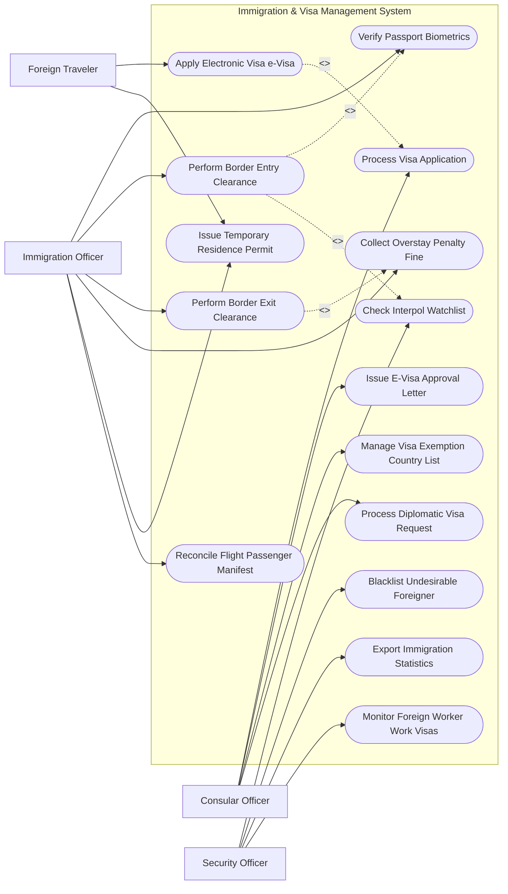

# Use Case Diagram — Immigration & Visa Management System

## Mermaid Code

## Actor Table | Bảng Actor

| # | Actor | Actor Type | Role Description | Related Use Cases |
|---|-------|------------|------------------|-------------------|
| 1 | Foreign Traveler | Primary | Khách nước ngoài nộp hồ sơ xin e-Visa và thực hiện thủ tục xuất nhập cảnh | UC01, UC09 |
| 2 | Immigration Officer | Primary | Cán bộ quản lý xuất nhập cảnh tại cửa khẩu kiểm tra hộ chiếu và cho phép qua cửa | UC04, UC05, UC06, UC08, UC09, UC12 |
| 3 | Consular Officer | Primary | Cán bộ đại sứ quán xét duyệt hồ sơ thị thực và quản lý danh mục miễn thị thực | UC02, UC03, UC10, UC15 |
| 4 | Security Officer | Primary | Cán bộ an ninh theo dõi danh sách đen, đối soát Interpol và cấp phép công tác | UC07, UC11, UC13, UC14 |

## Use Case Table | Bảng Use Case

| # | UC ID | Use Case Name | Primary Actor | Secondary Actor | Description | Priority |
|---|-------|---------------|---------------|-----------------|-------------|----------|
| 1 | UC01 | Apply Electronic Visa e-Visa | Traveler | PayGW | Nộp đơn xin cấp thị thực điện tử và thanh toán phí trực tuyến | High |
| 2 | UC02 | Process Visa Application | Consular | Security | Thẩm định tư cách pháp lý, mục đích chuyến đi và giấy tờ của công dân | High |
| 3 | UC03 | Issue E-Visa Approval Letter | Consular | Traveler | Phê duyệt và cấp công văn cho phép nhập cảnh điện tử kèm mã QR | High |
| 4 | UC04 | Verify Passport Biometrics | Officer | Biometric Device | Quét chip ICAO trên hộ chiếu điện tử, nhận diện khuôn mặt và vân tay | High |
| 5 | UC05 | Perform Border Entry Clearance | Officer | Traveler | Thực hiện kiểm tra, đóng dấu hoặc mở cổng tự động (e-Gate) cho phép nhập cảnh | High |
| 6 | UC06 | Perform Border Exit Clearance | Officer | Traveler | Kiểm tra thời hạn thị thực và thực hiện thủ tục cho phép xuất cảnh | High |
| 7 | UC07 | Check Interpol Watchlist | Security | Interpol | Tự động tra cứu hộ chiếu bị mất/đánh cắp và đối soát danh sách truy nã | High |
| 8 | UC08 | Collect Overstay Penalty Fine | Officer | PayGW | Tính toán tiền phạt vi phạm quá hạn tạm trú và thu phạt trước khi xuất cảnh | High |
| 9 | UC09 | Issue Temporary Residence Permit | Traveler, Officer | - | Cấp hoặc gia hạn thẻ tạm trú cho người nước ngoài làm việc/đầu tư | Medium |
| 10 | UC10 | Manage Visa Exemption Country List | Consular | - | Cấu hình danh sách các quốc gia được miễn thị thực đơn phương/song phương | Medium |
| 11 | UC11 | Blacklist Undesirable Foreigner | Security | - | Thêm người nước ngoài vi phạm pháp luật vào danh sách cấm nhập cảnh | High |
| 12 | UC12 | Reconcile Flight Passenger Manifest | Officer | AirlineSystem | Đối soát danh sách hành khách trước chuyến bay (APIS) với dữ liệu xuất nhập cảnh | Medium |
| 13 | UC13 | Export Immigration Statistics | Security | TourismDept | Báo cáo thống kê lượt xuất nhập cảnh theo cửa khẩu, quốc tịch và độ tuổi | Low |
| 14 | UC14 | Monitor Foreign Worker Work Visas | Security | Labor Dept | Quản lý tình hình người lao động nước ngoài làm việc theo visa lao động | Medium |
| 15 | UC15 | Process Diplomatic Visa Request | Consular | Foreign Ministry | Xử lý thủ tục cấp thị thực ngoại giao/công vụ cho đoàn khách quốc tế | High |

## Use Case Specification | Đặc tả Use Case

---

### UC01 — Apply Electronic Visa e-Visa

| Field | Detail |
|-------|--------|
| **UC ID** | UC01 |
| **Use Case Name** | Apply Electronic Visa e-Visa |
| **Actor(s)** | Primary: Foreign Traveler / Secondary: Payment Gateway |
| **Description** | Khách nước ngoài truy cập Cổng thông tin e-Visa quốc gia, điền tờ khai, tải ảnh hộ chiếu và thanh toán phí thị thực. |
| **Precondition** | 1. Khách nước ngoài sở hữu hộ chiếu còn thời hạn tối thiểu 6 tháng.   2. Quốc tịch của khách thuộc danh sách được cấp e-Visa. |
| **Main Flow** | 1. Traveler truy cập Cổng e-Visa chính thức.   2. Traveler tải lên ảnh chụp trang nhân thân hộ chiếu và ảnh chân dung chuẩn ICAO.   3. System dùng công nghệ OCR tự động bóc tách thông tin: Số hộ chiếu, Họ tên, Ngày sinh, Quốc tịch, Ngày hết hạn.   4. Traveler kiểm tra thông tin bóc tách và nhập bổ sung: Ngày dự kiến nhập cảnh, Cửa khẩu nhập cảnh, Địa chỉ tạm trú.   5. Traveler thực hiện thanh toán lệ phí cấp e-Visa qua Cổng thanh toán quốc tế (Visa/Mastercard).   6. PayGW trả về kết quả thanh toán thành công.   7. System sinh Mã hồ sơ tra cứu e-Visa (Registration Code) và gửi email xác nhận cho Traveler. |
| **Alternative Flow** | **AF1** — Xin e-Visa theo đoàn/công ty lữ hành: Đại lý du lịch tải file danh sách hàng loạt (Excel/JSON) kèm bộ ảnh để nộp e-Visa cho đoàn khách. |
| **Exception Flow** | **EX1** — Ảnh hộ chiếu bị mờ/mất góc không thể OCR: System báo lỗi yêu cầu chụp lại bản rõ hơn trước khi cho nộp.   **EX2** — Thanh toán thất bại: System giữ nguyên bản nháp hồ sơ trong 48 giờ để Traveler thử thanh toán lại. |
| **Postcondition** | Hồ sơ e-Visa được chuyển sang phân hệ thẩm định an ninh (UC02). |
| **Business Rule** | **BR1**: Phí cấp e-Visa không được hoàn lại trong mọi trường hợp hồ sơ bị từ chối do lý do an ninh. |

---

### UC02 — Process Visa Application

| Field | Detail |
|-------|--------|
| **UC ID** | UC02 |
| **Use Case Name** | Process Visa Application |
| **Actor(s)** | Primary: Consular Officer / Secondary: Security Officer |
| **Description** | Cán bộ quản lý xuất nhập cảnh xem xét hồ sơ xin e-Visa, chạy tự động kiểm tra danh sách đen và phê duyệt cấp thị thực. |
| **Precondition** | 1. Hồ sơ e-Visa (UC01) đã được thanh toán phí đầy đủ. |
| **Main Flow** | 1. ConsularOfficer mở hàng đợi xử lý hồ sơ e-Visa.   2. System tự động chạy đối soát: Kiểm tra thông tin nhân thân với Danh sách cấm nhập cảnh (UC11) và CSDL Interpol (UC07).   3. Nếu không có cảnh báo an ninh: System đề xuất "Đủ điều kiện cấp e-Visa".   4. ConsularOfficer rà soát lại thông tin và chọn "Phê duyệt cấp e-Visa".   5. System khởi tạo mã thị thực e-Visa điện tử duy nhất và ký số cơ quan xuất nhập cảnh.   6. System tự động gửi email Công văn cho phép nhập cảnh (Approval Letter PDF) kèm Mã QR cho công dân. |
| **Alternative Flow** | **AF1** — Yêu cầu sửa đổi thông tin: ConsularOfficer phát hiện sai lệch số hộ chiếu, chọn "Yêu cầu chỉnh sửa", System gửi email thông báo cho khách sửa lại trong 3 ngày. |
| **Exception Flow** | **EX1** — Trùng khớp với danh sách đen an ninh/Interpol: System tự động khóa hồ sơ, gửi cảnh báo đỏ cho SecurityOfficer và từ chối cấp e-Visa. |
| **Postcondition** | Khách nước ngoài nhận được thị thực điện tử e-Visa chính thức có thể in ra để làm thủ tục bay. |
| **Business Rule** | **BR1**: Thời hạn xử lý tối đa hồ sơ e-Visa không quá 03 ngày làm việc kể từ khi nhận đủ hồ sơ và phí. |

---

### UC05 — Perform Border Entry Clearance

| Field | Detail |
|-------|--------|
| **UC ID** | UC05 |
| **Use Case Name** | Perform Border Entry Clearance |
| **Actor(s)** | Primary: Immigration Officer / Secondary: Foreign Traveler |
| **Description** | Cán bộ xuất nhập cảnh tại bốt kiểm soát cửa khẩu kiểm tra hộ chiếu, e-Visa, đối soát sinh trắc học và quyết định cho phép nhập cảnh. |
| **Precondition** | 1. Hành khách có mặt tại bốt kiểm soát xuất nhập cảnh cửa khẩu.   2. Hành khách sở hữu hộ chiếu và thị thực/e-Visa hợp lệ. |
| **Main Flow** | 1. Traveler xuất trình hộ chiếu và quét mã QR e-Visa tại bốt kiểm soát.   2. System hiển thị thông tin hồ sơ thị thực và ảnh nhân thân của Traveler trên màn hình cán bộ.   3. Officer thực hiện quét hộ chiếu qua máy đọc OCR và chụp ảnh khuôn mặt/lấy vân tay trực tiếp của Traveler.   4. System thực hiện đối soát sinh trắc học khuôn mặt 1:1 với dữ liệu ảnh hộ chiếu (UC04).   5. System tự động kiểm tra lại danh sách đen và trạng thái bay (APIS).   6. Officer xác nhận thông tin khớp, bấm "Cho phép nhập cảnh".   7. System ghi nhận thời gian nhập cảnh, cấp Thời hạn tạm trú (ví dụ: 30 ngày) và in tem/đóng dấu nhập cảnh lên hộ chiếu. |
| **Alternative Flow** | **AF1** — Nhập cảnh qua Cổng kiểm soát tự động e-Gate: Traveler tự quét hộ chiếu, tự quét khuôn mặt/vân tay tại cổng e-Gate. Nếu tất cả dữ liệu khớp, cổng tự động mở cho qua mà không cần cán bộ can thiệp. |
| **Exception Flow** | **EX1** — Hộ chiếu hoặc thị thực giả mạo: System phát hiện dấu hiệu bất thường, Officer bấm nút "Chuyển khu vực phỏng vấn chuyên sâu" và tạm giữ hành khách. |
| **Postcondition** | Lịch sử nhập cảnh được ghi nhận vào CSDL Quốc gia, tạm trú của hành khách bắt đầu được tính. |
| **Business Rule** | **BR1**: Thời gian xử lý thủ tục nhập cảnh cho 1 hành khách tại bốt thủ công không quá 45 giây, tại e-Gate không quá 15 giây. |

---

### UC07 — Check Interpol Watchlist

| Field | Detail |
|-------|--------|
| **UC ID** | UC07 |
| **Use Case Name** | Check Interpol Watchlist |
| **Actor(s)** | Primary: Security Officer / Secondary: Interpol System |
| **Description** | Tự động truy vấn CSDL Interpol để phát hiện hộ chiếu bị mất/đánh cắp (Stolen and Lost Travel Documents - SLTD) và đối tượng bị truy nã đỏ. |
| **Precondition** | 1. Thông tin hộ chiếu được quét tại bước xin e-Visa (UC01) hoặc tại bốt nhập cảnh (UC05). |
| **Main Flow** | 1. System trích xuất Số hộ chiếu, Mã quốc gia ban hành và Mã máy đọc (MRZ Line).   2. System gửi yêu cầu API mã hóa tới CSDL Interpol SLTD toàn cầu.   3. Interpol System thực hiện tra cứu real-time.   4. Interpol System trả về kết quả "Clean" (Không có cảnh báo) hoặc "Match Hit" (Phát hiện trùng khớp).   5. Nếu Clean: System cho phép quy trình xuất nhập cảnh tiếp tục bình thường.   6. System ghi log truy vấn bảo mật. |
| **Alternative Flow** | **AF1** — Tra cứu danh sách đối tượng nghi vấn quốc gia (National Watchlist): Đồng thời tra cứu CSDL an ninh nội địa đối với các đối tượng cấm xuất nhập cảnh. |
| **Exception Flow** | **EX1** — Phát hiện "Match Hit" (Hộ chiếu báo mất hoặc đối tượng bị truy nã Interpol): System lập tức khóa cổng e-Gate/bốt kiểm soát, phát chuông báo động ngầm tại phòng an ninh và hiển thị Thông báo truy nã cho cán bộ xử lý. |
| **Postcondition** | Đảm bảo không có đối tượng tội phạm quốc tế hoặc hộ chiếu bị đánh cắp xâm nhập qua biên giới. |
| **Business Rule** | **BR1**: Mọi thông báo trùng khớp Interpol Hit phải được thông báo ngay cho Văn phòng Interpol Quốc gia theo quy trình ngoại giao. |

---

### UC08 — Collect Overstay Penalty Fine

| Field | Detail |
|-------|--------|
| **UC ID** | UC08 |
| **Use Case Name** | Collect Overstay Penalty Fine |
| **Actor(s)** | Primary: Immigration Officer / Secondary: Payment Gateway |
| **Description** | Phát hiện hành khách quá hạn tạm trú khi làm thủ tục xuất cảnh, tự động tính số tiền phạt và thu tiền phạt trước khi cho phép xuất cảnh. |
| **Precondition** | 1. Hành khách làm thủ tục xuất cảnh tại cửa khẩu (UC06).   2. Ngày xuất cảnh thực tế muộn hơn Ngày hết hạn tạm trú được cấp lúc nhập cảnh. |
| **Main Flow** | 1. Officer quét hộ chiếu hành khách làm thủ tục xuất cảnh.   2. System so sánh Ngày xuất cảnh với Ngày hết hạn tạm trú trong CSDL.   3. System phát hiện vi phạm quá hạn (Ví dụ: Quá hạn 5 ngày).   4. System tự động tính số tiền phạt hành chính dựa trên số ngày quá hạn theo biểu phạt quy định (Ví dụ: 500,000 VNĐ/ngày x 5 ngày = 2,500,000 VNĐ).   5. Officer lập Quyết định xử phạt vi phạm hành chính xuất nhập cảnh trên hệ thống.   6. Traveler thực hiện nộp tiền phạt trực tiếp bằng thẻ thanh toán tại bốt hoặc chuyển khoản qua POS/QR.   7. System xác nhận đã thu tiền phạt, xuất Biên lai thu tiền điện tử và mở khóa cho phép Officer hoàn thành thủ tục xuất cảnh (UC06). |
| **Alternative Flow** | **AF1** — Quá hạn nghiêm trọng (> 30 ngày): System chuyển hành khách sang Bộ phận Xử lý Vi phạm để xem xét đưa vào Danh sách cấm nhập cảnh có thời hạn (UC11). |
| **Exception Flow** | **EX1** — Hành khách không đủ tiền nộp phạt: Officer tạm hoãn xuất cảnh, chuyển hành khách tới phòng lưu giữ hành chính cho đến khi hoàn thành nghĩa vụ nộp phạt. |
| **Postcondition** | Vi phạm quá hạn được xử lý dứt điểm, số tiền phạt hạch toán vào Ngân sách Nhà nước và hành khách xuất cảnh hợp pháp. |
| **Business Rule** | **BR1**: Hành khách quá hạn tạm trú từ 16 ngày trở lên bắt buộc phải bị áp dụng hình phạt bổ sung là cấm nhập cảnh từ 1 đến 3 năm. |
