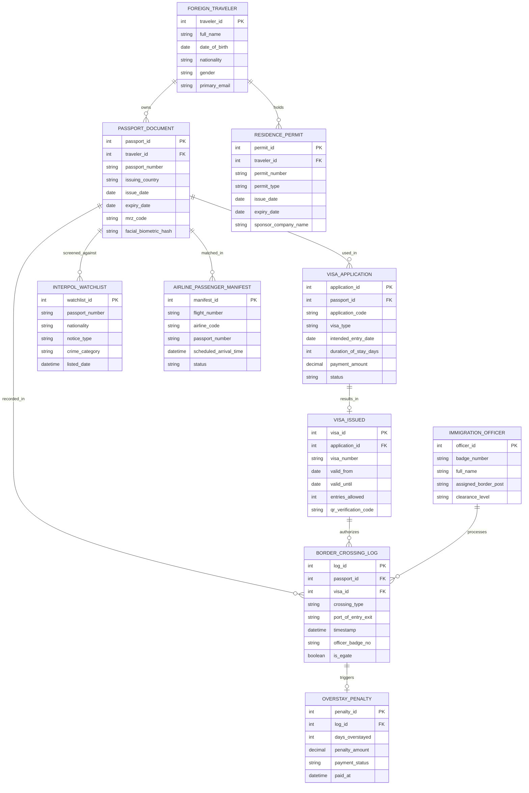

# Conceptual ERD — Immigration & Visa Management System

## Mermaid Code

## Entity Description Table | Bảng mô tả Entity

| # | Entity Name | Vietnamese Name | Description | Key Attributes | Main Relationships |
|---|-------------|-----------------|-------------|----------------|-------------------|
| 1 | FOREIGN_TRAVELER | Khách Du lịch Nước ngoài | Thông tin nhân thân của người nước ngoài nhập xuất cảnh | traveler_id, full_name, nationality, date_of_birth | Owns PASSPORT_DOCUMENT, holds RESIDENCE_PERMIT |
| 2 | PASSPORT_DOCUMENT | Hộ chiếu Ngoại quốc | Thông tin giấy thông hành/hộ chiếu quốc tế ICAO | passport_id, passport_number, issuing_country, mrz_code | Belongs to FOREIGN_TRAVELER, used in VISA_APPLICATION |
| 3 | VISA_APPLICATION | Đơn Xin Thị thực | Hồ sơ đề nghị cấp e-Visa hoặc visa dán tại đại sứ quán | application_id, application_code, visa_type, status | Belongs to PASSPORT_DOCUMENT, results in VISA_ISSUED |
| 4 | VISA_ISSUED | Thị thực Đã cấp | Thông tin giấy phép thị thực điện tử hoặc tem visa chính thức | visa_id, visa_number, valid_from, valid_until | Belongs to VISA_APPLICATION, authorizes BORDER_CROSSING_LOG |
| 5 | BORDER_CROSSING_LOG | Nhật ký Xuất Nhập cảnh | Ghi nhận từng lượt qua cửa khẩu nhập cảnh hoặc xuất cảnh | log_id, crossing_type, port_of_entry_exit, timestamp | Belongs to PASSPORT_DOCUMENT, VISA_ISSUED |
| 6 | INTERPOL_WATCHLIST | Danh sách Theo dõi Interpol | CSDL đối soát hộ chiếu báo mất/bị đánh cắp và đối tượng truy nã | watchlist_id, passport_number, notice_type, crime_category | Screened against PASSPORT_DOCUMENT |
| 7 | RESIDENCE_PERMIT | Thẻ Tạm trú | Thẻ tạm trú dài hạn cấp cho lao động, nhà đầu tư nước ngoài | permit_id, permit_number, permit_type, expiry_date | Belongs to FOREIGN_TRAVELER |
| 8 | IMMIGRATION_OFFICER | Cán bộ Xuất Nhập cảnh | Công chức công an quản lý xuất nhập cảnh tại cửa khẩu/đại sứ quán | officer_id, badge_number, full_name, assigned_border_post | Processes BORDER_CROSSING_LOG |
| 9 | OVERSTAY_PENALTY | Quyết định Xử phạt Quá hạn | Hồ sơ phạt hành chính đối với hành khách tạm trú quá hạn visa | penalty_id, days_overstayed, penalty_amount, payment_status | Belongs to BORDER_CROSSING_LOG |
| 10 | AIRLINE_PASSENGER_MANIFEST | Danh sách Hành khách Chuyến bay | Dữ liệu danh sách hành khách trước chuyến bay (APIS) do hãng hàng không truyền | manifest_id, flight_number, passport_number, scheduled_arrival_time | Matched in PASSPORT_DOCUMENT |

## Relationship Description | Mô tả Quan hệ

| # | From Entity | Cardinality | To Entity | Relationship Label | Business Explanation |
|---|-------------|-------------|-----------|-------------------|----------------------|
| 1 | FOREIGN_TRAVELER | one-to-many | PASSPORT_DOCUMENT | owns | Một công dân nước ngoài có thể sở hữu nhiều hộ chiếu qua các thời kỳ |
| 2 | PASSPORT_DOCUMENT | one-to-many | VISA_APPLICATION | used_in | Một hộ chiếu được sử dụng để nộp nhiều đơn xin visa khác nhau |
| 3 | VISA_APPLICATION | one-to-one | VISA_ISSUED | results_in | Một đơn xin visa được duyệt sinh ra một thị thực chính thức duy nhất |
| 4 | PASSPORT_DOCUMENT | one-to-many | BORDER_CROSSING_LOG | recorded_in | Một hộ chiếu lưu vết lịch sử nhiều lần nhập cảnh và xuất cảnh |
| 5 | VISA_ISSUED | one-to-many | BORDER_CROSSING_LOG | authorizes | Một thị thực cho phép hành khách thực hiện các lượt nhập cảnh theo quy định |
| 6 | FOREIGN_TRAVELER | one-to-many | RESIDENCE_PERMIT | holds | Một hành khách nước ngoài có thể được cấp các thẻ tạm trú gia hạn |
| 7 | BORDER_CROSSING_LOG | one-to-one | OVERSTAY_PENALTY | triggers | Một lượt xuất cảnh bị quá hạn tạm trú phát sinh một quyết định xử phạt |
| 8 | IMMIGRATION_OFFICER | one-to-many | BORDER_CROSSING_LOG | processes | Một cán bộ xuất nhập cảnh thực hiện kiểm tra cho nhiều lượt hành khách |
| 9 | PASSPORT_DOCUMENT | one-to-many | AIRLINE_PASSENGER_MANIFEST | matched_in | Thông tin hộ chiếu được đối soát với danh sách hành khách hàng không |
| 10 | PASSPORT_DOCUMENT | one-to-many | INTERPOL_WATCHLIST | screened_against | Mọi hộ chiếu xuất nhập cảnh đều được đối soát tự động với kho dữ liệu Interpol |
