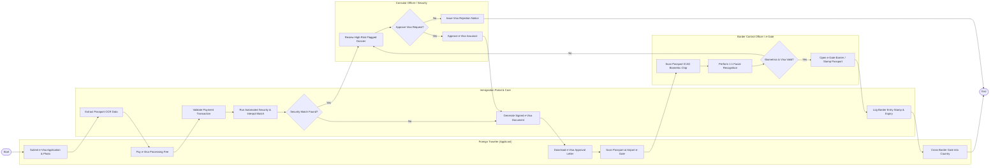

# Swimlane Diagram — Immigration & Visa Management System

## Mermaid Code

## Flow Description | Mô tả luồng

| Lane | Actor | Role in Flow |
|------|-------|-------------|
| 1 | Foreign Traveler (Applicant) | Nộp đơn e-Visa trực tuyến, tải ảnh hộ chiếu, nộp lệ phí, nhận công văn duyệt e-Visa, quét hộ chiếu tại cửa khẩu nhập cảnh. |
| 2 | Immigration Portal & Core | Bóc tách OCR dữ liệu hộ chiếu, tự động đối soát CSDL an ninh và Interpol, khởi tạo file e-Visa điện tử và ghi nhật ký xuất nhập cảnh. |
| 3 | Consular Officer / Security | Xét duyệt thủ công các hồ sơ nghi vấn hoặc thuộc danh sách cảnh báo, quyết định từ chối hoặc cấp phép thị thực. |
| 4 | Border Control Officer / e-Gate | Đọc chip sinh trắc học trên hộ chiếu, đối soát nhận diện khuôn mặt 1:1, kiểm tra hạn visa và điều khiển mở cổng tự động e-Gate. |
