# Action Tree — Immigration & Visa Management System

## Mermaid Code

```mermaid
graph TD
    Root["Immigration & Visa Management System"]

    Root --> M1["E-Visa Portal & Application"]
    Root --> M2["Consular Screening & Approval"]
    Root --> M3["Passport Biometrics & e-Gates"]
    Root --> M4["Border Entry & Exit Control"]
    Root --> M5["Watchlist & Security Enforcement"]
    Root --> M6["Residence Permits & Overstay Penalty"]

    M1 --> A11["Submit Online e-Visa Application"]
    M1 --> A12["OCR Extract ICAO Passport Data"]
    M1 --> A13["Process Visa Fee International Payment"]
    M1 --> A14["Download Electronic Approval Letter"]

    M2 --> A21["Review Consular Application Dossier"]
    M2 --> A22["Manage Visa Exemption Country List"]
    M2 --> A23["Process Diplomatic Visa Request"]
    M2 --> A24["Issue Multi-Entry Commercial Visas"]

    M3 --> A31["Read ICAO e-Passport Microchip"]
    M3 --> A32["Execute 1:1 Live Facial Recognition"]
    M3 --> A33["Capture 10-Fingerprint Scans Gate"]
    M3 --> A34["Control Automated e-Gate Barriers"]

    M4 --> A41["Perform Entry Clearance Clearance"]
    M4 --> A42["Perform Exit Clearance Clearance"]
    M4 --> A43["Reconcile Airline APIS Passenger Manifest"]
    M4 --> A44["Issue Electronic Entry Exit Stamps"]

    M5 --> A51["Query Interpol Stolen Passport Database"]
    M5 --> A52["Check National Blacklist Criminals"]
    M5 --> A53["Flag Undesirable Foreign Nationals"]
    M5 --> A54["Issue Immediate Border Interception Alert"]

    M6 --> A61["Detect Overstay Expiry Violations"]
    M6 --> A62["Calculate Overstay Financial Penalties"]
    M6 --> A63["Issue Temporary Residence Permits"]
    M6 --> A64["Monitor Foreign Labor Work Permits"]
```

## Module Description | Mô tả Module

| # | Module | Description | Actions |
|---|--------|-------------|---------|
| 1 | E-Visa Portal & Application | Cổng nộp đơn e-Visa trực tuyến, bóc tách OCR hộ chiếu tự động và thanh toán phí quốc tế | Submit Online e-Visa Application, OCR Extract ICAO Passport Data, Process Visa Fee International Payment, Download Electronic Approval Letter |
| 2 | Consular Screening & Approval | Phân hệ thẩm định hồ sơ của cán bộ lãnh sự, quản lý miễn thị thực và cấp visa ngoại giao/thương mại | Review Consular Application Dossier, Manage Visa Exemption Country List, Process Diplomatic Visa Request, Issue Multi-Entry Commercial Visas |
| 3 | Passport Biometrics & e-Gates | Xử lý đọc chip hộ chiếu điện tử, đối soát sinh trắc học khuôn mặt/vân tay và điều khiển cổng e-Gate tự động | Read ICAO e-Passport Microchip, Execute 1:1 Live Facial Recognition, Capture 10-Fingerprint Scans Gate, Control Automated e-Gate Barriers |
| 4 | Border Entry & Exit Control | Kiểm soát thủ tục nhập cảnh và xuất cảnh tại cửa khẩu, đóng dấu điện tử và đối soát danh sách bay APIS | Perform Entry Clearance Clearance, Perform Exit Clearance Clearance, Reconcile Airline APIS Passenger Manifest, Issue Electronic Entry Exit Stamps |
| 5 | Watchlist & Security Enforcement | Đối soát CSDL Interpol, phát hiện hộ chiếu mất/bị đánh cắp và quản lý danh sách cấm nhập cảnh an ninh | Query Interpol Stolen Passport Database, Check National Blacklist Criminals, Flag Undesirable Foreign Nationals, Issue Immediate Border Interception Alert |
| 6 | Residence Permits & Overstay Penalty | Tự động phát hiện vi phạm tạm trú quá hạn, tính tiền phạt hành chính và cấp thẻ tạm trú dài hạn | Detect Overstay Expiry Violations, Calculate Overstay Financial Penalties, Issue Temporary Residence Permits, Monitor Foreign Labor Work Permits |
