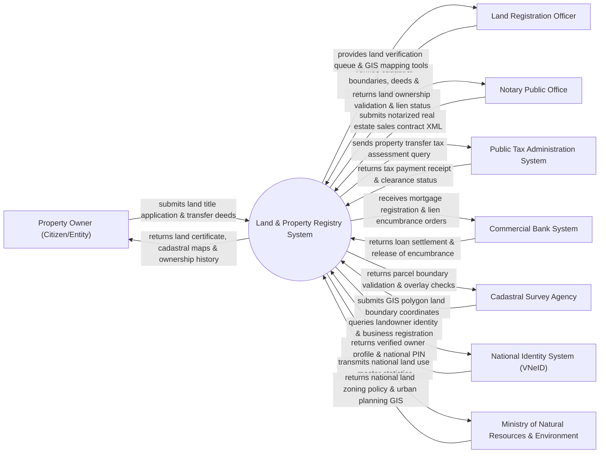

# Context Diagram — Land & Property Registry System

## Mermaid Code

## Actor & Interaction Table | Bảng Actor & Tương tác

| # | Actor | Actor Type | Data Sent TO System | Data Received FROM System | Notes |
|---|-------|------------|---------------------|---------------------------|-------|
| 1 | Property Owner (Citizen/Entity) | Primary | Land registration application, transfer contracts, identity documents | Land Use Right Certificate (Red Book), parcel map extract | Chủ sở hữu/người sử dụng đất thực hiện thủ tục đất đai |
| 2 | Land Registration Officer | Primary | Dossier review approvals, cadastral verifications, certificate issuance | Cadastral verification queue, spatial GIS map overlays | Cán bộ Văn phòng Đăng ký Đất đai cấp quận/huyện |
| 3 | Notary Public Office | Primary | Notarized real estate sale/gift contracts, digital notary signatures | Land ownership verification, encumbrance/mortgage status | Phòng/Văn phòng Công chứng thực hiện công chứng hợp đồng |
| 4 | Public Tax Administration System | Supporting | Land transfer tax clearance, registration fee receipt status | Property transfer tax calculation requests, land valuation | Cơ quan Thuế tính và thu thuế chuyển nhượng, lệ phí trước bạ |
| 5 | Commercial Bank System | Supporting | Mortgage registration requests, loan collateral encumbrances | Registered mortgage certificate, release of encumbrance | Ngân hàng thương mại đăng ký giao dịch bảo đảm (thế chấp) |
| 6 | Cadastral Survey Agency | Supporting | GIS polygon coordinates, boundary measurement data | Parcel ID confirmation, boundary overlap test results | Đơn vị đo đạc địa chính khảo sát mốc giới thửa đất |
| 7 | National Identity System (VNeID) | Supporting | Owner personal demographics, identity validation confirmation | Identity query parameters, national ID lookup | Cơ sở dữ liệu quốc gia về dân cư xác thực thông tin chủ đất |
| 8 | Ministry of Natural Resources & Environment | Regulatory | National land use master plans, land pricing frame regulations | National land database statistics, land availability reports | Bộ Tài nguyên và Môi trường quản lý quy hoạch đất đai quốc gia |

## System Boundary Description | Mô tả Phạm vi Hệ thống

Hệ thống Land & Property Registry System (Hệ thống Đăng ký Đất đai và Bất động sản / CSDL Đất đai Quốc gia) chịu trách nhiệm quản lý toàn bộ cơ sở dữ liệu đất đai đa mục tiêu (bao gồm dữ liệu không gian thửa đất GIS và dữ liệu thuộc tính pháp lý). Hệ thống xử lý các quy trình đăng ký đất đai lần đầu, chuyển nhượng quyền sử dụng đất, tách/hợp thửa, đăng ký giao dịch bảo đảm (thế chấp ngân hàng), tính thuế đất và cấp Giấy chứng nhận Quyền sử dụng đất (Sổ đỏ/Sổ hồng điện tử). Tuy nhiên, hệ thống KHÔNG trực tiếp thực hiện đo đạc cắm mốc vật lý tại thực địa và KHÔNG thay thế cơ quan Tòa án trong việc giải quyết tranh chấp đất đai sâu.
