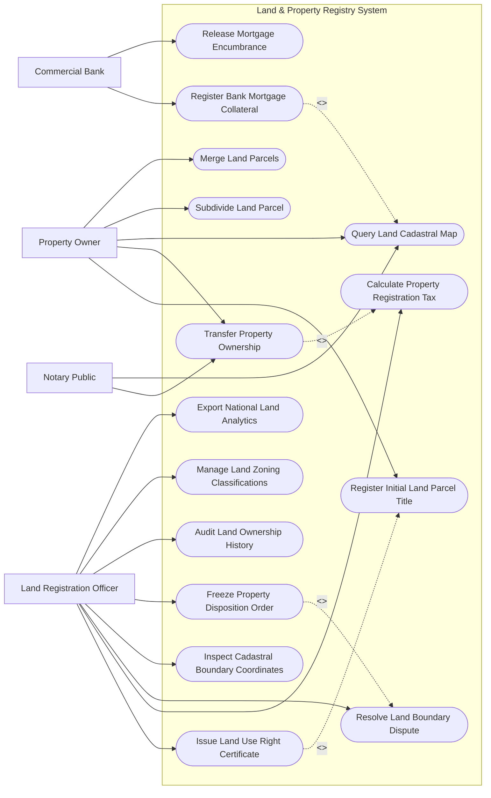

# Use Case Diagram — Land & Property Registry System

## Mermaid Code

## Actor Table | Bảng Actor

| # | Actor | Actor Type | Role Description | Related Use Cases |
|---|-------|------------|------------------|-------------------|
| 1 | Property Owner | Primary | Chủ sở hữu/người sử dụng đất nộp hồ sơ chuyển nhượng, tách/hợp thửa | UC01, UC02, UC04, UC08, UC09 |
| 2 | Notary Public | Primary | Công chứng viên đối soát trạng thái quy hoạch/thế chấp và đẩy hợp đồng | UC02, UC04 |
| 3 | Commercial Bank | Primary | Ngân hàng đăng ký giao dịch bảo đảm (thế chấp) hoặc xóa chấp điện tử | UC06, UC07 |
| 4 | Land Registration Officer | Primary | Cán bộ văn phòng đăng ký đất đai thẩm định hồ sơ, cấp Sổ đỏ và quản lý GIS | UC03, UC05, UC10, UC11, UC12, UC13, UC14, UC15 |

## Use Case Table | Bảng Use Case

| # | UC ID | Use Case Name | Primary Actor | Secondary Actor | Description | Priority |
|---|-------|---------------|---------------|-----------------|-------------|----------|
| 1 | UC01 | Register Initial Land Parcel Title | Owner | Officer | Đăng ký quyền sử dụng đất lần đầu cho thửa đất mới | High |
| 2 | UC02 | Transfer Property Ownership | Owner, Notary | TaxOffice | Thực hiện thủ tục mua bán, cho tặng, thừa kế chuyển nhượng nhà đất | High |
| 3 | UC03 | Issue Land Use Right Certificate | Officer | Owner | Ban hành Giấy chứng nhận quyền sử dụng đất (Sổ đỏ/Sổ hồng) điện tử | High |
| 4 | UC04 | Query Land Cadastral Map | Owner, Notary | GIS Engine | Tra cứu thông tin thửa đất, tọa độ ranh giới và quy hoạch sử dụng đất | High |
| 5 | UC05 | Calculate Property Registration Tax | Officer | TaxOffice | Tự động tính thuế thu nhập cá nhân và lệ phí trước bạ nhà đất | High |
| 6 | UC06 | Register Bank Mortgage Collateral | Bank | Officer | Đăng ký giao dịch bảo đảm thế chấp quyền sử dụng đất tại ngân hàng | High |
| 7 | UC07 | Release Mortgage Encumbrance | Bank | Officer | Giải chấp, xóa đăng ký thế chấp khi ngân hàng hoàn thành thu nợ | High |
| 8 | UC08 | Subdivide Land Parcel | Owner | CadastralSurveyor | Thực hiện tách một thửa đất thành nhiều thửa đất nhỏ đáp ứng diện tích tối thiểu | Medium |
| 9 | UC09 | Merge Land Parcels | Owner | CadastralSurveyor | Thực hiện gộp nhiều thửa đất liền kề thành một thửa đất lớn | Medium |
| 10 | UC10 | Resolve Land Boundary Dispute | Officer | Court | Ghi nhận trạng thái tranh chấp ranh giới thửa đất và phong tỏa giao dịch | High |
| 11 | UC11 | Inspect Cadastral Boundary Coordinates | Officer | CadastralSurveyor | Khảo sát đối soát tọa độ ranh giới thửa đất trên bản đồ địa chính GIS | Medium |
| 12 | UC12 | Freeze Property Disposition Order | Officer | Court, Police | Kê biên, ngăn chặn giao dịch nhà đất theo quyết định của Tòa án/Công an | High |
| 13 | UC13 | Audit Land Ownership History | Officer | - | Trích xuất toàn bộ biến động lịch sử chủ sở hữu qua các thời kỳ | Medium |
| 14 | UC14 | Manage Land Zoning Classifications | SysAdmin | MONRE | Cập nhật bản đồ quy hoạch sử dụng đất (đất ở, đất nông nghiệp, thương mại) | Medium |
| 15 | UC15 | Export National Land Analytics | SysAdmin | MONRE | Thống kê diện tích đất đai, số lượng chứng nhận đã cấp trên toàn quốc | Low |

## Use Case Specification | Đặc tả Use Case

---

### UC01 — Register Initial Land Parcel Title

| Field | Detail |
|-------|--------|
| **UC ID** | UC01 |
| **Use Case Name** | Register Initial Land Parcel Title |
| **Actor(s)** | Primary: Property Owner / Secondary: Land Registration Officer |
| **Description** | Đăng ký quyền sử dụng đất và tài sản gắn liền với đất lần đầu cho cá nhân, hộ gia đình hoặc tổ chức. |
| **Precondition** | 1. Thửa đất chưa từng được cấp Giấy chứng nhận quyền sử dụng đất.   2. Có giấy tờ chứng minh nguồn gốc sử dụng đất hợp pháp. |
| **Main Flow** | 1. Owner nộp đơn đăng ký đất đai lần đầu (Mẫu 01/ĐK) trên Cổng Dịch vụ công Đất đai.   2. Owner tải lên bản sao giấy tờ nguồn gốc đất, trích đo địa chính và chứng minh nhân thân.   3. System tự động kiểm tra tọa độ thửa đất trên Bản đồ địa chính GIS để đảm bảo không đè phủ lên thửa đất đã cấp.   4. Officer thụ lý hồ sơ, kiểm tra tính pháp lý và niêm yết công khai thông tin đăng ký tại UBND Xã/Phường trong 15 ngày.   5. Hết thời hạn niêm yết không có tranh chấp: Officer gửi thông báo nghĩa vụ tài chính thuế cho Owner.   6. Owner hoàn thành nộp thuế/lệ phí trước bạ.   7. Officer ký duyệt và cấp Giấy chứng nhận quyền sử dụng đất (UC03). |
| **Alternative Flow** | **AF1** — Đất cấp cho tổ chức/doanh nghiệp: Thẩm quyền duyệt thuộc Sở Tài nguyên & Môi trường, luân chuyển hồ sơ lên cấp Tỉnh. |
| **Exception Flow** | **EX1** — Tọa độ thửa đất bị đè phủ (Overlap) với thửa đất khác: System chặn hồ sơ, phát thông báo xung đột ranh giới và chuyển sang quy trình xác minh địa chính (UC11). |
| **Postcondition** | Thửa đất được đăng ký mã số định danh duy nhất vào CSDL Đất đai Quốc gia và phát hành Sổ đỏ. |
| **Business Rule** | **BR1**: Mã thửa đất bắt buộc phải tuân theo cấu trúc quốc gia `[Mã Tỉnh]-[Mã Huyện]-[Mã Xã]-[Số Tờ Bản Đồ]-[Số Thửa]`. |

---

### UC02 — Transfer Property Ownership

| Field | Detail |
|-------|--------|
| **UC ID** | UC02 |
| **Use Case Name** | Transfer Property Ownership |
| **Actor(s)** | Primary: Property Owner, Notary Public / Secondary: Public Tax Office |
| **Description** | Thực hiện sang tên chuyển nhượng (chuyển nhượng, tặng cho, thừa kế) quyền sử dụng đất và tài sản trên đất. |
| **Precondition** | 1. Thửa đất đã có Giấy chứng nhận hợp pháp (Sổ đỏ/Sổ hồng).   2. Thửa đất không ở trạng thái thế chấp, tranh chấp hoặc bị kê biên ngăn chặn (UC12). |
| **Main Flow** | 1. NotaryPublic công chứng Hợp đồng chuyển nhượng nhà đất và đẩy tệp hợp đồng XML lên hệ thống.   2. System tự động kiểm tra điều kiện giao dịch: Sổ đỏ hợp lệ, không có ngăn chặn thi hành án, không bị phong tỏa thế chấp.   3. Owner (Bên bán và Bên mua) nộp hồ sơ đăng ký biến động đất đai trực tuyến.   4. System truyền dữ liệu thông tin giao dịch sang Thuế (UC05) để tự động tính Thuế TNCN và Lệ phí trước bạ.   5. Đương sự hoàn thành nộp thuế và tải hóa đơn điện tử xác nhận lên hệ thống.   6. Officer Văn phòng đăng ký đất đai thẩm định và thực hiện in trang bổ sung biến động (hoặc cấp đổi Sổ đỏ mới).   7. System cập nhật tên chủ sở hữu mới vào Cơ sở dữ liệu Đất đai Quốc gia. |
| **Alternative Flow** | **AF1** — Chuyển nhượng một phần thửa đất: Đương sự nộp đơn xin tách thửa (UC08) trước khi làm thủ tục chuyển nhượng phần đất tách. |
| **Exception Flow** | **EX1** — Thửa đất đang bị thế chấp tại Ngân hàng: System phát hiện ngăn chặn thế chấp chưa xóa (UC06), từ chối nhận hồ sơ sang tên cho đến khi có văn bản giải chấp. |
| **Postcondition** | Quyền sử dụng đất được sang tên chính thức cho bên mua, cập nhật vĩnh viễn vào nhật ký biến động đất đai. |
| **Business Rule** | **BR1**: Hợp đồng chuyển nhượng bất động sản bắt buộc phải được công chứng hoặc chứng thực theo quy định của Luật Đất đai. |

---

### UC03 — Issue Land Use Right Certificate

| Field | Detail |
|-------|--------|
| **UC ID** | UC03 |
| **Use Case Name** | Issue Land Use Right Certificate |
| **Actor(s)** | Primary: Land Registration Officer / Secondary: Property Owner |
| **Description** | Khởi tạo, ký số và phát hành Giấy chứng nhận quyền sử dụng đất, quyền sở hữu nhà ở và tài sản khác gắn liền với đất (Sổ đỏ/Sổ hồng điện tử). |
| **Precondition** | 1. Hồ sơ đăng ký đất đai lần đầu hoặc cấp đổi đã qua thẩm định đạt tiêu chuẩn và hoàn thành nghĩa vụ thuế. |
| **Main Flow** | 1. Officer mở hồ sơ đã hoàn thành kiểm tra pháp lý.   2. System hiển thị thông tin thửa đất: Mã thửa, sơ đồ hình thể thửa đất, diện tích, mục đích sử dụng, thời hạn sử dụng và tên chủ sở hữu.   3. Officer rà soát tính chính xác của dữ liệu không gian và thuộc tính.   4. Lãnh đạo UBND Huyện / Sở Tài nguyên Môi trường sử dụng Chữ ký số cơ quan nhà nước ký duyệt lên Giấy chứng nhận.   5. System phát hành Mã Giấy chứng nhận (Sổ đỏ) điện tử duy nhất kèm mã QR tra cứu tính pháp lý.   6. System đồng bộ Giấy chứng nhận điện tử vào Ví giấy tờ của chủ đất trên ứng dụng VNeID.   7. In bản giấy Sổ đỏ chính thức (trên phôi bảo mật quốc gia) để trả cho người dân. |
| **Alternative Flow** | **AF1** — Cấp đổi Giấy chứng nhận bị rách/hỏng/mất: Officer thu hồi Sổ cũ (nếu có), hủy hiệu lực mã Sổ cũ và cấp Sổ đỏ với mã số mới. |
| **Exception Flow** | **EX1** — Lỗi ký số cán bộ thẩm định: System báo lỗi xác thực chứng thư số, từ chối cấp mã sổ cho đến khi chữ ký số được xác thực lại. |
| **Postcondition** | Giấy chứng nhận quyền sử dụng đất điện tử có giá trị pháp lý chính thức được lưu vĩnh viễn trong CSDL Đất đai. |
| **Business Rule** | **BR1**: Mỗi Giấy chứng nhận phát hành bắt buộc phải có mã QR chứa liên kết tra cứu dữ liệu gốc từ CSDL Đất đai Quốc gia. |

---

### UC06 — Register Bank Mortgage Collateral

| Field | Detail |
|-------|--------|
| **UC ID** | UC06 |
| **Use Case Name** | Register Bank Mortgage Collateral |
| **Actor(s)** | Primary: Commercial Bank / Secondary: Land Registration Officer |
| **Description** | Ngân hàng thực hiện đăng ký thế chấp quyền sử dụng đất để làm tài sản bảo đảm cho khoản vay tín dụng. |
| **Precondition** | 1. Thửa đất đã có Giấy chứng nhận hợp pháp chính chủ.   2. Hợp đồng thế chấp giữa Ngân hàng và Chủ đất đã được công chứng. |
| **Main Flow** | 1. CommercialBank đăng nhập Cổng Dịch vụ Đăng ký Giao dịch Bảo đảm Đất đai.   2. Bank nhập Mã Giấy chứng nhận (Sổ đỏ) và thông tin Hợp đồng thế chấp tín dụng.   3. System tự động kiểm tra tình trạng pháp lý: Thửa đất không bị ngăn chặn, không bị tranh chấp.   4. Bank nộp phí đăng ký giao dịch bảo đảm trực tuyến.   5. Officer rà soát và bấm "Phê duyệt đăng ký thế chấp".   6. System tự động cập nhật trạng thái "Đang thế chấp tại Ngân hàng X" vào CSDL Đất đai.   7. System cấp Giấy xác nhận đăng ký giao dịch bảo đảm điện tử có ký số gửi cho Ngân hàng và Chủ đất. |
| **Alternative Flow** | **AF1** — Đăng ký thế chấp bằng tài sản hình thành trong tương lai: Bank nhập thông tin dự án/nhà ở hình thành trong tương lai, System ghi nhận thế chấp tài sản gắn liền với đất. |
| **Exception Flow** | **EX1** — Sổ đỏ đang có lệnh phong tỏa của Tòa án (UC12): System lập tức từ chối nhận đăng ký thế chấp và phát thông báo ngăn chặn cho Ngân hàng. |
| **Postcondition** | Thửa đất bị khóa tính năng chuyển nhượng/tách thửa cho đến khi Ngân hàng làm thủ tục xóa thế chấp (UC07). |
| **Business Rule** | **BR1**: Thời gian xử lý đăng ký giao dịch bảo đảm bằng thế chấp đất đai điện tử không quá 01 ngày làm việc. |

---

### UC08 — Subdivide Land Parcel

| Field | Detail |
|-------|--------|
| **UC ID** | UC08 |
| **Use Case Name** | Subdivide Land Parcel |
| **Actor(s)** | Primary: Property Owner / Secondary: Cadastral Surveyor, Land Officer |
| **Description** | Thực hiện chia tách một thửa đất ban đầu thành hai hoặc nhiều thửa đất mới độc lập theo đúng quy định diện tích tối thiểu. |
| **Precondition** | 1. Thửa đất có Giấy chứng nhận quyền sử dụng đất hợp pháp.   2. Diện tích thửa đất đủ điều kiện tách thửa theo quy định của UBND Tỉnh. |
| **Main Flow** | 1. Owner nộp Đề nghị tách thửa đất trực tuyến.   2. CadastralSurveyor đo đạc hiện trạng, lập Bản vẽ trích đo địa chính chia tách thửa đất và nạp tọa độ các điểm góc ranh giới mới lên hệ thống.   3. System tự động kiểm tra diện tích các thửa đất mới hình thành vs Quy định diện tích tách thửa tối thiểu của Tỉnh.   4. System kiểm tra lối đi công cộng cho các thửa đất mới.   5. Officer thẩm định bản vẽ trích đo và phê duyệt Quyết định tách thửa.   6. System hủy mã thửa đất cũ, tự động sinh các Mã thửa đất mới và cập nhật bản đồ địa chính GIS.   7. Officer thu hồi Sổ đỏ cũ và cấp các Giấy chứng nhận quyền sử dụng đất mới (UC03) cho các thửa đất vừa tách. |
| **Alternative Flow** | **AF1** — Tách thửa để chuyển nhượng một phần: Đương sự nộp đồng thời hồ sơ tách thửa và hồ sơ chuyển nhượng (UC02) để xử lý song song. |
| **Exception Flow** | **EX1** — Diện tích thửa đất mới nhỏ hơn diện tích tối thiểu quy định: System báo lỗi "Không đủ điều kiện tách thửa do vi phạm diện tích tối thiểu" và dừng hồ sơ. |
| **Postcondition** | Thửa đất cũ chấm dứt tồn tại, các thửa đất mới được ghi nhận chính thức trên bản đồ địa chính. |
| **Business Rule** | **BR1**: Mọi thửa đất mới hình thành sau khi tách thửa bắt buộc phải có đường giao thông công cộng tiếp giáp hợp pháp. |
