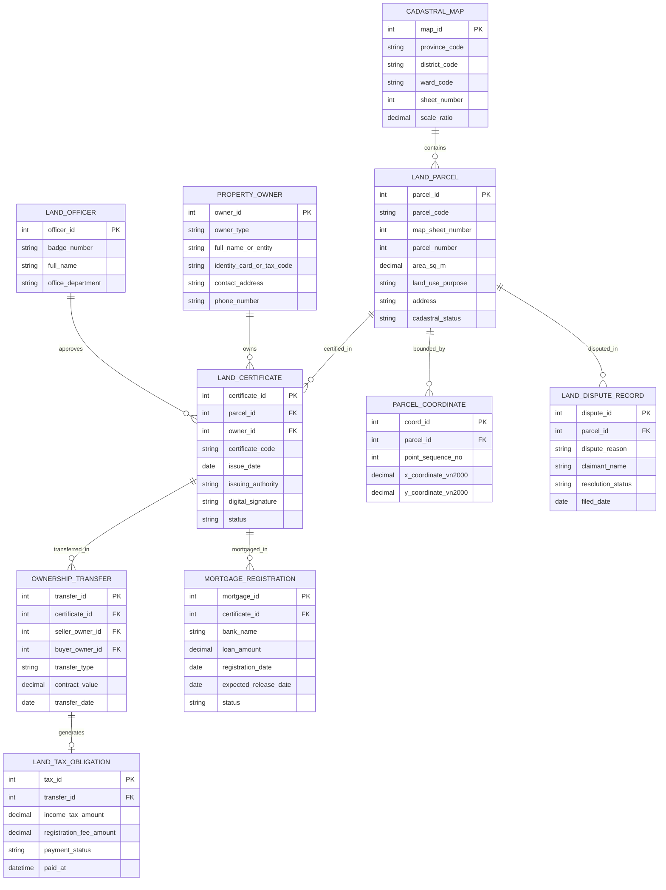

# Conceptual ERD — Land & Property Registry System

## Mermaid Code

## Entity Description Table | Bảng mô tả Entity

| # | Entity Name | Vietnamese Name | Description | Key Attributes | Main Relationships |
|---|-------------|-----------------|-------------|----------------|-------------------|
| 1 | LAND_PARCEL | Thửa Đất Địa chính | Thông tin thuộc tính cốt lõi của thửa đất (diện tích, mục đích sử dụng, địa chỉ) | parcel_id, parcel_code, map_sheet_number, area_sq_m | Contained in CADASTRAL_MAP, certified in LAND_CERTIFICATE |
| 2 | PROPERTY_OWNER | Chủ Sở hữu / Người Sử dụng Đất | Thông tin cá nhân, hộ gia đình hoặc tổ chức đứng tên quyền sử dụng đất | owner_id, owner_type, full_name_or_entity, identity_card_or_tax_code | Owns LAND_CERTIFICATE |
| 3 | LAND_CERTIFICATE | Giấy chứng nhận QSDĐ (Sổ đỏ) | Giấy chứng nhận quyền sử dụng đất, quyền sở hữu nhà ở điện tử | certificate_id, certificate_code, issue_date, status | Belongs to LAND_PARCEL, PROPERTY_OWNER |
| 4 | OWNERSHIP_TRANSFER | Giao dịch Chuyển nhượng Đất | Nhật ký sang tên, mua bán, tặng cho, thừa kế quyền sử dụng đất | transfer_id, transfer_type, contract_value, transfer_date | Belongs to LAND_CERTIFICATE, generates LAND_TAX_OBLIGATION |
| 5 | MORTGAGE_REGISTRATION | Đăng ký Thế chấp Ngân hàng | Hồ sơ giao dịch bảo đảm thế chấp quyền sử dụng đất tại tổ chức tín dụng | mortgage_id, bank_name, loan_amount, status | Belongs to LAND_CERTIFICATE |
| 6 | CADASTRAL_MAP | Tờ Bản đồ Địa chính | Tờ bản đồ địa chính hệ tọa độ VN-2000 quản lý không gian các thửa đất | map_id, sheet_number, province_code, scale_ratio | Contains LAND_PARCEL |
| 7 | PARCEL_COORDINATE | Tọa độ Đỉnh Ranh giới Thửa đất | Danh sách tọa độ các đỉnh ranh giới X, Y (VN-2000) khép góc thửa đất | coord_id, point_sequence_no, x_coordinate_vn2000, y_coordinate_vn2000 | Belongs to LAND_PARCEL |
| 8 | LAND_TAX_OBLIGATION | Nghĩa vụ Thuế Đất đai | Chứng từ nghĩa vụ thuế thu nhập cá nhân và lệ phí trước bạ nhà đất | tax_id, income_tax_amount, registration_fee_amount, payment_status | Belongs to OWNERSHIP_TRANSFER |
| 9 | LAND_DISPUTE_RECORD | Hồ sơ Tranh chấp Đất đai | Đơn khiếu nại tranh chấp ranh giới hoặc phong tỏa giao dịch thửa đất | dispute_id, dispute_reason, resolution_status | Belongs to LAND_PARCEL |
| 10 | LAND_OFFICER | Cán bộ Đăng ký Đất đai | Công chức/viên chức thẩm định và duyệt cấp Sổ đỏ tại Văn phòng Đăng ký | officer_id, badge_number, full_name, office_department | Approves LAND_CERTIFICATE |

## Relationship Description | Mô tả Quan hệ

| # | From Entity | Cardinality | To Entity | Relationship Label | Business Explanation |
|---|-------------|-------------|-----------|-------------------|----------------------|
| 1 | CADASTRAL_MAP | one-to-many | LAND_PARCEL | contains | Một tờ bản đồ địa chính quản lý khoanh vùng nhiều thửa đất |
| 2 | LAND_PARCEL | one-to-many | PARCEL_COORDINATE | bounded_by | Một thửa đất được định hình bởi tập hợp chuỗi tọa độ các đỉnh ranh giới X, Y |
| 3 | LAND_PARCEL | one-to-many | LAND_CERTIFICATE | certified_in | Một thửa đất có thể được cấp các Giấy chứng nhận qua các thời kỳ lịch sử |
| 4 | PROPERTY_OWNER | one-to-many | LAND_CERTIFICATE | owns | Một chủ sở hữu đất đai có thể đứng tên nhiều Giấy chứng nhận (Sổ đỏ) |
| 5 | LAND_CERTIFICATE | one-to-many | OWNERSHIP_TRANSFER | transferred_in | Một Sổ đỏ trải qua nhiều lượt giao dịch chuyển nhượng, sang tên |
| 6 | LAND_CERTIFICATE | one-to-many | MORTGAGE_REGISTRATION | mortgaged_in | Một Sổ đỏ có thể đăng ký thế chấp nhiều lần tại các ngân hàng |
| 7 | OWNERSHIP_TRANSFER | one-to-one | LAND_TAX_OBLIGATION | generates | Mỗi giao dịch chuyển nhượng bất động sản phát sinh một nghĩa vụ thuế |
| 8 | LAND_PARCEL | one-to-many | LAND_DISPUTE_RECORD | disputed_in | Một thửa đất có thể ghi nhận các vụ việc tranh chấp ranh giới |
| 9 | LAND_OFFICER | one-to-many | LAND_CERTIFICATE | approves | Một cán bộ đăng ký đất đai duyệt cấp nhiều Giấy chứng nhận Sổ đỏ |
