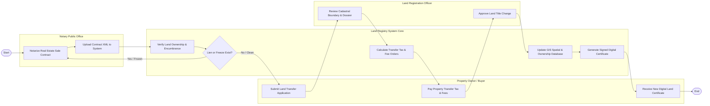

# Swimlane Diagram — Land & Property Registry System

## Mermaid Code

## Flow Description | Mô tả luồng

| Lane | Actor | Role in Flow |
|------|-------|-------------|
| 1 | Property Owner / Buyer | Ký hợp đồng chuyển nhượng tại phòng công chứng, nộp đơn sang tên đất đai, nộp tiền thuế/lệ phí trước bạ và nhận Sổ đỏ mới. |
| 2 | Notary Public Office | Công chứng hợp đồng mua bán/tặng cho bất động sản, mã hóa dữ liệu hợp đồng XML và đẩy lên CSDL đất đai. |
| 3 | Land Registry System Core | Tự động kiểm tra tình trạng thế chấp/phong tỏa của thửa đất, tính thuế đất, cập nhật biến động không gian GIS và cấp Sổ đỏ điện tử. |
| 4 | Land Registration Officer | Thẩm định tính pháp lý của hồ sơ, đối soát bản đồ ranh giới thửa đất địa chính và duyệt Quyết định cấp sang tên Sổ đỏ. |
