# Action Tree — Land & Property Registry System

## Mermaid Code

```mermaid
graph TD
    Root["Land & Property Registry System"]

    Root --> M1["Land Parcel & Cadastral Mapping"]
    Root --> M2["Title Registration & Certificate"]
    Root --> M3["Ownership Transfer & Conveyance"]
    Root --> M4["Mortgage & Financial Encumbrance"]
    Root --> M5["Land Division & Boundary Management"]
    Root --> M6["Tax Assessment & Legal Audit"]

    M1 --> A11["Query GIS Spatial Cadastral Map"]
    M1 --> A12["Inspect VN-2000 Parcel Coordinates"]
    M1 --> A13["Manage Land Use Zoning Classifications"]
    M1 --> A14["Overlay Urban Master Planning GIS"]

    M2 --> A21["Register Initial Land Parcel Title"]
    M2 --> A22["Issue Signed Digital Land Certificate"]
    M2 --> A23["Issue QR Code Verification Token"]
    M2 --> A24["Re-issue Lost Damaged Certificates"]

    M3 --> A31["Process Property Sale Conveyance"]
    M3 --> A32["Verify Notarized Contract XML"]
    M3 --> A33["Update Owner Identity Record VNeID"]
    M3 --> A34["Audit Historical Ownership Chain"]

    M4 --> A41["Register Bank Mortgage Collateral"]
    M4 --> A42["Process Release of Encumbrance"]
    M4 --> A43["Freeze Property Disposition Orders"]
    M4 --> A44["Issue Lien Status Verification"]

    M5 --> A51["Process Parcel Subdivision Request"]
    M5 --> A52["Process Parcel Merger Request"]
    M5 --> A53["Resolve Boundary Overlap Disputes"]
    M5 --> A54["Verify Minimum Subdivision Area"]

    M6 --> A61["Calculate Transfer Tax Registration Fee"]
    M6 --> A62["Sync Clearance Public Tax Office"]
    M6 --> A63["Log System Immutable Audit Logs"]
    M6 --> A64["Export MONRE Land Use Analytics"]
```

## Module Description | Mô tả Module

| # | Module | Description | Actions |
|---|--------|-------------|---------|
| 1 | Land Parcel & Cadastral Mapping | Quản lý bản đồ địa chính không gian GIS hệ VN-2000, ranh giới thửa đất và quy hoạch sử dụng đất | Query GIS Spatial Cadastral Map, Inspect VN-2000 Parcel Coordinates, Manage Land Use Zoning Classifications, Overlay Urban Master Planning GIS |
| 2 | Title Registration & Certificate | Đăng ký cấp GCN QSDĐ (Sổ đỏ/Sổ hồng) lần đầu, ký số điện tử và tích hợp mã QR tra cứu pháp lý | Register Initial Land Parcel Title, Issue Signed Digital Land Certificate, Issue QR Code Verification Token, Re-issue Lost Damaged Certificates |
| 3 | Ownership Transfer & Conveyance | Xử lý quy trình sang tên, mua bán, tặng cho, thừa kế bất động sản và cập nhật chuỗi biến động chủ sở hữu | Process Property Sale Conveyance, Verify Notarized Contract XML, Update Owner Identity Record VNeID, Audit Historical Ownership Chain |
| 4 | Mortgage & Financial Encumbrance | Đăng ký giao dịch bảo đảm thế chấp ngân hàng, xóa thế chấp giải chấp và phong tỏa tài sản kê biên | Register Bank Mortgage Collateral, Process Release of Encumbrance, Freeze Property Disposition Orders, Issue Lien Status Verification |
| 5 | Land Division & Boundary Management | Quản lý quy trình tách thửa, hợp thửa đất đai, giải quyết đè phủ ranh giới và kiểm tra diện tích tối thiểu | Process Parcel Subdivision Request, Process Parcel Merger Request, Resolve Boundary Overlap Disputes, Verify Minimum Subdivision Area |
| 6 | Tax Assessment & Legal Audit | Tự động tính thuế đất, đối soát chứng từ nộp thuế với Thuế và trích xuất báo cáo thống kê đất đai | Calculate Transfer Tax Registration Fee, Sync Clearance Public Tax Office, Log System Immutable Audit Logs, Export MONRE Land Use Analytics |
