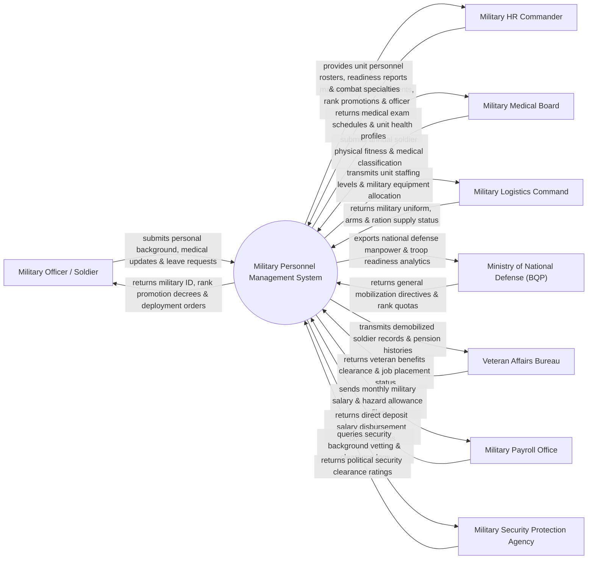

# Context Diagram — Military Personnel Management System

## Mermaid Code

## Actor & Interaction Table | Bảng Actor & Tương tác

| # | Actor | Actor Type | Data Sent TO System | Data Received FROM System | Notes |
|---|-------|------------|---------------------|---------------------------|-------|
| 1 | Military Officer / Soldier | Primary | Personal biography, medical updates, leave requests, specialty choices | Digital military ID QR, rank promotion orders, unit deployment tasks | Sĩ quan, quân nhân chuyên nghiệp, hạ sĩ quan và chiến sĩ quân đội |
| 2 | Military HR Commander | Primary | Officer assignment decisions, rank promotion decrees, transfer orders | Unit personnel rosters, troop readiness levels, specialty indexes | Cán bộ Trưởng phòng/Ban Quân lực cơ quan quân sự các cấp |
| 3 | Military Medical Board | Supporting | Annual soldier medical fitness grades (Sức khỏe loại 1-6), exam logs | Unit health profiles, medical examination schedules | Hội đồng Giám định Y khoa Quân đội kiểm tra sức khỏe chiến sĩ |
| 4 | Military Logistics Command | Supporting | Military uniform allocations, arms issuance, ration supply status | Unit staffing numbers, deployment location coordinates | Cục Hậu cần / Cục Quân nhu cung cấp quân trang thiết bị |
| 5 | Ministry of National Defense (BQP) | Regulatory | National mobilization directives, officer rank quota policies | National defense manpower analytics, troop readiness reports | Bộ Quốc phòng chỉ đạo vĩ mô lực lượng vũ trang nhân dân |
| 6 | Veteran Affairs Bureau | Supporting | Veteran benefit clearance, demobilized soldier job placements | Demobilized soldier dossiers, military pension service history | Cơ quan Cục Chính sách / Sở LĐ-TB&XH giải quyết chế độ xuất ngũ |
| 7 | Military Payroll Office | Supporting | Salary credit confirmations, combat hazard allowance logs | Monthly military payroll instruction files, bank accounts | Cục Tài chính BQP thực hiện chi trả lương và phụ cấp quân quân |
| 8 | Military Security Protection Agency | Regulatory | Political security clearance ratings, background vetting reports | Classified personnel file query requests, access audit trails | Cục Bảo vệ An ninh Quân đội kiểm tra tiêu chuẩn trị an |

## System Boundary Description | Mô tả Phạm vi Hệ thống

Hệ thống Military Personnel Management System (Hệ thống Quản lý Quân lực và Nhân sự Quân đội) chịu trách nhiệm tự động hóa quy trình quản lý quân số và hồ sơ cán bộ chiến sĩ trong Quân đội Nhân dân: Quản lý đăng ký nghĩa vụ quân sự, gọi nhập ngũ, quản lý hồ sơ sĩ quan/quân nhân chuyên nghiệp, thăng cấp bậc hàm (từ Thượng sĩ đến Đại tướng), phân công điều động đơn vị tác chiến, kiểm tra phân loại sức khỏe quân y định kỳ, tính toán lương và phụ cấp đặc thù quân binh chủng, giải quyết xuất ngũ và chế độ chính sách hậu phương quân đội. Hệ thống vận hành trên mạng bảo mật cơ yếu dành riêng cho quốc phòng. Tuy nhiên, hệ thống KHÔNG trực tiếp truyền lệnh tác chiến chiến đấu và KHÔNG thay thế công tác huấn luyện quân sự thực địa.
