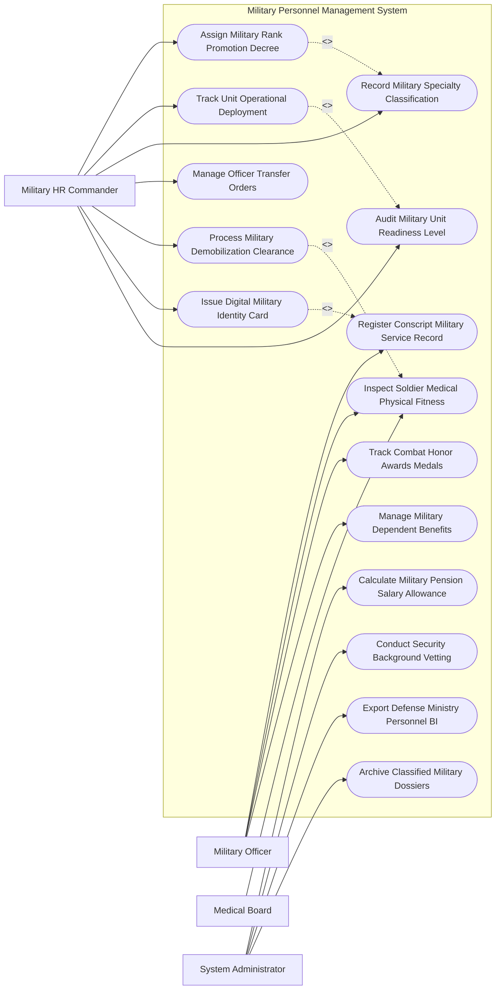

# Use Case Diagram — Military Personnel Management System

## Mermaid Code

## Actor Table | Bảng Actor

| # | Actor | Actor Type | Role Description | Related Use Cases |
|---|-------|------------|------------------|-------------------|
| 1 | Military Officer | Primary | Sĩ quan, chiến sĩ cập nhật thông tin cá nhân, xem khen thưởng và đăng ký thân nhân | UC01, UC06, UC10, UC12 |
| 2 | Military HR Commander | Primary | Cán bộ Quân lực quyết định thăng cấp bậc hàm, điều động đơn vị và giải quyết xuất ngũ | UC02, UC03, UC04, UC05, UC08, UC09, UC11 |
| 3 | Medical Board | Secondary | Hội đồng quân y kiểm tra sức khỏe, phân loại thể lực quân nhân | UC06 |
| 4 | System Administrator | System | Quản trị viên bảo mật thẩm tra chính trị, tính lương quân đội và lưu trữ hồ sơ mật | UC07, UC13, UC14, UC15 |

## Use Case Table | Bảng Use Case

| # | UC ID | Use Case Name | Primary Actor | Secondary Actor | Description | Priority |
|---|-------|---------------|---------------|-----------------|-------------|----------|
| 1 | UC01 | Register Conscript Military Service Record | Soldier | Commander | Đăng ký hồ sơ công dân nhập ngũ nghĩa vụ quân sự và cấp Mã quân nhân | High |
| 2 | UC02 | Assign Military Rank Promotion Decree | Commander | BQP | Ban hành quyết định thăng quân hàm sĩ quan, quân nhân chuyên nghiệp theo niên hạn | High |
| 3 | UC03 | Track Unit Operational Deployment | Commander | UnitLead | Quản lý biên chế quân số và điều động đơn vị sẵn sàng chiến đấu (SSCD) | High |
| 4 | UC04 | Record Military Specialty Classification | Commander | TrainingStaff | Quản lý mã nhóm ngành đào tạo quân sự (SQ Lục quân, Hải quân, Phòng không, Công binh) | High |
| 5 | UC05 | Manage Officer Transfer Orders | Commander | - | Luân chuyển, điều động sĩ quan giữa các Quân khu, Quân đoàn, Binh chủng | High |
| 6 | UC06 | Inspect Soldier Medical Physical Fitness | Medical | Soldier | Kiểm tra sức khỏe quân y hàng năm, phân loại thể lực 1-6 và chẩn đoán bệnh | High |
| 7 | UC07 | Calculate Military Pension Salary Allowance | Admin | Payroll | Tự động tính lương, phụ cấp quân hàm, phụ cấp thâm niên và phụ cấp đặc thù | High |
| 8 | UC08 | Process Military Demobilization Clearance | Commander | VeteranBureau | Giải quyết thủ tục quân nhân xuất ngũ, chuyển ngành hoặc nghỉ hưu theo chế độ | High |
| 9 | UC09 | Issue Digital Military Identity Card | Commander | Soldier | Cấp Thẻ quân nhân điện tử tích hợp chíp mã hóa bảo mật quốc phòng | High |
| 10 | UC10 | Track Combat Honor Awards Medals | Soldier | Commander | Ghi nhận Huân chương, Huy chương, Chiến sĩ thi đua và khen thưởng lập công | Medium |
| 11 | UC11 | Audit Military Unit Readiness Level | Commander | BQP | Kiểm toán tỷ lệ quân số hiện diện thực tế đảm bảo hệ số sẵn sàng chiến đấu | High |
| 12 | UC12 | Manage Military Dependent Benefits | Soldier | - | Quản lý chính sách hậu phương quân đội (BHYT thân nhân sĩ quan, nhà ở công vụ) | Medium |
| 13 | UC13 | Conduct Security Background Vetting | Admin | SecurityAgency | Thẩm tra tiêu chuẩn trị an, lịch sử chính trị gia đình của sĩ quan | High |
| 14 | UC14 | Export Defense Ministry Personnel BI | Admin | BQP | Trích xuất báo cáo tổng quan lực lượng quân số nộp Bộ trưởng Bộ Quốc phòng | Low |
| 15 | UC15 | Archive Classified Military Dossiers | Admin | DefenseArchives | Mã hóa và lưu trữ bảo mật hồ sơ sĩ quan theo cấp độ Mật quốc phòng | Low |

## Use Case Specification | Đặc tả Use Case

---

### UC01 — Register Conscript Military Service Record

| Field | Detail |
|-------|--------|
| **UC ID** | UC01 |
| **Use Case Name** | Register Conscript Military Service Record |
| **Actor(s)** | Primary: Military Officer (Chiến sĩ) / Secondary: Military HR Commander |
| **Description** | Tiếp nhận và đăng ký hồ sơ công dân trúng tuyển nghĩa vụ quân sự nhập ngũ vào các đơn vị quân đội. |
| **Precondition** | 1. Công dân nam trong độ tuổi 18-27 đã qua khám tuyển sức khỏe nghĩa vụ quân sự đạt chuẩn. |
| **Main Flow** | 1. Cán bộ Ban Quân lực nhập Mã định danh VNeID của thanh niên trúng tuyển nhập ngũ.   2. System tự động liên kết CSDL Dân cư lấy thông tin lý lịch (Họ tên, Ngày sinh, Quê quán, Học vấn).   3. Cán bộ nhập đơn vị tiếp nhận (Quân đoàn, Sư đoàn, Trung đoàn, Đại đội tân binh).   4. System khởi tạo Mã số Quân nhân (Military Serial Number) duy nhất.   5. Cán bộ nhập kết quả kiểm tra sức khỏe tân binh giao nhận quân (UC06).   6. System khởi tạo Hồ sơ quân nhân điện tử (Military E-Dossier).   7. System tự động xuất Bảng danh sách tân binh nhập ngũ và phát hành Thẻ quân nhân (UC09). |
| **Alternative Flow** | **AF1** — Đăng ký Học viên các Trường Quân đội: Nhập kết quả thi tuyển sinh quân sự, System xếp vào luồng đào tạo Sĩ quan dự bị. |
| **Exception Flow** | **EX1** — Tân binh bù đổi do không đủ sức khỏe khi giao nhận quân: Cán bộ lập biên bản bù đổi, System loại khỏi danh sách và trả về địa phương. |
| **Postcondition** | Công dân chính thức trở thành quân nhân, quân số được ghi nhận vào biên chế đơn vị. |
| **Business Rule** | **BR1**: Mỗi quân nhân bắt buộc phải được cấp một Mã số Quân nhân duy nhất không trùng lặp trong suốt thời gian tại ngũ. |

---

### UC02 — Assign Military Rank Promotion Decree

| Field | Detail |
|-------|--------|
| **UC ID** | UC02 |
| **Use Case Name** | Assign Military Rank Promotion Decree |
| **Actor(s)** | Primary: Military HR Commander / Secondary: Ministry of National Defense (BQP) |
| **Description** | Thẩm định và ban hành Quyết định thăng cấp bậc hàm cho sĩ quan, quân nhân chuyên nghiệp theo niên hạn hoặc vượt cấp do lập công. |
| **Precondition** | 1. Sĩ quan/Quân nhân đến niên hạn xét thăng cấp bậc hàm (Ví dụ: Trung úy lên Đại úy là 03 năm).   2. Đạt tiêu chuẩn phân loại cán bộ và tiêu chuẩn chính trị. |
| **Main Flow** | 1. System chạy tiến trình rà soát danh sách cán bộ đến niên hạn thăng cấp bậc hàm trong năm.   2. HRCommander mở danh sách đề nghị thăng quân hàm.   3. System kiểm tra điều kiện: $Niên\_hạn \ge Quy\_định$, $Chức\_vụ \ge Trần\_quân\_hàm\_chức\_vụ$, Kết quả đánh giá "Hoàn thành tốt nhiệm vụ trở lên".   4. HRCommander trình Hội đồng Cán bộ duyệt danh sách thăng quân hàm.   5. Bộ trưởng Bộ Quốc phòng hoặc Tư lệnh Quân khu ký số Quyết định thăng cấp bậc hàm.   6. System tự động cập nhật Cấp bậc hàm mới (Ví dụ: Từ Thượng úy lên Đại úy) vào Hồ sơ quân nhân.   7. System tự động tính toán điều chỉnh mức phụ cấp quân hàm mới trên bảng lương (UC07). |
| **Alternative Flow** | **AF1** — Thăng quân hàm trước thời hạn: HRCommander đính kèm Quyết định khen thưởng Huân chương chiến công, System cho phép thăng cấp trước niên hạn 01 năm. |
| **Exception Flow** | **EX1** — Cán bộ đang trong thời gian thi hành kỷ luật: System tự động kéo dài niên hạn thăng cấp 01 năm và thông báo lý do cho HRCommander. |
| **Postcondition** | Quân hàm mới có hiệu lực pháp lý, chế độ tiền lương phụ cấp mới được tự động áp dụng. |
| **Business Rule** | **BR1**: Cấp bậc hàm của sĩ quan không được vượt quá Trần quân hàm cao nhất quy định cho chức vụ đảm nhiệm. |

---

### UC03 — Track Unit Operational Deployment

| Field | Detail |
|-------|--------|
| **UC ID** | UC03 |
| **Use Case Name** | Track Unit Operational Deployment |
| **Actor(s)** | Primary: Military HR Commander / Secondary: Defense Ministry |
| **Description** | Quản lý biến động quân số, tình trạng hiện diện thực tế và điều động các đơn vị thực hiện nhiệm vụ Sẵn sàng Chiến đấu (SSCD), diễn tập, cứu hộ. |
| **Precondition** | 1. Biên chế quân số của các đơn vị đã được cập nhật đầy đủ (UC01, UC05). |
| **Main Flow** | 1. HRCommander mở Bảng điều khiển Quản lý Quân số và Trạng thái Sẵn sàng Chiến đấu.   2. System hiển thị biểu đồ quân số theo đơn vị (Sư đoàn, Trung đoàn, Tiểu đoàn, Đại đội): Số quân số biên chế, Số hiện diện, Số đi công tác, Số nằm viện, Số nghỉ phép.   3. HRCommander kiểm tra Tỷ lệ quân số hiện diện thực tế ($Quân\_số\_SSCD = \frac{Hiện\_diện}{Biên\_chế} \times 100\%$).   4. System so sánh với Hệ số SSCD quy định (Ví dụ: Đơn vị chủ lực bắt buộc $Quân\_số\_SSCD \ge 95\%$).   5. HRCommander ra Lệnh điều động đơn vị thực hiện nhiệm vụ (Diễn tập, Phòng chống thiên tai, Trực chiến).   6. System tự động cập nhật trạng thái "Đang thực hiện nhiệm vụ cơ động" cho đơn vị.   7. System xuất báo cáo tình hình quân số trực chiến nộp Bộ Tổng Tham mưu (UC14). |
| **Alternative Flow** | **AF1** — Báo động kiểm tra quân số đột xuất: HRCommander phát lệnh báo động, chỉ huy đơn vị quét điểm danh quân số tại chỗ bằng thiết bị di động. |
| **Exception Flow** | **EX1** — Tỷ lệ quân số hiện diện rớt xuống dưới 90%: System bật cảnh báo Đỏ "Vi phạm hệ số SSCD", yêu cầu chỉ huy đơn vị triệu tập lực lượng nghỉ phép về đơn vị gấp. |
| **Postcondition** | Nắm chắc tình hình quân số thực tế 24/7, bảo đảm khả năng cơ động chiến đấu của quân đội. |
| **Business Rule** | **BR1**: Thông tin vị trí điều động và quân số trực chiến của các đơn vị phải được bảo mật tuyệt đối theo Luật Bảo vệ Bí mật Nhà nước. |

---

### UC06 — Inspect Soldier Medical Physical Fitness

| Field | Detail |
|-------|--------|
| **UC ID** | UC06 |
| **Use Case Name** | Inspect Soldier Medical Physical Fitness |
| **Actor(s)** | Primary: Military Medical Board / Secondary: Military Officer |
| **Description** | Tổ chức khám sức khỏe định kỳ hàng năm cho quân nhân, phân loại thể lực 1-6 và quản lý hồ sơ bệnh án quân y. |
| **Precondition** | 1. Kế hoạch khám sức khỏe định kỳ của đơn vị được duyệt. |
| **Main Flow** | 1. MedicalBoard mở Phân hệ Khám sức khỏe Quân y.   2. Quân nhân xuất trình Thẻ quân nhân QR (UC09) để điểm danh vào phòng khám.   3. Các bác sĩ quân y tiến hành khám chuyên khoa: Nội, Ngoại, Mắt, Tai Mũi Họng, Răng Hàm Mặt, Tâm thần thần kinh và Chẩn đoán hình ảnh.   4. Bác sĩ nhập chỉ số sinh hiệu (Chiều cao, cân nặng, huyết áp, thị lực) và chẩn đoán bệnh vào hồ sơ.   5. System tự động áp dụng Tiêu chuẩn sức khỏe quân sự (Thông tư liên tịch BQP-BYT) để xếp loại sức khỏe (Loại 1: Rất tốt, Loại 2: Tốt, ..., Loại 6: Không đủ sức khỏe).   6. Chủ tịch Hội đồng Y khoa ký số phê duyệt Phiếu phân loại sức khỏe quân nhân.   7. System tự động cập nhật sức khỏe vào Hồ sơ quân nhân và gửi cảnh báo đối với quân nhân có sức khỏe Loại 5, 6 cần chuyển công tác hoặc điều trị. |
| **Alternative Flow** | **AF1** — Khám sức khỏe phi công, thợ lặn, đặc công: System áp dụng tiêu chuẩn kiểm tra thể lực đặc chủng khắt khe riêng. |
| **Exception Flow** | **EX1** — Phát hiện quân nhân mắc bệnh hiểm nghèo/bệnh nghề nghiệp: Hội đồng Y khoa lập hồ sơ chuyển viện Quân y tuyến trên điều trị và làm thủ tục giám định thương tật. |
| **Postcondition** | Hồ sơ sức khỏe quân y được cập nhật, làm căn cứ xét thăng quân hàm, quy hoạch cán bộ và phân công nhiệm vụ. |
| **Business Rule** | **BR1**: 100% quân nhân tại ngũ bắt buộc phải được kiểm tra phân loại sức khỏe định kỳ tối thiểu 01 lần/năm. |

---

### UC08 — Process Military Demobilization Clearance

| Field | Detail |
|-------|--------|
| **UC ID** | UC08 |
| **Use Case Name** | Process Military Demobilization Clearance |
| **Actor(s)** | Primary: Military HR Commander / Secondary: Veteran Affairs Bureau |
| **Description** | Giải quyết thủ tục cho hạ sĩ quan, chiến sĩ hoàn thành nghĩa vụ quân sự xuất ngũ hoặc sĩ quan nghỉ hưu, chuyển ngành. |
| **Precondition** | 1. Chiến sĩ hết thời hạn phục vụ tại ngũ 24 tháng hoặc Sĩ quan đến tuổi nghỉ hưu. |
| **Main Flow** | 1. HRCommander mở danh sách quân nhân đến đợt xuất ngũ/nghỉ hưu.   2. System kiểm tra hoàn thành các nghĩa vụ: Đã bàn giao vũ khí quân trang, đã thanh quyết toán tài chính, không có án kỷ luật pending.   3. System tự động tính toán các chế độ được hưởng khi xuất ngũ:   - Trợ cấp xuất ngũ một lần (Mỗi năm phục vụ = 2 tháng tiền lương cơ sở).   - Trợ cấp tạo việc làm (6 tháng tiền lương cơ sở).   - Cấp Thẻ học nghề miễn phí cho hạ sĩ quan chiến sĩ.   4. HRCommander trình Lãnh đạo ký duyệt Quyết định xuất ngũ / Quyết định nghỉ hưu.   5. System phát hành Quyết định xuất ngũ điện tử và Giấy giới thiệu về địa phương.   6. System tự động chuyển dữ liệu quân nhân xuất ngũ sang CSDL Đăng ký Quân dự bị (VNeID) và Cục Chính sách (Veteran Bureau).   7. Chuyển trạng thái quân nhân thành "Đã xuất ngũ - Chuyển sang ngạch Quân dự bị". |
| **Alternative Flow** | **AF1** — Sĩ quan chuyển ngành sang cơ quan hành chính nhà nước: System bảo lưu số năm đóng BHXH quân đội và chuyển hồ sơ sang CSDL Công chức. |
| **Exception Flow** | **EX1** — Quân nhân bị kỷ luật tước danh hiệu quân nhân: System lập Quyết định tước danh hiệu, không cấp trợ cấp xuất ngũ và gửi thông báo về Công an địa phương. |
| **Postcondition** | Quân nhân hoàn thành xuất ngũ, được đăng ký vào lực lượng dự bị động viên tại địa phương. |
| **Business Rule** | **BR1**: Quyết định xuất ngũ và các chế độ trợ cấp phải được giao tận tay quân nhân trước ngày xuất ngũ 05 ngày. |
