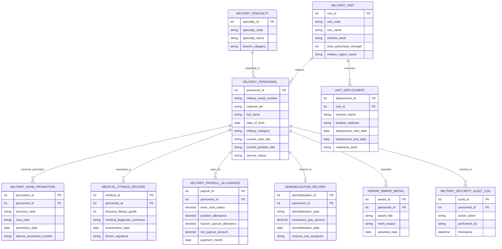

# Conceptual ERD — Military Personnel Management System

## Mermaid Code

## Entity Description Table | Bảng mô tả Entity

| # | Entity Name | Vietnamese Name | Description | Key Attributes | Main Relationships |
|---|-------------|-----------------|-------------|----------------|-------------------|
| 1 | MILITARY_PERSONNEL | Quân nhân Quân đội | Thông tin nhân thân, mã số quân nhân, quân hàm và vị trí công tác | personnel_id, military_serial_number, full_name, current_rank_title, service_status | Stationed in UNIT, receives PROMOTION, paid via PAYROLL |
| 2 | MILITARY_UNIT | Đơn vị Quân đội | Danh mục các cơ quan, đơn vị quân sự (Bộ Tư lệnh, Quân đoàn, Sư đoàn, Trung đoàn) | unit_id, unit_code, unit_name, echelon_level, total_authorized_strength | Stations MILITARY_PERSONNEL, executes UNIT_DEPLOYMENT |
| 3 | MILITARY_RANK_PROMOTION | Quyết định Thăng Quân hàm | Hồ sơ thăng cấp bậc hàm sĩ quan, quân nhân chuyên nghiệp theo niên hạn | promotion_id, previous_rank, new_rank, promotion_date, decree_document_number | Belongs to MILITARY_PERSONNEL |
| 4 | UNIT_DEPLOYMENT | Điều động Đơn vị Tác chiến | Nhật ký phân công đơn vị cơ động thực hiện nhiệm vụ SSCD, diễn tập, cứu hộ | deployment_id, mission_name, location_address, deployment_start_date, readiness_level | Belongs to MILITARY_UNIT |
| 5 | MILITARY_SPECIALTY | Chuyên ngành Quân sự (MOS) | Phân loại nhóm ngành chuyên môn quân sự (Lục quân, Hải quân, Không quân, Thông tin) | specialty_id, specialty_code, specialty_name, branch_category | Classified in MILITARY_PERSONNEL |
| 6 | MEDICAL_FITNESS_RECORD | Phiếu Khám Sức khỏe Quân y | Hồ sơ kiểm tra thể lực định kỳ (loại 1-6) và tiền sử bệnh tật quân y | medical_id, physical_fitness_grade, medical_diagnosis_summary, examination_date | Belongs to MILITARY_PERSONNEL |
| 7 | MILITARY_PAYROLL_ALLOWANCE | Bảng Lương & Phụ cấp Quân đội | Chi tiết tiền lương theo quân hàm, phụ cấp thâm niên và phụ cấp đặc thù quân binh chủng | payroll_id, base_rank_salary, position_allowance, hazard_special_allowance, payment_month | Belongs to MILITARY_PERSONNEL |
| 8 | DEMOBILIZATION_RECORD | Hồ sơ Xuất ngũ / Nghỉ hưu | Quyết định xuất ngũ, chế độ trợ cấp một lần và phân công đơn vị dự bị | demobilization_id, demobilization_type, severance_pay_amount, reserve_unit_assigned | Belongs to MILITARY_PERSONNEL |
| 9 | HONOR_AWARD_MEDAL | Khen thưởng & Khen tặng | Danh mục Huân chương, Huy chương, danh hiệu Thi đua quân nhân lập công | award_id, award_title, merit_reason, awarded_date | Belongs to MILITARY_PERSONNEL |
| 10 | MILITARY_SECURITY_AUDIT_LOG | Nhật ký Kiểm toán Bảo mật | Lưu vết toàn bộ thao tác truy cập hồ sơ mật quân đội, thẩm tra an ninh | audit_id, action_taken, performed_by, timestamp | Belongs to MILITARY_PERSONNEL |

## Relationship Description | Mô tả Quan hệ

| # | From Entity | Cardinality | To Entity | Relationship Label | Business Explanation |
|---|-------------|-------------|-----------|-------------------|----------------------|
| 1 | MILITARY_UNIT | one-to-many | MILITARY_PERSONNEL | stations | Một đơn vị quân đội quản lý biên chế nhiều cán bộ chiến sĩ quân nhân |
| 2 | MILITARY_PERSONNEL | one-to-many | MILITARY_RANK_PROMOTION | receives_promotion | Một quân nhân nhận nhiều quyết định thăng cấp bậc hàm trong sự nghiệp |
| 3 | MILITARY_UNIT | one-to-many | UNIT_DEPLOYMENT | executes | Một đơn vị thực hiện nhiều đợt điều động cơ động tác chiến SSCD |
| 4 | MILITARY_SPECIALTY | one-to-many | MILITARY_PERSONNEL | classified_in | Một chuyên ngành quân sự phân loại cho nhiều quân nhân |
| 5 | MILITARY_PERSONNEL | one-to-many | MEDICAL_FITNESS_RECORD | examined_in | Một quân nhân trải qua nhiều đợt kiểm tra sức khỏe quân y hàng năm |
| 6 | MILITARY_PERSONNEL | one-to-many | MILITARY_PAYROLL_ALLOWANCE | paid_via | Một quân nhân nhận bảng chi trả tiền lương và phụ cấp hàng tháng |
| 7 | MILITARY_PERSONNEL | one-to-one | DEMOBILIZATION_RECORD | cleared_in | Mỗi quân nhân kết thúc thời gian tại ngũ bằng duy nhất một Hồ sơ xuất ngũ |
| 8 | MILITARY_PERSONNEL | one-to-many | HONOR_AWARD_MEDAL | awarded | Một quân nhân có thể được trao tặng nhiều huân chương khen thưởng chiến công |
| 9 | MILITARY_PERSONNEL | one-to-many | MILITARY_SECURITY_AUDIT_LOG | tracked_in | Mọi thao tác trên hồ sơ quân nhân được ghi lại nhật ký kiểm toán mật bất biến |
