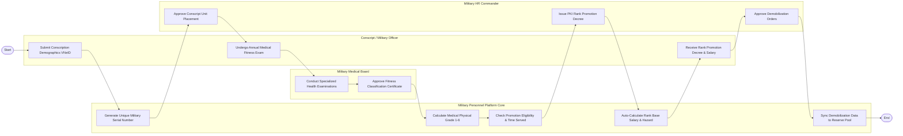

# Swimlane Diagram — Military Personnel Management System

## Mermaid Code

## Flow Description | Mô tả luồng

| Lane | Actor | Role in Flow |
|------|-------|-------------|
| 1 | Conscript / Military Officer | Đăng ký thông tin nghĩa vụ quân sự, kiểm tra sức khỏe quân y hàng năm, nhận quyết định thăng quân hàm và lương. |
| 2 | Military Personnel Platform Core | Tự động sinh Mã số quân nhân duy nhất, phân loại thể lực quân y, kiểm tra tiêu chuẩn thăng cấp, tự động tính lương và đồng bộ dự bị động viên. |
| 3 | Military Medical Board | Khám kiểm tra các chuyên khoa y tế, chẩn đoán sức khỏe và ký sổ phê duyệt Giấy chứng nhận phân loại thể lực. |
| 4 | Military HR Commander | Duyệt phân công quân số về các đơn vị, ký số Quyết định thăng cấp bậc hàm và phê duyệt Quyết định xuất ngũ. |
