# Action Tree — Military Personnel Management System

## Mermaid Code

```mermaid
graph TD
    Root["Military Personnel Management System"]

    Root --> M1["Conscription & Personnel Records"]
    Root --> M2["Rank Promotion & Officer Career"]
    Root --> M3["Unit Deployment & Operational Readiness"]
    Root --> M4["Medical Fitness & Military Payroll"]
    Root --> M5["Demobilization & Veteran Benefits"]
    Root --> M6["Defense BI & Classified Audit"]

    M1 --> A11["Register Conscript Military Service Records"]
    M1 --> A12["Generate Unique Military Serial Numbers"]
    M1 --> A13["Issue Digital Military Identity Cards"]
    M1 --> A14["Classify Military Specialties MOS"]

    M2 --> A21["Assign Military Rank Promotion Decrees"]
    M2 --> A22["Manage Officer Transfer Mobility Orders"]
    M2 --> A23["Track Combat Honor Awards Medals"]
    M2 --> A24["Evaluate Officer Annual Performance"]

    M3 --> A31["Track Unit Operational Deployment"]
    M3 --> A32["Audit Military Unit Readiness Levels"]
    M3 --> A33["Manage Unit Authorized Staffing Rosters"]
    M3 --> A34["Trigger Emergency Readiness Alerts"]

    M4 --> A41["Inspect Soldier Medical Physical Fitness"]
    M4 --> A42["Classify Health Grades 1 to 6"]
    M4 --> A43["Calculate Military Base Rank Salaries"]
    M4 --> A44["Disburse Branch Hazard Special Allowances"]

    M5 --> A51["Process Military Demobilization Clearances"]
    M5 --> A52["Calculate Demobilization Severance Pay"]
    M5 --> A53["Sync Reserve Forces Database VNeID"]
    M5 --> A54["Manage Military Dependent Health Benefits"]

    M6 --> A61["Conduct Security Background Vetting"]
    M6 --> A62["Export Defense Ministry Personnel BI"]
    M6 --> A63["Archive Classified Military E-Dossiers"]
    M6 --> A64["Log System Immutable Encrypted Audits"]
```

## Module Description | Mô tả Module

| # | Module | Description | Actions |
|---|--------|-------------|---------|
| 1 | Conscription & Personnel Records | Đăng ký nghĩa vụ quân sự, tự động sinh mã số quân nhân duy nhất, cấp thẻ quân nhân điện tử và phân loại ngành quân sự | Register Conscript Military Service Records, Generate Unique Military Serial Numbers, Issue Digital Military Identity Cards, Classify Military Specialties MOS |
| 2 | Rank Promotion & Officer Career | Thẩm định thăng cấp bậc hàm sĩ quan/QNCNDP theo niên hạn, luân chuyển cán bộ, ghi nhận huân chương khen thưởng và đánh giá | Assign Military Rank Promotion Decrees, Manage Officer Transfer Mobility Orders, Track Combat Honor Awards Medals, Evaluate Officer Annual Performance |
| 3 | Unit Deployment & Operational Readiness | Giám sát biến động quân số các đơn vị, kiểm toán hệ số sẵn sàng chiến đấu (SSCD), quản lý biên chế và phát lệnh cơ động | Track Unit Operational Deployment, Audit Military Unit Readiness Levels, Manage Unit Authorized Staffing Rosters, Trigger Emergency Readiness Alerts |
| 4 | Medical Fitness & Military Payroll | Kiểm tra sức khỏe quân y hàng năm, phân loại thể lực loại 1-6, tự động tính lương theo quân hàm và phụ cấp đặc thù | Inspect Soldier Medical Physical Fitness, Classify Health Grades 1 to 6, Calculate Military Base Rank Salaries, Disburse Branch Hazard Special Allowances |
| 5 | Demobilization & Veteran Benefits | Giải quyết thủ tục quân nhân xuất ngũ/nghỉ hưu, tính trợ cấp xuất ngũ, đồng bộ lực lượng dự bị động viên và bảo hiểm thân nhân | Process Military Demobilization Clearances, Calculate Demobilization Severance Pay, Sync Reserve Forces Database VNeID, Manage Military Dependent Health Benefits |
| 6 | Defense BI & Classified Audit | Thẩm tra an ninh chính trị cán bộ, trích xuất báo cáo nhân sự nộp Bộ trưởng BQP, lưu trữ hồ sơ mật và kiểm toán bất biến | Conduct Security Background Vetting, Export Defense Ministry Personnel BI, Archive Classified Military E-Dossiers, Log System Immutable Encrypted Audits |
