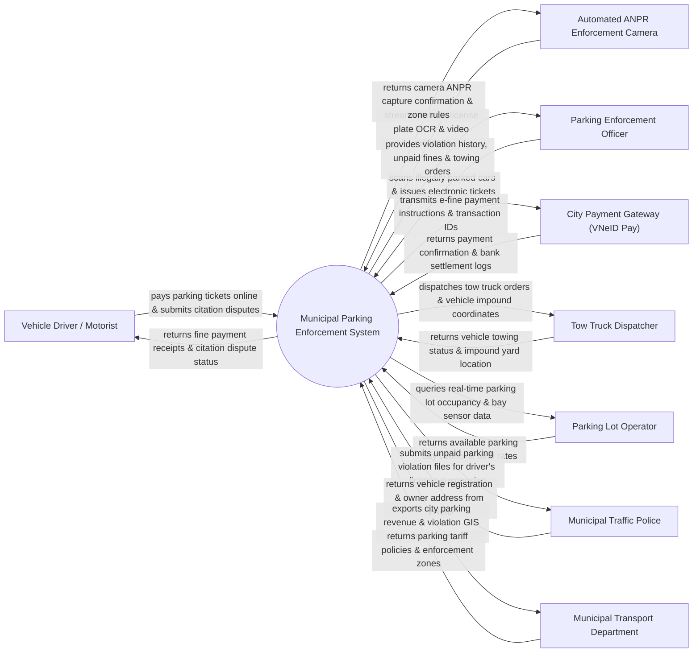

# Context Diagram — Municipal Parking Enforcement System

## Mermaid Code

## Actor & Interaction Table | Bảng Actor & Tương tác

| # | Actor | Actor Type | Data Sent TO System | Data Received FROM System | Notes |
|---|-------|------------|---------------------|---------------------------|-------|
| 1 | Vehicle Driver / Motorist | Primary | Parking fine payments, citation dispute petitions, e-permit requests | Electronic citation tickets, payment receipts, parking bay maps | Lái xe vi phạm dừng đỗ sai quy định hoặc quá giờ tại đô thị |
| 2 | Parking Enforcement Officer | Primary | Scanned violation photos, mobile citation entries, wheel clamp status | Vehicle owner info, unpaid citation history, towing dispatch orders | Đội Thanh tra Giao thông / Đội Trật tự Đô thị phạt đỗ xe |
| 3 | Automated ANPR Enforcement Camera | Supporting | Vehicle license plate OCR, video evidence, timestamp | ANPR capture confirmation, zone parking rules | Camera AI thông minh nhận diện biển số xe vi phạm dừng đỗ |
| 4 | City Payment Gateway (VNeID Pay) | Supporting | Fine payment confirmation, bank transfer settlement logs | E-fine payment instruction details, fee amounts | Cổng thanh toán trực tuyến phạt nguội đô thị |
| 5 | Tow Truck Dispatcher | Primary | Vehicle towing status, impound yard receipt, towing fee logs | Towing dispatch orders, vehicle GPS location, impound bay | Đội xe cẩu cẩu kéo phương tiện vi phạm về bãi giữ |
| 6 | Parking Lot Operator | Supporting | Real-time parking bay occupancy count, sensor status | Street parking tariff rules, operator license status | Đơn vị vận hành bãi đỗ xe và lề đường đô thị |
| 7 | Municipal Traffic Police | Regulatory | Vehicle registration metadata, owner home address from VNeID | Unpaid parking violation records, driver license suspension files | Phòng Cảnh sát Giao thông đường bộ công an thành phố |
| 8 | Municipal Transport Department | Regulatory | Parking tariff policies, designated parking zone maps | City parking revenue analytics, violation GIS heatmaps | Sở Giao thông Vận tải quy định giá phí và vùng phạt đỗ xe |

## System Boundary Description | Mô tả Phạm vi Hệ thống

Hệ thống Municipal Parking Enforcement System (Hệ thống Xử lý Vi phạm Đỗ xe và Phạt nguội Đô thị) chịu trách nhiệm tự động hóa quy trình phát hiện và xử lý vi phạm dừng đỗ xe trái phép: Nhận diện biển số xe vi phạm bằng camera AI ANPR (Automatic Number Plate Recognition), lập biên bản phạt nguội điện tử, khóa bánh xe (Wheel Clamp) hoặc cẩu xe về bãi tạm giữ đối với các trường hợp cản trở giao thông, thanh toán tiền phạt trực tuyến qua VNeID Pay, quản lý giấy phép đỗ xe cư dân (e-Permit) và công khai bản đồ bãi đỗ xe trống. Tuy nhiên, hệ thống KHÔNG trực tiếp vận hành xe cẩu cứu hộ và KHÔNG thay thế việc cưỡng chế trực tiếp của lực lượng Cảnh sát Giao thông.
