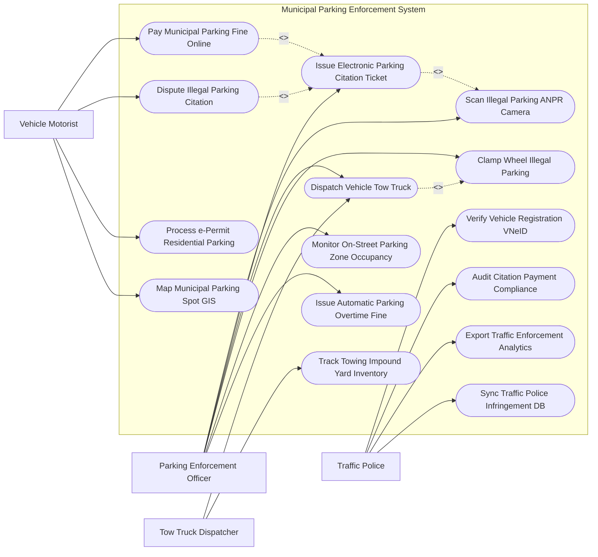

# Use Case Diagram — Municipal Parking Enforcement System

## Mermaid Code

## Actor Table | Bảng Actor

| # | Actor | Actor Type | Role Description | Related Use Cases |
|---|-------|------------|------------------|-------------------|
| 1 | Vehicle Motorist | Primary | Lái xe vi phạm trả tiền phạt nguội trực tuyến, khiếu nại phiếu phạt, xin cấp e-Permit và tra cứu chỗ đỗ | UC03, UC07, UC09, UC12 |
| 2 | Parking Enforcement Officer | Primary | Thanh tra giao thông phát hiện vi phạm qua camera AI, lập e-Ticket, khóa bánh xe và phạt quá giờ | UC01, UC02, UC04, UC05, UC06, UC11 |
| 3 | Tow Truck Dispatcher | Primary | Lực lượng xe cẩu tiếp nhận lệnh cẩu xe vi phạm về bãi và quản lý bãi tạm giữ phương tiện | UC04, UC13 |
| 4 | Traffic Police | Secondary | Cảnh sát giao thông đối soát dữ liệu đăng ký xe VNeID, xử lý nợ tiền phạt và đồng bộ phạt nguội | UC08, UC10, UC14, UC15 |

## Use Case Table | Bảng Use Case

| # | UC ID | Use Case Name | Primary Actor | Secondary Actor | Description | Priority |
|---|-------|---------------|---------------|-----------------|-------------|----------|
| 1 | UC01 | Scan Illegal Parking ANPR Camera | Officer, Camera | System | Camera AI tự động quét biển số xe đỗ dừng trái phép hoặc đỗ sai làn đường | High |
| 2 | UC02 | Issue Electronic Parking Citation Ticket | Officer | Motorist | Lập Biên bản phạt nguội điện tử đính kèm hình ảnh minh chứng và mã QR phạt | High |
| 3 | UC03 | Pay Municipal Parking Fine Online | Motorist | PaymentGateway | Lái xe thanh toán tiền phạt đỗ xe trực tuyến qua VNeID Pay / Ví điện tử | High |
| 4 | UC04 | Dispatch Vehicle Tow Truck | Officer, Tow | Dispatcher | Điều động xe cẩu chuyên dụng cẩu xe vi phạm cản trở giao thông về bãi tạm giữ | High |
| 5 | UC05 | Clamp Wheel Illegal Parking | Officer | Motorist | Thực hiện khóa bánh xe (Wheel Clamp) đối với các phương tiện đỗ sai quy định | High |
| 6 | UC06 | Monitor On-Street Parking Zone Occupancy | Officer | Sensor Engine | Giám sát mật độ đỗ xe lề đường thời gian thực từ cảm biến từ lòng đường | High |
| 7 | UC07 | Dispute Illegal Parking Citation | Motorist | Officer | Tiếp nhận và xử lý khiếu nại của lái xe đối với phiếu phạt nguội bị đỗ sai | Medium |
| 8 | UC08 | Verify Vehicle Registration VNeID | Police | VNeID | Truy vấn CSDL Đăng ký xe và Dân cư để xác định chủ sở hữu phương tiện vi phạm | High |
| 9 | UC09 | Process e-Permit Residential Parking | Motorist | CityCouncil | Đăng ký và cấp Giấy phép đỗ xe cư dân điện tử (e-Permit) cho cư dân sinh sống | Medium |
| 10 | UC10 | Audit Citation Payment Compliance | Police | TaxAgency | Kiểm toán tỷ lệ nộp phạt, phát lệnh từ chối đăng kiểm đối với xe nợ tiền phạt | High |
| 11 | UC11 | Issue Automatic Parking Overtime Fine | Officer | System | Tự động phạt tiền đỗ xe quá giờ so với thời gian đã trả tiền qua ứng dụng | High |
| 12 | UC12 | Map Municipal Parking Spot GIS | Motorist | GIS Engine | Trực quan hóa bản đồ GIS hiển thị các ô đỗ xe còn trống trên đường phố | Medium |
| 13 | UC13 | Track Towing Impound Yard Inventory | Tow | Police | Quản lý danh sách phương tiện đang bị tạm giữ tại bãi xe cẩu và tiền lưu bãi | Medium |
| 14 | UC14 | Export Traffic Enforcement Analytics | Police | TransportDept | Trích xuất báo cáo bản đồ nhiệt các điểm nóng vi phạm đỗ xe đô thị | Low |
| 15 | UC15 | Sync Traffic Police Infringement DB | System | TrafficPoliceDB | Đồng bộ dữ liệu vi phạm đỗ xe về CSDL Xử lý Vi phạm Giao thông Quốc gia | High |

## Use Case Specification | Đặc tả Use Case

---

### UC01 — Scan Illegal Parking ANPR Camera

| Field | Detail |
|-------|--------|
| **UC ID** | UC01 |
| **Use Case Name** | Scan Illegal Parking ANPR Camera |
| **Actor(s)** | Primary: Parking Enforcement Officer, ANPR Camera / Secondary: System |
| **Description** | Camera AI gắn cố định trên phố hoặc xe tuần tra tự động nhận diện biển số xe đỗ dừng trái phép và ghi nhận video minh chứng. |
| **Precondition** | 1. Phương tiện dừng đỗ tại khu vực có biển cấm dừng đỗ hoặc đỗ quá thời gian quy định ($> 5$ phút). |
| **Main Flow** | 1. ANPR Camera quét luồng video tuyến đường đỗ xe cấm.   2. Thuật toán AI Computer Vision phát hiện xe dừng đỗ và tự động kích hoạt đồng hồ đếm thời gian.   3. If Thời gian dừng đỗ $> 5$ phút: AI trích xuất biển số xe bằng công nghệ ANPR OCR (Độ chính xác $> 99\%$).   4. System chụp 03 ảnh minh chứng: Ảnh toàn cảnh vị trí đỗ kèm biển cấm, ảnh biển số xe cận cảnh và đoạn video clip 10 giây.   5. System ghi nhận tọa độ GPS, tên tuyến đường và mốc thời gian vi phạm.   6. System tự động kiểm tra xem xe có Giấy phép đỗ xe cư dân (e-Permit - UC09) hay không.   7. If Không có e-Permit: System khởi tạo bản ghi vi phạm đỗ xe và chuyển sang khâu Lập phiếu phạt nguội (UC02). |
| **Alternative Flow** | **AF1** — Cán bộ tuần tra dùng máy tính bảng quét: Officer di chuyển bằng xe máy, dùng camera máy tính bảng quét biển số các xe đỗ lề đường. |
| **Exception Flow** | **EX1** — Biển số xe bị che mờ hoặc quá bẩn: System báo cảnh báo "Biển số không rõ", gửi cảnh báo cho Officer đến kiểm tra và chụp ảnh trực tiếp. |
| **Postcondition** | Bằng chứng vi phạm đỗ xe được ghi nhận đầy đủ, làm căn cứ pháp lý không thể chối cãi để phạt nguội (UC02). |
| **Business Rule** | **BR1**: Biên bản phạt nguội bắt buộc phải có ít nhất 02 ảnh chụp thời gian thực cách nhau tối thiểu 05 phút tại cùng vị trí. |

---

### UC02 — Issue Electronic Parking Citation Ticket

| Field | Detail |
|-------|--------|
| **UC ID** | UC02 |
| **Use Case Name** | Issue Electronic Parking Citation Ticket |
| **Actor(s)** | Primary: Parking Enforcement Officer / Secondary: Vehicle Motorist |
| **Description** | Ban hành Biên bản phạt nguội đỗ xe điện tử (e-Citation), gửi tin nhắn thông báo cho chủ xe và in phiếu dán lên kính xe. |
| **Precondition** | 1. Đã có bằng chứng vi phạm đỗ xe được thu thập từ camera ANPR (UC01). |
| **Main Flow** | 1. Officer mở ứng dụng Xử lý Vi phạm Đỗ xe Đô thị.   2. Officer rà soát ảnh minh chứng, biển số xe và hành vi vi phạm (Ví dụ: Đỗ xe nơi có biển cấm đỗ, Đỗ xe trên vỉa hè, Đỗ xe quá giờ).   3. System kết nối CSDL Đăng ký xe (UC08) trích xuất Họ tên chủ xe, Số điện thoại và Địa chỉ.   4. Officer chọn mức tiền phạt theo Nghị định xử phạt VPHC đường bộ (Ví dụ: 900,000 VND).   5. Officer ký số phát hành Biên bản phạt nguội điện tử (e-Citation).   6. System tự động tạo Mã QR nộp phạt trực tuyến (UC03) và gửi tin nhắn SMS/VNeID thông báo cho Motorist.   7. Officer in Phiếu thông báo vi phạm bằng máy in nhiệt cầm tay và dán lên kính chắn gió trước của xe. |
| **Alternative Flow** | **AF1** — Xe gây cản trở giao thông nghiêm trọng: Officer lập e-Citation đồng thời phát Lệnh cẩu xe về bãi (UC04) hoặc Khóa bánh xe (UC05). |
| **Exception Flow** | **EX1** — Không tìm thấy số điện thoại chủ xe: System tự động gửi Giấy báo phạt nguội qua đường bưu điện theo địa chỉ đăng ký xe VNeID. |
| **Postcondition** | Phạt nguội được ban hành hợp pháp, tài khoản chủ xe nhận được thông báo nộp phạt. |
| **Business Rule** | **BR1**: Tin nhắn thông báo phạt nguội đỗ xe phải được gửi tới chủ xe trong vòng 24 giờ kể từ khi phát hiện vi phạm. |

---

### UC03 — Pay Municipal Parking Fine Online

| Field | Detail |
|-------|--------|
| **UC ID** | UC03 |
| **Use Case Name** | Pay Municipal Parking Fine Online |
| **Actor(s)** | Primary: Vehicle Motorist / Secondary: City Payment Gateway (VNeID Pay) |
| **Description** | Lái xe vi phạm thực hiện quét mã QR nộp tiền phạt đỗ xe trực tuyến nhanh chóng qua Cổng thanh toán thành phố. |
| **Precondition** | 1. Lái xe nhận được Biên bản phạt nguội e-Citation (UC02) hoặc phiếu dán trên kính xe. |
| **Main Flow** | 1. Motorist quét Mã QR in trên Phiếu phạt nguội bằng ứng dụng VNeID Pay / Banking App.   2. System hiển thị thông tin vi phạm: Biển số xe, Lỗi vi phạm, Thời gian, Địa điểm, Ảnh minh chứng và Số tiền phạt.   3. Motorist kiểm tra thông tin và chọn phương thức thanh toán (Thẻ ngân hàng, Ví điện tử, VNeID Pay).   4. Motorist xác thực thanh toán bằng OTP / Biometric FaceID.   5. PaymentGateway thực hiện gạch nợ và chuyển tiền vào Tài khoản Thu Ngân sách Thành phố.   6. System tự động cập nhật trạng thái phiếu phạt thành "Đã nộp phạt thành công - Đóng hồ sơ".   7. System tự động phát hành Biên lai nộp tiền phạt điện tử (E-Receipt PDF) gửi cho Motorist.   8. System xóa tên xe khỏi Danh sách nợ tiền phạt đăng kiểm (UC10). |
| **Alternative Flow** | **AF1** — Nộp phạt trực tiếp tại Bãi tạm giữ xe: Motorist thanh toán cả tiền phạt đỗ xe + tiền cẩu xe + tiền lưu bãi tại quầy thanh toán bãi xe. |
| **Exception Flow** | **EX1** — Giao dịch nộp tiền bị lỗi ngân hàng: System giữ nguyên trạng thái "Chờ nộp phạt", gửi cảnh báo cho Motorist thử lại. |
| **Postcondition** | Nghĩa vụ nộp phạt hoàn thành, tiền phạt được nộp 100% vào ngân sách nhà nước. |
| **Business Rule** | **BR1**: Giảm 10% tiền phạt nếu lái xe thực hiện nộp phạt trực tuyến trong vòng 48 giờ kể từ khi nhận e-Citation. |

---

### UC04 — Dispatch Vehicle Tow Truck

| Field | Detail |
|-------|--------|
| **UC ID** | UC04 |
| **Use Case Name** | Dispatch Vehicle Tow Truck |
| **Actor(s)** | Primary: Parking Enforcement Officer, Tow Truck Dispatcher / Secondary: Traffic Police |
| **Description** | Điều động xe cẩu chuyên dụng đến cẩu xe vi phạm đỗ cản trở giao thông nghiêm trọng về Bãi tạm giữ phương tiện đô thị. |
| **Precondition** | 1. Phương tiện đỗ xe tại các vị trí nguy hiểm (Trước cổng bệnh viện, trên cầu, chắn lối xe chữa cháy).   2. Đã quá 30 phút dán e-Citation mà chủ xe không đến di chuyển xe. |
| **Main Flow** | 1. Officer mở Phân hệ Điều động Xe Cẩu Cứu hộ.   2. Officer bấm "Yêu cầu Cẩu xe vi phạm khẩn cấp", nhập vị trí GPS và biển số xe.   3. System tự động định vị xe cẩu cứu hộ rảnh gần nhất và gửi Đơn điều xe (Tow Dispatch Order) cho TowDispatcher.   4. TowDispatcher điều xe cẩu đến hiện trường vi phạm.   5. Officer và TowDispatcher chụp ảnh niêm phong các cửa xe và lập Biên bản tạm giữ phương tiện.   6. TowDispatcher cẩu xe lên thùng xe cẩu và di chuyển về Bãi tạm giữ phương tiện đô thị (Impound Yard).   7. System tự động gửi SMS thông báo cho chủ xe: "Xe biển số X đã được cẩu về Bãi giữ Y tại địa chỉ Z".   8. TowDispatcher cập nhật trạng thái "Xe đã nhập Bãi tạm giữ" vào CSDL Quản lý bãi xe (UC13). |
| **Alternative Flow** | **AF1** — Chủ xe xuất hiện kịp thời khi xe cẩu đang niêm phong: Officer hủy lệnh cẩu xe, yêu cầu chủ xe nộp phạt đỗ xe + Phí di chuyển xe cẩu tại chỗ. |
| **Exception Flow** | **EX1** — Xe ô tô gầm thấp/xe điện không thể cẩu thông thường: TowDispatcher điều xe cứu hộ sàn trượt chuyên dụng đến hỗ trợ. |
| **Postcondition** | Tuyến đường được giải phóng thông thoáng, xe vi phạm được bảo quản an toàn tại bãi tạm giữ. |
| **Business Rule** | **BR1**: 100% các cửa xe và cốp xe phải được dán tem niêm phong có chữ ký cán bộ trước khi cẩu xe rời khỏi hiện trường. |

---

### UC05 — Clamp Wheel Illegal Parking

| Field | Detail |
|-------|--------|
| **UC ID** | UC05 |
| **Use Case Name** | Clamp Wheel Illegal Parking |
| **Actor(s)** | Primary: Parking Enforcement Officer / Secondary: Vehicle Motorist |
| **Description** | Thực hiện khóa bánh xe ô tô vi phạm bằng thiết bị khóa bánh chuyên dụng (Wheel Clamp) để vô hiệu hóa xe tại chỗ. |
| **Precondition** | 1. Xe đỗ sai quy định tại khu vực cấm đỗ nhưng không gây cản trở giao thông quá nghiêm trọng để phải cẩu xe. |
| **Main Flow** | 1. Officer tiếp cận xe ô tô vi phạm đỗ lề đường.   2. Officer mở ứng dụng di động, quét biển số xe và lập e-Citation (UC02).   3. Officer lắp Thiết bị khóa bánh xe (Wheel Clamp) vào bánh trước bên lái của xe.   4. Officer khóa thiết bị bằng Khóa điện tử IoT.   5. Officer dán Phiếu thông báo khóa bánh màu Đỏ lên cửa kính bên lái (Ghi rõ: "Xe đã bị khóa bánh, quét mã QR nộp phạt để mở khóa").   6. System ghi nhận trạng thái "Xe đang bị khóa bánh tại GPS X".   7. When Motorist quét mã QR nộp phạt trực tuyến (UC03): System kiểm tra đã nhận đủ tiền phạt.   8. System tự động gửi Mã mở khóa IoT (Unlock Code) qua tin nhắn SMS cho Motorist (hoặc gửi lệnh cho Officer gần nhất đến tháo khóa). |
| **Alternative Flow** | **AF1** — Motorist tự tháo khóa IoT bằng mã Bluetooth: Sau khi nộp phạt thành công, ứng dụng cấp quyền Bluetooth cho Motorist tự bấm mở khóa trên điện thoại. |
| **Exception Flow** | **EX1** — Motorist cố tình lái xe vọt đi làm hỏng khóa bánh: System bật còi báo động chống trộm trên khóa, tự động gửi vị trí GPS phát hiện xe vi phạm cho Cảnh sát giao thông đuổi bắt. |
| **Postcondition** | Xe vi phạm được xử lý triệt để tại chỗ, cưỡng chế chủ xe phải chấp hành nộp phạt. |
| **Business Rule** | **BR1**: Thiết bị khóa bánh xe phải có bọc cao su chống làm trầy xước vành xe của nhân dân. |
