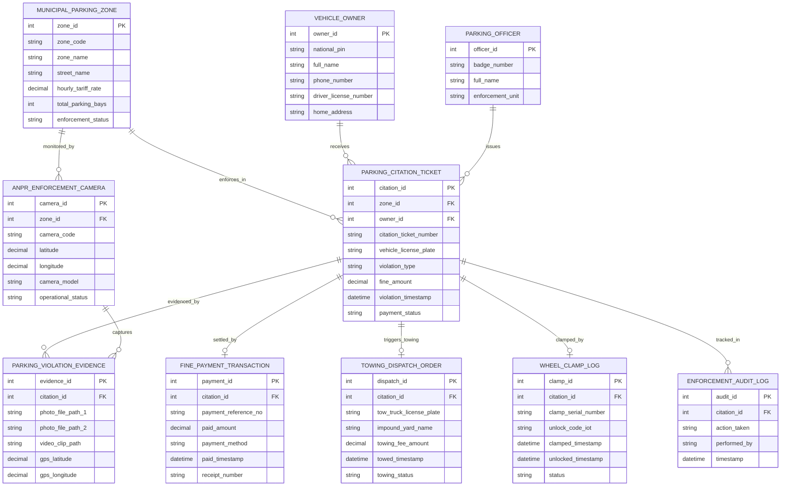

# Conceptual ERD — Municipal Parking Enforcement System

## Mermaid Code

## Entity Description Table | Bảng mô tả Entity

| # | Entity Name | Vietnamese Name | Description | Key Attributes | Main Relationships |
|---|-------------|-----------------|-------------|----------------|-------------------|
| 1 | MUNICIPAL_PARKING_ZONE | Vùng Đỗ xe Đô thị | Thông tin các tuyến đường, khu vực đỗ xe có thu phí/cấm đỗ và biểu giá | zone_id, zone_code, zone_name, hourly_tariff_rate, total_parking_bays | Enforces PARKING_CITATION, monitored by ANPR_CAMERA |
| 2 | PARKING_CITATION_TICKET | Biên bản Phạt nguội Đỗ xe | Chi tiết phiếu phạt vi phạm dừng đỗ xe (mã phiếu, biển số xe, lỗi, tiền phạt) | citation_id, citation_ticket_number, vehicle_license_plate, fine_amount, payment_status | Belongs to ZONE, OWNER, settled by PAYMENT, triggers TOWING |
| 3 | VEHICLE_OWNER | Chủ Phương tiện Giao thông | Thông tin chủ xe ô tô/xe máy trích xuất từ CSDL Đăng ký xe VNeID | owner_id, national_pin, full_name, phone_number, driver_license_number | Receives PARKING_CITATION_TICKET |
| 4 | ANPR_ENFORCEMENT_CAMERA | Camera AI Nhận diện Biển số | Thông tin trạm camera AI tự động quét biển số xe vi phạm đỗ xe lề đường | camera_id, camera_code, latitude, longitude, camera_model | Monitors ZONE, captures PARKING_VIOLATION_EVIDENCE |
| 5 | PARKING_VIOLATION_EVIDENCE | Bằng chứng Vi phạm Đỗ xe | Ảnh chụp toàn cảnh, ảnh biển số cận cảnh, video clip minh chứng vi phạm | evidence_id, photo_file_path_1, video_clip_path, gps_latitude | Evidences PARKING_CITATION, captured by CAMERA |
| 6 | FINE_PAYMENT_TRANSACTION | Giao dịch Nộp tiền Phạt | Nhật ký thanh toán tiền phạt nguội trực tuyến qua VNeID Pay / Ngân hàng | payment_id, payment_reference_no, paid_amount, payment_method, receipt_number | Settles PARKING_CITATION_TICKET |
| 7 | TOWING_DISPATCH_ORDER | Lệnh Cẩu xe Vi phạm | Lệnh điều động xe cẩu chuyên dụng cẩu phương tiện vi phạm về bãi tạm giữ | dispatch_id, tow_truck_license_plate, impound_yard_name, towing_fee_amount | Triggers by PARKING_CITATION_TICKET |
| 8 | WHEEL_CLAMP_LOG | Nhật ký Khóa Bánh xe | Nhật ký thực hiện khóa bánh xe ô tô bằng thiết bị khóa IoT tại chỗ | clamp_id, clamp_serial_number, unlock_code_iot, clamped_timestamp | Clamps PARKING_CITATION_TICKET |
| 9 | PARKING_OFFICER | Cán bộ Thanh tra Giao thông | Thông tin cán bộ thanh tra giao thông / trật tự đô thị lập phiếu phạt | officer_id, badge_number, full_name, enforcement_unit | Issues PARKING_CITATION_TICKET |
| 10 | ENFORCEMENT_AUDIT_LOG | Nhật ký Kiểm toán Xử phạt | Lưu vết toàn bộ thao tác lập phiếu phạt, gửi SMS, khóa bánh, cẩu xe và gạch nợ | audit_id, action_taken, performed_by, timestamp | Belongs to PARKING_CITATION_TICKET |

## Relationship Description | Mô tả Quan hệ

| # | From Entity | Cardinality | To Entity | Relationship Label | Business Explanation |
|---|-------------|-------------|-----------|-------------------|----------------------|
| 1 | MUNICIPAL_PARKING_ZONE | one-to-many | PARKING_CITATION_TICKET | enforces_in | Một tuyến đường/vùng đỗ xe ghi nhận nhiều biên bản vi phạm phạt nguội |
| 2 | MUNICIPAL_PARKING_ZONE | one-to-many | ANPR_ENFORCEMENT_CAMERA | monitored_by | Một vùng đỗ xe được giám sát bởi nhiều camera AI ANPR cố định |
| 3 | VEHICLE_OWNER | one-to-many | PARKING_CITATION_TICKET | receives | Một chủ phương tiện có thể nhận nhiều biên bản phạt nguội đỗ xe |
| 4 | PARKING_CITATION_TICKET | one-to-many | PARKING_VIOLATION_EVIDENCE | evidenced_by | Mỗi biên bản phạt nguội đính kèm nhiều tệp ảnh và video minh chứng |
| 5 | PARKING_CITATION_TICKET | one-to-one | FINE_PAYMENT_TRANSACTION | settled_by | Mỗi biên bản phạt được hoàn tất bằng duy nhất một giao dịch nộp tiền phạt |
| 6 | PARKING_CITATION_TICKET | one-to-one | TOWING_DISPATCH_ORDER | triggers_towing | Biên bản vi phạm nghiêm trọng kích hoạt một Lệnh cẩu xe về bãi tạm giữ |
| 7 | PARKING_CITATION_TICKET | one-to-one | WHEEL_CLAMP_LOG | clamped_by | Biên bản vi phạm có thể được xử lý cưỡng chế bằng một Nhật ký khóa bánh |
| 8 | PARKING_OFFICER | one-to-many | PARKING_CITATION_TICKET | issues | Một cán bộ thanh tra giao thông lập và ký phát hành nhiều biên bản e-Citation |
| 9 | PARKING_CITATION_TICKET | one-to-many | ENFORCEMENT_AUDIT_LOG | tracked_in | Mọi thao tác xử lý phiếu phạt được ghi nhật ký kiểm toán bất biến minh bạch |
| 10 | ANPR_ENFORCEMENT_CAMERA | one-to-many | PARKING_VIOLATION_EVIDENCE | captures | Một camera AI chụp và tự động tạo nhiều bản ghi hình ảnh minh chứng |
