# Swimlane Diagram — Municipal Parking Enforcement System

## Mermaid Code

```mermaid
flowchart LR
    Start(["Start"])

    subgraph Lane1["ANPR AI Camera / System"]
        A1["Scan License Plate & Capture Photos"]
        A2["Check Overtime Parking > 5 Mins"]
        A3["Check e-Permit Residential Exemption"]
    end

    subgraph Lane2["Parking Enforcement Platform"]
        S1["Query Vehicle Owner Details VNeID"]
        S2["Generate Electronic e-Citation Ticket"]
        S3["Send Real-time SMS Citation Alert"]
        S4["Verify Online Payment Settlement"]
        S5["Clear Unpaid Fine Flag in Database"]
    end

    subgraph Lane3["Parking Enforcement Officer"]
        O1["Verify Violation Evidence Photos"]
        O2["Attach Printed Ticket to Windshield"]
        O3["Attach IoT Wheel Clamp if Required"]
    end

    subgraph Lane4["Vehicle Motorist"]
        B1["Scan QR Code on Ticket or SMS"]
        B2["Pay Parking Fine via VNeID Pay"]
        B3["Receive E-Receipt & IoT Unlock Code"]
    end

    Finish(["End"])

    Start --> A1 --> A2 --> A3 --> S1 --> S2 --> O1 --> O2 --> O3 --> S3 --> B1 --> B2 --> S4 --> S5 --> B3 --> Finish
```

## Flow Description | Mô tả luồng

| Lane | Actor | Role in Flow |
|------|-------|-------------|
| 1 | ANPR AI Camera / System | Tự động quét biển số xe, đếm thời gian đỗ quá giờ, đối soát giấy phép đỗ xe cư dân e-Permit và chụp ảnh minh chứng. |
| 2 | Parking Enforcement Platform | Truy vấn CSDL Đăng ký xe VNeID, tự động lập phiếu phạt nguội e-Citation, gửi tin nhắn SMS cảnh báo và gạch nợ tiền phạt. |
| 3 | Parking Enforcement Officer | Rà soát ảnh vi phạm, in phiếu dán lên kính xe vi phạm và thực hiện khóa bánh xe IoT đối với các trường hợp cố tình. |
| 4 | Vehicle Motorist | Quét mã QR in trên phiếu phạt nguội hoặc tin nhắn SMS, thực hiện nộp tiền phạt trực tuyến và nhận biên lai gạch nợ. |
