# Action Tree — Municipal Parking Enforcement System

## Mermaid Code

```mermaid
graph TD
    Root["Municipal Parking Enforcement System"]

    Root --> M1["ANPR Camera Detection & Citation Issuance"]
    Root --> M2["Payment Processing & Online Fines"]
    Root --> M3["Wheel Clamping & Tow Truck Logistics"]
    Root --> M4["Zone Occupancy & Residential Permits"]
    Root --> M5["Dispute Resolution & Police Sync"]
    Root --> M6["Enforcement BI & Impound Analytics"]

    M1 --> A11["Scan Illegal Parking ANPR Cameras"]
    M1 --> A12["Capture Violation Photo Video Evidence"]
    M1 --> A13["Issue Electronic Parking Citation Tickets"]
    M1 --> A14["Issue Automatic Parking Overtime Fines"]

    M2 --> A21["Pay Municipal Parking Fines Online"]
    M2 --> A22["Generate Fine Payment QR Codes"]
    M2 --> A23["Issue Electronic Payment E-Receipts"]
    M2 --> A24["Audit Citation Payment Compliance"]

    M3 --> A31["Dispatch Vehicle Tow Trucks"]
    M3 --> A32["Clamp Wheel Illegal Parking IoT"]
    M3 --> A33["Track Towing Impound Yard Inventory"]
    M3 --> A34["Issue Automated IoT Clamp Unlock Codes"]

    M4 --> A41["Monitor On-Street Parking Zone Occupancy"]
    M4 --> A42["Process e-Permit Residential Parking"]
    M4 --> A43["Map Municipal Parking Spots GIS"]
    M4 --> A44["Manage On-Street Parking Tariffs"]

    M5 --> A51["Dispute Illegal Parking Citations"]
    M5 --> A52["Verify Vehicle Registration VNeID"]
    M5 --> A53["Sync Traffic Police Infringement DB"]
    M5 --> A54["Flag Unpaid Fines License Renewal"]

    M6 --> A61["Render Illegal Parking GIS Heatmaps"]
    M6 --> A62["Export Traffic Enforcement Analytics"]
    M6 --> A63["Export Municipal Parking Revenue BI"]
    M6 --> A64["Log System Immutable Audit Trails"]
```

## Module Description | Mô tả Module

| # | Module | Description | Actions |
|---|--------|-------------|---------|
| 1 | ANPR Camera Detection & Citation Issuance | Quét biển số xe bằng camera AI ANPR, thu thập ảnh/video minh chứng, lập e-Citation và tự động phạt đỗ quá giờ | Scan Illegal Parking ANPR Cameras, Capture Violation Photo Video Evidence, Issue Electronic Parking Citation Tickets, Issue Automatic Parking Overtime Fines |
| 2 | Payment Processing & Online Fines | Nộp phạt đỗ xe trực tuyến qua VNeID Pay / Ngân hàng, tự động sinh mã QR phạt, xuất biên lai điện tử và kiểm toán nợ phạt | Pay Municipal Parking Fines Online, Generate Fine Payment QR Codes, Issue Electronic Payment E-Receipts, Audit Citation Payment Compliance |
| 3 | Wheel Clamping & Tow Truck Logistics | Khóa bánh xe ô tô vi phạm bằng khóa IoT tại chỗ, điều động xe cẩu cẩu xe cản trở giao thông và quản lý bãi tạm giữ | Dispatch Vehicle Tow Trucks, Clamp Wheel Illegal Parking IoT, Track Towing Impound Yard Inventory, Issue Automated IoT Clamp Unlock Codes |
| 4 | Zone Occupancy & Residential Permits | Giám sát mật độ đỗ xe lề đường thời gian thực, cấp giấy phép đỗ xe cư dân e-Permit và hiển thị bản đồ GIS ô đỗ trống | Monitor On-Street Parking Zone Occupancy, Process e-Permit Residential Parking, Map Municipal Parking Spots GIS, Manage On-Street Parking Tariffs |
| 5 | Dispute Resolution & Police Sync | Tiếp nhận giải quyết khiếu nại phiếu phạt nguội, đối soát đăng ký xe VNeID, đồng bộ CSDL Cảnh sát Giao thông và chặn đăng kiểm | Dispute Illegal Parking Citations, Verify Vehicle Registration VNeID, Sync Traffic Police Infringement DB, Flag Unpaid Fines License Renewal |
| 6 | Enforcement BI & Impound Analytics | Trực quan hóa bản đồ nhiệt các điểm nóng vi phạm đỗ xe GIS, trích xuất báo cáo doanh thu phí và lưu vết kiểm toán bất biến | Render Illegal Parking GIS Heatmaps, Export Traffic Enforcement Analytics, Export Municipal Parking Revenue BI, Log System Immutable Audit Trails |
