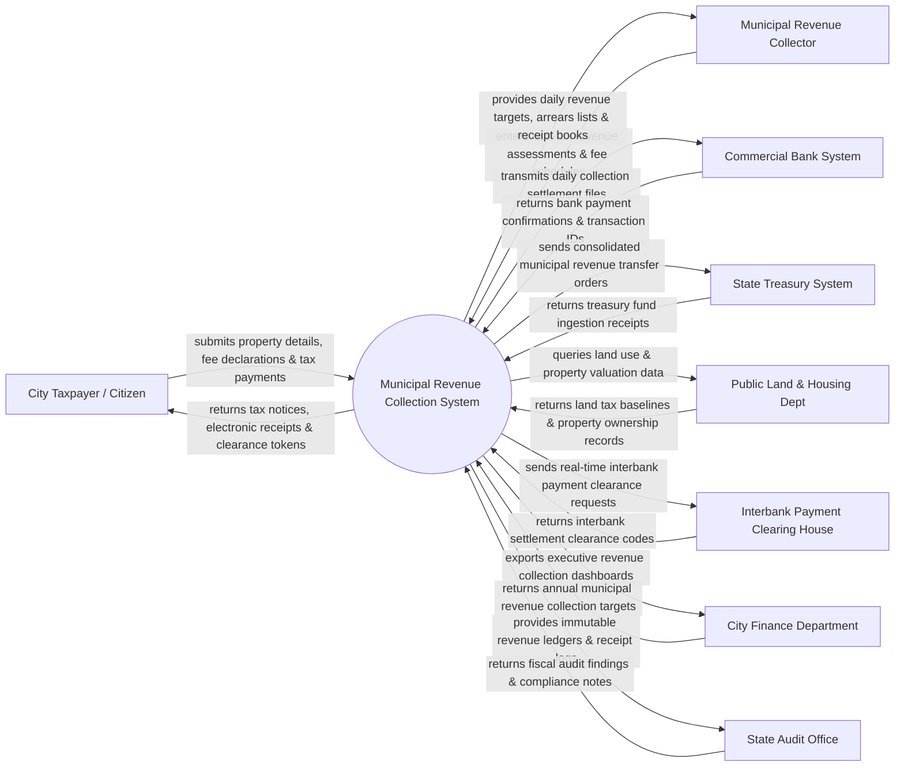

# Context Diagram — Municipal Revenue Collection System

## Mermaid Code

## Actor & Interaction Table | Bảng Actor & Tương tác

| # | Actor | Actor Type | Data Sent TO System | Data Received FROM System | Notes |
|---|-------|------------|---------------------|---------------------------|-------|
| 1 | City Taxpayer / Citizen | Primary | Property declarations, municipal fee payments, tax inquiry parameters | Tax notices, electronic receipts, tax clearance certificates | Công dân/doanh nghiệp nộp các khoản phí, lệ phí và thuế đất đô thị |
| 2 | Municipal Revenue Collector | Primary | Fee assessments, cash collection logs, fee schedule adjustments | Collection targets, overdues lists, electronic receipt books | Cán bộ thu nộp ngân sách thuộc Phòng Tài chính / Trung tâm Dịch vụ công |
| 3 | Commercial Bank System | Supporting | Payment transaction IDs, bank account statements | Electronic tax payment orders, customer bill details | Các ngân hàng thương mại liên kết thu ngân sách đô thị |
| 4 | State Treasury System | Supporting | Treasury account credit notifications, fund receipts | Consolidated municipal revenue transfer files | Kho bạc Nhà nước tiếp nhận dòng tiền thu ngân sách địa phương |
| 5 | Public Land & Housing Dept | Supporting | Land area measurements, property valuation tables | Property land tax query parameters | Cơ quan Quản lý Đất đai cung cấp dữ liệu diện tích và giá đất |
| 6 | Interbank Payment Clearing House | Supporting | Interbank settlement clearance codes | Real-time payment clearing requests | Trục thanh toán liên ngân hàng xử lý giao dịch tài chính |
| 7 | City Finance Department | Regulatory | Annual municipal revenue targets, fee rate policies | Executive revenue collection dashboards, BI analytics | Sở Tài chính / UBND Thành phố giao chỉ tiêu thu ngân sách |
| 8 | State Audit Office | Regulatory | Audit inspection queries, compliance guidelines | Immutable revenue ledgers, electronic receipt audit logs | Cơ quan Kiểm toán Nhà nước kiểm tra tính hợp pháp thu ngân sách |

## System Boundary Description | Mô tả Phạm vi Hệ thống

Hệ thống Municipal Revenue Collection System (Hệ thống Quản lý Thu Ngân sách và Phi Thuế Đô thị) chịu trách nhiệm tự động hóa quy trình quản lý thu các khoản thu thuộc ngân sách địa phương: Thuế sử dụng đất phi nông nghiệp, phí sử dụng lòng đường vỉa hè, phí cấp phép xây dựng, phí vệ sinh môi trường, tiền thuê nhà đất thuộc sở hữu nhà nước và các khoản phí dịch vụ công. Hệ thống kết nối trực tiếp với các Ngân hàng thương mại và Kho bạc Nhà nước. Tuy nhiên, hệ thống KHÔNG trực tiếp thu thuế thu nhập doanh nghiệp/GTGT (do Tổng cục Thuế đảm nhận) và KHÔNG trực tiếp thu tiền phạt vi phạm giao thông (do Cảnh sát giao thông quản lý).
