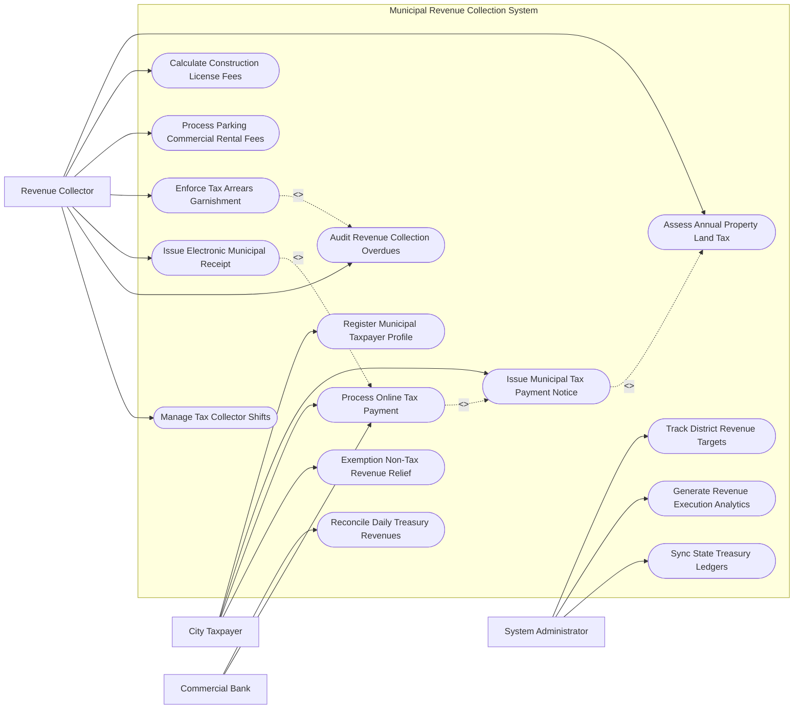

# Use Case Diagram — Municipal Revenue Collection System

## Mermaid Code

## Actor Table | Bảng Actor

| # | Actor | Actor Type | Role Description | Related Use Cases |
|---|-------|------------|------------------|-------------------|
| 1 | City Taxpayer | Primary | Công dân/doanh nghiệp nộp thuế đất, phí vỉa hè và tra cứu thông báo nợ | UC01, UC05, UC07, UC11 |
| 2 | Revenue Collector | Primary | Cán bộ thu ngân sách tính thuế đất, lập thông báo thu phí và xử lý nợ đọng | UC02, UC03, UC04, UC08, UC09, UC10, UC13 |
| 3 | Commercial Bank | Secondary / System | Ngân hàng liên kết thu hộ tiền thuế, chuyển tiền và truyền dữ liệu đối soát | UC06, UC07 |
| 4 | System Administrator | System | Quản trị viên theo dõi chỉ tiêu thu ngân sách, đối soát Kho bạc và trích xuất BI | UC12, UC14, UC15 |

## Use Case Table | Bảng Use Case

| # | UC ID | Use Case Name | Primary Actor | Secondary Actor | Description | Priority |
|---|-------|---------------|---------------|-----------------|-------------|----------|
| 1 | UC01 | Register Municipal Taxpayer Profile | Taxpayer | VNeID | Khởi tạo hồ sơ người nộp thuế/phí địa phương gắn với mã định danh VNeID | High |
| 2 | UC02 | Assess Annual Property Land Tax | Collector | LandDept | Tự động tính thuế sử dụng đất phi nông nghiệp hàng năm theo bảng giá đất | High |
| 3 | UC03 | Calculate Construction License Fees | Collector | - | Tính lệ phí cấp phép xây dựng công trình và phí thẩm định thiết kế | High |
| 4 | UC04 | Process Parking Commercial Rental Fees | Collector | - | Quản lý và tính phí sử dụng tạm thời lòng đường, vỉa hè kinh doanh/đỗ xe | Medium |
| 5 | UC05 | Issue Municipal Tax Payment Notice | Collector | Taxpayer | Phát hành Thông báo nộp tiền thuế/phí kèm Mã QR định danh khoản nộp | High |
| 6 | UC06 | Reconcile Daily Treasury Revenues | Bank | Treasury | Tự động đối soát dữ liệu tiền thu hộ của Ngân hàng với sổ sách Kho bạc | High |
| 7 | UC07 | Process Online Tax Payment | Taxpayer | Bank, PayGW | Thanh toán tiền thuế/phí thành phố trực tuyến qua QRCode/Ví điện tử/Banking | High |
| 8 | UC08 | Enforce Tax Arrears Garnishment | Collector | Bank | Cưỡng chế trích tiền từ tài khoản ngân hàng đối với trường hợp nợ thuế dây dưa | High |
| 9 | UC09 | Issue Electronic Municipal Receipt | Collector | Taxpayer | Khởi tạo và ký số Biên lai thu tiền phí/lệ phí điện tử có mã của cơ quan thuế | High |
| 10 | UC10 | Audit Revenue Collection Overdues | Collector | - | Rà soát danh sách các hộ gia đình/doanh nghiệp nợ tiền thuế đất, phí quá hạn | Medium |
| 11 | UC11 | Exemption Non-Tax Revenue Relief | Taxpayer | Collector | Nộp đơn và xét duyệt miễn/giảm thuế đất đối với đối tượng chính sách | Medium |
| 12 | UC12 | Track District Revenue Targets | Admin | FinanceDept | Theo dõi tiến độ thực hiện chỉ tiêu thu ngân sách nhà nước theo từng Quận/Huyện | High |
| 13 | UC13 | Manage Tax Collector Shifts | Collector | - | Quản lý ca trực thu tiền mặt, chốt sổ biên lai và nộp tiền vào Kho bạc | Medium |
| 14 | UC14 | Generate Revenue Execution Analytics | Admin | FinanceDept | Trích xuất báo cáo phân tích thu ngân sách đô thị nộp HĐND và Sở Tài chính | Low |
| 15 | UC15 | Sync State Treasury Ledgers | System | StateTreasury | Tự động đồng bộ chứng từ thu ngân sách sang Hệ thống Kho bạc TABMIS | High |

## Use Case Specification | Đặc tả Use Case

---

### UC01 — Register Municipal Taxpayer Profile

| Field | Detail |
|-------|--------|
| **UC ID** | UC01 |
| **Use Case Name** | Register Municipal Taxpayer Profile |
| **Actor(s)** | Primary: City Taxpayer / Secondary: VNeID, Land Office |
| **Description** | Công dân hoặc doanh nghiệp đăng ký hồ sơ người nộp thuế/phí địa phương để quản lý nghĩa vụ tài chính đất đai. |
| **Precondition** | 1. Công dân có tài khoản VNeID hoặc Mã số thuế cá nhân/doanh nghiệp. |
| **Main Flow** | 1. Taxpayer đăng nhập Cổng Quản lý Thu Ngân sách Đô thị.   2. Taxpayer quét mã QR VNeID để tự động điền thông tin nhân thân (Họ tên, CCCD/MST, Địa chỉ thường trú).   3. Taxpayer kê khai danh sách các bất động sản sở hữu (Mã thửa đất, Tờ bản đồ, Địa chỉ nhà đất).   4. System kết nối CSDL Đất đai (Land Office) đối soát thông tin quyền sử dụng đất.   5. System khởi tạo Mã người nộp thuế đô thị (Municipal Taxpayer ID).   6. System tự động liên kết các khoản thuế đất, phí vỉa hè, phí vệ sinh môi trường vào tài khoản của Taxpayer.   7. Taxpayer nhận thông báo xác nhận khởi tạo hồ sơ người nộp thuế thành công. |
| **Alternative Flow** | **AF1** — Đăng ký cho Doanh nghiệp/Hộ kinh doanh: Taxpayer nhập Mã số thuế 10 số, System trích xuất thông tin doanh nghiệp từ CSDL Đăng ký Doanh nghiệp. |
| **Exception Flow** | **EX1** — Thông tin thửa đất không khớp với CSDL Đất đai: System thông báo "Thông tin cần xác minh", chuyển hồ sơ sang Cán bộ địa chính kiểm tra. |
| **Postcondition** | Hồ sơ người nộp thuế được tạo lập, làm cơ sở tính thuế đất và phát hành thông báo nộp tiền (UC02, UC05). |
| **Business Rule** | **BR1**: Mỗi bất động sản chỉ được liên kết với duy nhất 01 Hồ sơ người nộp thuế đất phi nông nghiệp active. |

---

### UC02 — Assess Annual Property Land Tax

| Field | Detail |
|-------|--------|
| **UC ID** | UC02 |
| **Use Case Name** | Assess Annual Property Land Tax |
| **Actor(s)** | Primary: Municipal Revenue Collector / Secondary: Land Dept |
| **Description** | Hệ thống tự động tính toán số tiền thuế sử dụng đất phi nông nghiệp phải nộp hàng năm cho từng thửa đất. |
| **Precondition** | 1. Bảng giá đất đô thị do UBND Thành phố ban hành đã được cấu hình trên hệ thống.   2. Thửa đất đã được đăng ký trong Hồ sơ người nộp thuế (UC01). |
| **Main Flow** | 1. System chạy tiến trình lập bộ thuế đất phi nông nghiệp đầu năm tài chính (Deduct Engine).   2. System lấy diện tích đất tính thuế ($m^2$), giá $1m^2$ đất theo Bảng giá đất và Hạn mức đất ở của địa phương.   3. System áp dụng công thức tính thuế lũy tiến:   - Diện tích trong hạn mức: Thuế suất 0.03%.   - Diện tích vượt không quá 3 lần hạn mức: Thuế suất 0.07%.   - Diện tích vượt trên 3 lần hạn mức: Thuế suất 0.15%.   4. System tính Số tiền thuế đất phải nộp hàng năm.   5. Collector kiểm tra và bấm "Duyệt bộ thuế đất năm".   6. System tự động phát hành Thông báo nộp tiền thuế đất (UC05) gửi cho Taxpayer. |
| **Alternative Flow** | **AF1** — Đất thuộc diện miễn/giảm thuế (Gia đình thương binh, liệt sĩ): System áp dụng tỷ lệ giảm trừ 50% hoặc 100% theo quyết định miễn giảm (UC11). |
| **Exception Flow** | **EX1** — Thửa đất lấn chiếm chưa có Giấy chứng nhận: System áp dụng thuế suất phạt 0.2% trên toàn bộ diện tích lấn chiếm. |
| **Postcondition** | Nghĩa vụ thuế đất phi nông nghiệp được ghi nhận vào sổ nợ thuế, sẵn sàng cho việc thu tiền. |
| **Business Rule** | **BR1**: Bộ thuế sử dụng đất phi nông nghiệp hàng năm phải được duyệt xong trước ngày 30 tháng 4 hàng năm. |

---

### UC05 — Issue Municipal Tax Payment Notice

| Field | Detail |
|-------|--------|
| **UC ID** | UC05 |
| **Use Case Name** | Issue Municipal Tax Payment Notice |
| **Actor(s)** | Primary: Municipal Revenue Collector / Secondary: City Taxpayer |
| **Description** | Phát hành Thông báo nộp tiền thuế/phí/lệ phí điện tử kèm Mã QR định danh khoản nộp gửi tới người nộp thuế. |
| **Precondition** | 1. Khoản thuế hoặc phí đã được tính toán chính xác (UC02, UC03, UC04). |
| **Main Flow** | 1. System tự động gom nhóm các khoản phải nộp của Taxpayer (Thuế đất, Phí vỉa hè, Lệ phí cấp phép).   2. System khởi tạo Thông báo nộp tiền thuế và khoản thu ngân sách địa phương (Form 01/TBT).   3. System tạo Mã định danh khoản nộp (ID Định danh khoản nộp - Payment Reference ID) duy nhất.   4. System sinh Mã QR thanh toán VietQR chứa sẵn: Số tài khoản Kho bạc, Mã định danh khoản nộp, Số tiền phải nộp.   5. Collector ký số ban hành Thông báo nộp tiền.   6. System gửi thông báo điện tử qua Zalo OA, Email, App VNeID và Bưu điện cho Taxpayer.   7. System đặt lịch nhắc nợ tự động trước khi hết hạn nộp 05 ngày. |
| **Alternative Flow** | **AF1** — Phát hành thông báo nợ đọng quá hạn: Thông báo ghi rõ số tiền phạt chậm nộp (0.03%/ngày) và cảnh báo cưỡng chế (UC08). |
| **Exception Flow** | **EX1** — Sai địa chỉ bưu chính của người nộp thuế: System đánh dấu "Thông báo trả về", gửi cảnh báo cho Collector để xác minh lại địa chỉ cư trú. |
| **Postcondition** | Thông báo nộp tiền có hiệu lực pháp lý, người nộp thuế có thể dùng mã QR để thanh toán ngay. |
| **Business Rule** | **BR1**: Mỗi Thông báo nộp tiền bắt buộc phải có duy nhất một Mã định danh khoản nộp (Payment Ref ID) để chống thu trùng. |

---

### UC07 — Process Online Tax Payment

| Field | Detail |
|-------|--------|
| **UC ID** | UC07 |
| **Use Case Name** | Process Online Tax Payment |
| **Actor(s)** | Primary: City Taxpayer / Secondary: Commercial Bank, Payment Gateway |
| **Description** | Người nộp thuế thực hiện thanh toán tiền thuế/phí thành phố trực tuyến bằng cách quét mã QR hoặc chuyển khoản ngân hàng. |
| **Precondition** | 1. Taxpayer nhận được Thông báo nộp tiền có Mã QR thanh toán (UC05). |
| **Main Flow** | 1. Taxpayer mở ứng dụng Mobile Banking của Ngân hàng bất kỳ hoặc Cổng Dịch vụ công.   2. Taxpayer quét mã VietQR trên Thông báo nộp tiền (hoặc nhập Mã định danh khoản nộp ID).   3. Ứng dụng ngân hàng tự động hiển thị: Tên người nộp, Cơ quan thu (Kho bạc Nhà nước), Số tiền phải nộp.   4. Taxpayer bấm "Xác nhận thanh toán" và thực hiện xác thực OTP/Biometrics.   5. Bank xử lý giao dịch chuyển tiền vào Tài khoản thu ngân sách nhà nước tại Kho bạc.   6. Bank gửi tin nhắn truyền dữ liệu thanh toán thành công (Real-time Payment Callback) cho System.   7. System tự động gạch nợ cho Taxpayer và khởi tạo Biên lai thu tiền điện tử (UC09). |
| **Alternative Flow** | **AF1** — Nộp tiền trực tiếp tại quầy Ngân hàng/Kho bạc: Giao dịch viên ngân hàng nhập Mã định danh khoản nộp và thu tiền mặt. |
| **Exception Flow** | **EX1** — Giao dịch nộp tiền bị gián đoạn (Đã trừ tiền ngân hàng nhưng chưa gạch nợ): System tự động chuyển vào hàng chờ đối soát (UC06) để xử lý gạch nợ bù trong 1 giờ. |
| **Postcondition** | Nghĩa vụ tài chính được hoàn thành, tiền được chuyển vào ngân sách thành phố tại Kho bạc Nhà nước. |
| **Business Rule** | **BR1**: Thời gian xử lý gạch nợ tự động sau khi nhận tín hiệu báo có từ ngân hàng không được vượt quá 05 giây. |

---

### UC08 — Enforce Tax Arrears Garnishment

| Field | Detail |
|-------|--------|
| **UC ID** | UC08 |
| **Use Case Name** | Enforce Tax Arrears Garnishment |
| **Actor(s)** | Primary: Municipal Revenue Collector / Secondary: Commercial Bank |
| **Description** | Thực hiện biện pháp cưỡng chế trích tiền từ tài khoản ngân hàng của đối tượng nợ tiền thuế/phí quá hạn 90 ngày. |
| **Precondition** | 1. Nợ tiền thuế/phí ngân sách quá hạn trên 90 ngày kể từ ngày hết hạn nộp.   2. Đã gửi Quyết định cưỡng chế thi hành nhưng đối tượng không chấp hành. |
| **Main Flow** | 1. System lọc danh sách các đối tượng nợ đọng ngân sách $> 90$ ngày (UC10).   2. Collector lập Quyết định cưỡng chế bằng biện pháp trích tiền từ tài khoản ngân hàng.   3. Lãnh đạo Sở Tài chính / UBND Thành phố ký số Quyết định cưỡng chế.   4. System tự động gửi Quyết định cưỡng chế điện tử sang Hệ thống Ngân hàng thương mại (Commercial Bank) nơi đối tượng mở tài khoản.   5. Bank tự động phong tỏa và trích nợ số tiền tương ứng từ tài khoản ngân hàng của đối tượng chuyển vào Kho bạc.   6. Bank gửi Văn bản xác nhận đã thực hiện trích tiền cưỡng chế thành công cho System.   7. System tự động gạch trừ số tiền nợ đọng và xuất Biên lai thu tiền cưỡng chế. |
| **Alternative Flow** | **AF1** — Số dư tài khoản không đủ trích nợ: Bank trích toàn bộ số dư hiện có và tiếp tục phong tỏa tài khoản để trích tiếp khi có tiền vào. |
| **Exception Flow** | **EX1** — Đối tượng khiếu nại Quyết định cưỡng chế do đã nộp tiền trước đó: System tạm dừng lệnh cưỡng chế, chuyển hồ sơ cho Collector đối soát chứng từ. |
| **Postcondition** | Số tiền nợ đọng ngân sách được thu hồi triệt để, đảm bảo kỷ cương quản lý tài chính đô thị. |
| **Business Rule** | **BR1**: Biện pháp cưỡng chế trích tiền tài khoản chỉ được thực hiện sau 15 ngày kể từ ngày ban hành Quyết định cưỡng chế. |
