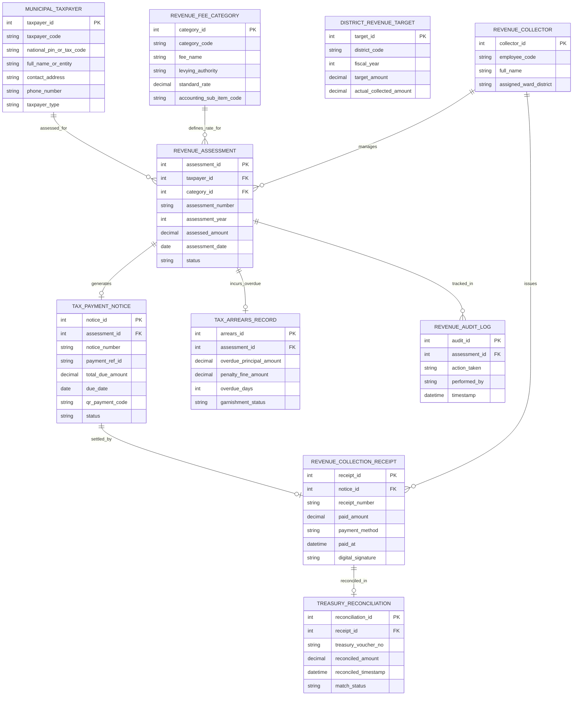

# Conceptual ERD — Municipal Revenue Collection System

## Mermaid Code

## Entity Description Table | Bảng mô tả Entity

| # | Entity Name | Vietnamese Name | Description | Key Attributes | Main Relationships |
|---|-------------|-----------------|-------------|----------------|-------------------|
| 1 | MUNICIPAL_TAXPAYER | Người nộp Thuế / Phí Đô thị | Thông tin cá nhân, hộ kinh doanh hoặc doanh nghiệp có nghĩa vụ nộp ngân sách | taxpayer_id, taxpayer_code, national_pin_or_tax_code, taxpayer_type | Assessed for REVENUE_ASSESSMENT |
| 2 | REVENUE_FEE_CATEGORY | Danh mục Khoản thu Ngân sách | Danh mục các loại thuế đất, phí lòng đường, lệ phí cấp phép và phí môi trường | category_id, category_code, fee_name, standard_rate, accounting_sub_item_code | Defines rate for REVENUE_ASSESSMENT |
| 3 | REVENUE_ASSESSMENT | Hồ sơ Lập bộ Thu ngân sách | Ghi nhận kết quả tính toán số tiền thuế/phí phải nộp theo kỳ tính thuế | assessment_id, assessment_number, assessment_year, assessed_amount | Belongs to TAXPAYER, CATEGORY, generates NOTICE |
| 4 | TAX_PAYMENT_NOTICE | Thông báo Nộp tiền Ngân sách | Thông báo nộp tiền điện tử chứa Mã định danh khoản nộp ID và mã QR VietQR | notice_id, notice_number, payment_ref_id, total_due_amount, due_date | Belongs to ASSESSMENT, settled by RECEIPT |
| 5 | REVENUE_COLLECTION_RECEIPT | Biên lai Thu tiền Điện tử | Chứng từ thu tiền điện tử có mã của cơ quan thuế cấp cho người nộp | receipt_id, receipt_number, paid_amount, payment_method, paid_at | Belongs to NOTICE, reconciled in TREASURY_RECONCILIATION |
| 6 | TREASURY_RECONCILIATION | Nhật ký Đối soát Kho bạc | Hồ sơ đối soát số liệu tiền thu hộ của Ngân hàng với tài khoản Kho bạc | reconciliation_id, treasury_voucher_no, reconciled_amount, match_status | Belongs to REVENUE_COLLECTION_RECEIPT |
| 7 | TAX_ARREARS_RECORD | Sổ Nợ đọng & Cưỡng chế | Theo dõi khoản tiền nợ quá hạn, tiền phạt chậm nộp 0.03%/ngày và cưỡng chế | arrears_id, overdue_principal_amount, penalty_fine_amount, garnishment_status | Belongs to REVENUE_ASSESSMENT |
| 8 | DISTRICT_REVENUE_TARGET | Chỉ tiêu Thu Ngân sách Quận/Huyện | Quyết định giao chỉ tiêu dự toán thu ngân sách địa phương hàng năm | target_id, district_code, fiscal_year, target_amount, actual_collected_amount | Independent analytics entity |
| 9 | REVENUE_COLLECTOR | Cán bộ Thu Ngân sách | Thông tin cán bộ thu thuế/phí địa bàn phụ trách lập sổ và quản lý nợ | collector_id, employee_code, full_name, assigned_ward_district | Manages ASSESSMENT, issues RECEIPT |
| 10 | REVENUE_AUDIT_LOG | Nhật ký Kiểm toán Thu Ngân sách | Lưu vết toàn bộ lịch sử lập bộ, phát hành thông báo, gạch nợ và đối soát | audit_id, action_taken, performed_by, timestamp | Belongs to REVENUE_ASSESSMENT |

## Relationship Description | Mô tả Quan hệ

| # | From Entity | Cardinality | To Entity | Relationship Label | Business Explanation |
|---|-------------|-------------|-----------|-------------------|----------------------|
| 1 | MUNICIPAL_TAXPAYER | one-to-many | REVENUE_ASSESSMENT | assessed_for | Một người nộp thuế được lập bộ tính toán nhiều khoản thuế/phí hàng năm |
| 2 | REVENUE_FEE_CATEGORY | one-to-many | REVENUE_ASSESSMENT | defines_rate_for | Một danh mục phí quy định biểu giá tính toán cho nhiều hồ sơ thu |
| 3 | REVENUE_ASSESSMENT | one-to-one | TAX_PAYMENT_NOTICE | generates | Mỗi hồ sơ lập bộ thu phát hành duy nhất một Thông báo nộp tiền |
| 4 | TAX_PAYMENT_NOTICE | one-to-one | REVENUE_COLLECTION_RECEIPT | settled_by | Mỗi Thông báo nộp tiền sau khi thanh toán được cấp một Biên lai thu tiền |
| 5 | REVENUE_COLLECTION_RECEIPT | one-to-one | TREASURY_RECONCILIATION | reconciled_in | Mỗi biên lai thu tiền được hạch toán đối soát sang một chứng từ Kho bạc |
| 6 | REVENUE_ASSESSMENT | one-to-one | TAX_ARREARS_RECORD | incurs_overdue | Một hồ sơ thu bị quá hạn sẽ phát sinh một bản ghi theo dõi nợ đọng |
| 7 | REVENUE_COLLECTOR | one-to-many | REVENUE_ASSESSMENT | manages | Một cán bộ thu ngân sách quản lý lập bộ thu cho nhiều đối tượng địa bàn |
| 8 | REVENUE_COLLECTOR | one-to-many | REVENUE_COLLECTION_RECEIPT | issues | Một cán bộ thu ngân sách ký phát hành nhiều biên lai thu tiền điện tử |
| 9 | REVENUE_ASSESSMENT | one-to-many | REVENUE_AUDIT_LOG | tracked_in | Mọi thao tác trên hồ sơ thu ngân sách được ghi nhật ký kiểm toán bất biến |
