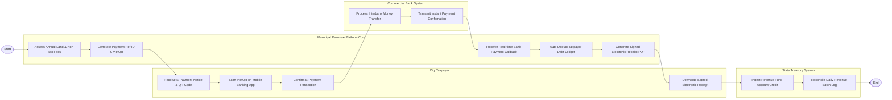

# Swimlane Diagram — Municipal Revenue Collection System

## Mermaid Code

## Flow Description | Mô tả luồng

| Lane | Actor | Role in Flow |
|------|-------|-------------|
| 1 | City Taxpayer | Nhận Thông báo nộp tiền điện tử chứa mã VietQR, mở ứng dụng ngân hàng quét mã thanh toán và tải biên lai thu tiền. |
| 2 | Municipal Revenue Platform Core | Tính toán các khoản thuế/phí, sinh mã định danh khoản nộp ID & VietQR, nhận kết quả gạch nợ tự động và xuất biên lai điện tử. |
| 3 | Commercial Bank System | Xử lý chuyển tiền thu hộ ngân sách nhà nước và gửi tín hiệu báo có thời gian thực (Callback) về hệ thống. |
| 4 | State Treasury System | Ghi nhận tiền vào tài khoản thu ngân sách tại Kho bạc và thực hiện đối soát tự động cuối ngày. |
