# Action Tree — Municipal Revenue Collection System

## Mermaid Code

```mermaid
graph TD
    Root["Municipal Revenue Collection System"]

    Root --> M1["Taxpayer Profile & Assessment"]
    Root --> M2["Municipal Fees & Non-Tax Revenues"]
    Root --> M3["E-Payment & Electronic Receipts"]
    Root --> M4["Treasury Settlement & Reconciliation"]
    Root --> M5["Arrears Enforcement & Compliance"]
    Root --> M6["District Revenue BI & Analytics"]

    M1 --> A11["Register Municipal Taxpayer VNeID"]
    M1 --> A12["Assess Annual Property Land Tax"]
    M1 --> A13["Link Land Use Records Land Office"]
    M1 --> A14["Process Tax Relief Exemptions"]

    M2 --> A21["Calculate Construction License Fees"]
    M2 --> A22["Process Sidewalk Commercial Fees"]
    M2 --> A23["Process Sanitation Environment Fees"]
    M2 --> A24["Manage Public Property Rental Contracts"]

    M3 --> A31["Generate Payment Ref ID VietQR"]
    M3 --> A32["Process Mobile Banking E-Payments"]
    M3 --> A33["Issue Electronic Tax Receipts PDF"]
    M3 --> A34["Auto-Deduct Tax Debt Ledgers"]

    M4 --> A41["Reconcile Daily Treasury Revenue Logs"]
    M4 --> A42["Sync TABMIS Treasury System Ledgers"]
    M4 --> A43["Process Interbank Clearing Transfers"]
    M4 --> A44["Audit Bank Transaction Discrepancies"]

    M5 --> A51["Audit Overdue Tax Arrears Lists"]
    M5 --> A52["Calculate Late Penalty Fines 0.03 Percent"]
    M5 --> A53["Enforce Bank Account Garnishment"]
    M5 --> A54["Issue Public Tax Default Notices"]

    M6 --> A61["Track District Annual Revenue Targets"]
    M6 --> A62["Generate Executive Finance Dashboards"]
    M6 --> A63["Log System Immutable Audit Trails"]
    M6 --> A64["Export State Audit Compliance Reports"]
```

## Module Description | Mô tả Module

| # | Module | Description | Actions |
|---|--------|-------------|---------|
| 1 | Taxpayer Profile & Assessment | Quản lý hồ sơ người nộp thuế thành phố, tự động lập bộ tính thuế đất phi nông nghiệp hàng năm và xét duyệt miễn giảm | Register Municipal Taxpayer VNeID, Assess Annual Property Land Tax, Link Land Use Records Land Office, Process Tax Relief Exemptions |
| 2 | Municipal Fees & Non-Tax Revenues | Quản lý thu các khoản phí/lệ phí cấp phép xây dựng, phí lòng đường vỉa hè, phí vệ sinh và tiền thuê nhà đất công | Calculate Construction License Fees, Process Sidewalk Commercial Fees, Process Sanitation Environment Fees, Manage Public Property Rental Contracts |
| 3 | E-Payment & Electronic Receipts | Sinh mã định danh VietQR, nhận kết quả gạch nợ tự động từ ngân hàng và phát hành biên lai thu tiền điện tử PDF | Generate Payment Ref ID VietQR, Process Mobile Banking E-Payments, Issue Electronic Tax Receipts PDF, Auto-Deduct Tax Debt Ledgers |
| 4 | Treasury Settlement & Reconciliation | Tự động đối soát dòng tiền thu hộ giữa các Ngân hàng thương mại và Kho bạc Nhà nước, đồng bộ TABMIS | Reconcile Daily Treasury Revenue Logs, Sync TABMIS Treasury System Ledgers, Process Interbank Clearing Transfers, Audit Bank Transaction Discrepancies |
| 5 | Arrears Enforcement & Compliance | Theo dõi danh sách nợ đọng, tính tiền phạt chậm nộp 0.03%/ngày và thực hiện lệnh cưỡng chế trích tài khoản ngân hàng | Audit Overdue Tax Arrears Lists, Calculate Late Penalty Fines 0.03 Percent, Enforce Bank Account Garnishment, Issue Public Tax Default Notices |
| 6 | District Revenue BI & Analytics | Theo dõi chỉ tiêu dự toán thu ngân sách theo từng Quận/Huyện, phân tích BI thu ngân sách nộp Sở Tài chính | Track District Annual Revenue Targets, Generate Executive Finance Dashboards, Log System Immutable Audit Trails, Export State Audit Compliance Reports |
