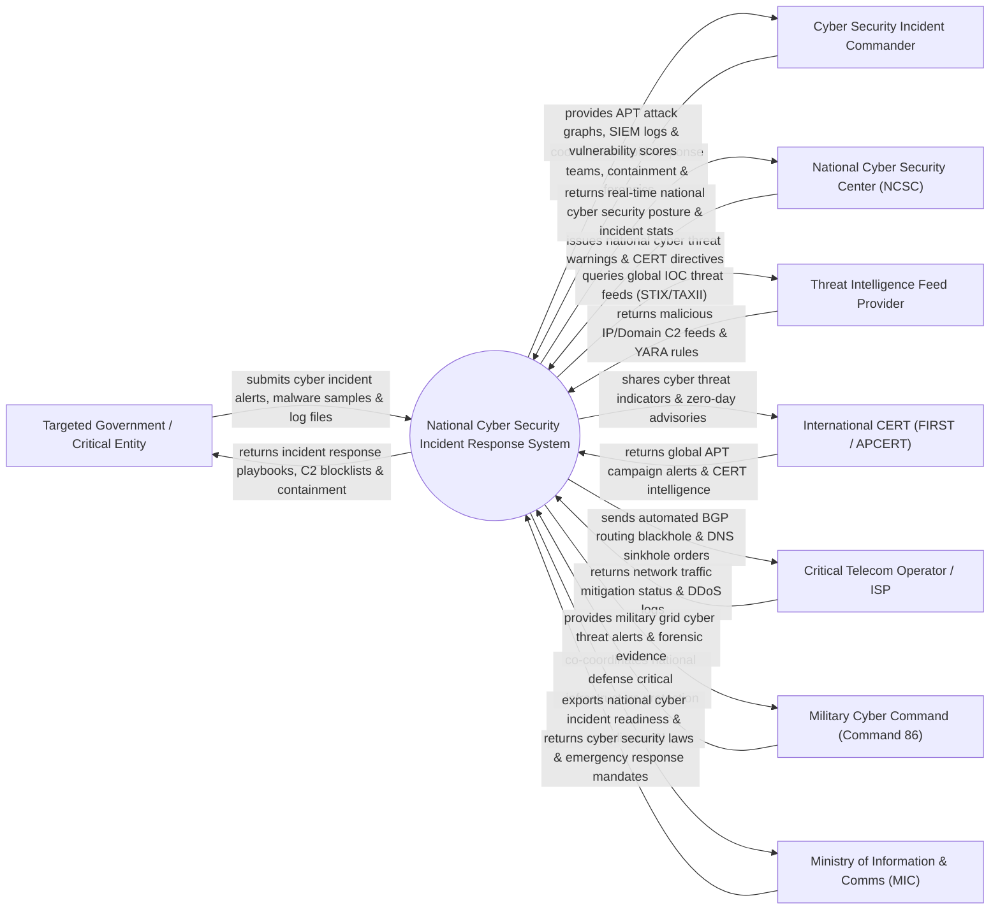

# Context Diagram — National Cyber Security Incident Response System

## Mermaid Code

## Actor & Interaction Table | Bảng Actor & Tương tác

| # | Actor | Actor Type | Data Sent TO System | Data Received FROM System | Notes |
|---|-------|------------|---------------------|---------------------------|-------|
| 1 | Targeted Government / Critical Entity | Primary | Cyber incident alerts, malware samples, SIEM log files, compromise indicators | Incident containment playbooks, C2 blocklists, mitigation steps | Các Bộ/Ngành, Ngân hàng, Điện lực, Hàng không bị tấn công mạng |
| 2 | Cyber Security Incident Commander | Primary | Response team assignments, containment orders, forensic sign-offs | Real-time APT attack graphs, SIEM logs, vulnerability scores | Chỉ huy trưởng Đội Ứng cứu Sự cố An toàn Thông tin Quốc gia |
| 3 | National Cyber Security Center (NCSC) | Primary | National cyber threat warnings, CERT directives, YARA rules | Real-time national cyber security posture, incident stats | Cục An toàn Thông tin / Trung tâm Giám sát An toàn Không gian mạng QG |
| 4 | Threat Intelligence Feed Provider | Supporting | Malicious IP/Domain C2 feeds, STIX/TAXII indicators, YARA rules | Threat feed query requests, telemetry samples | Các tổ chức tình báo an ninh mạng quốc tế cung cấp IOC |
| 5 | International CERT (FIRST / APCERT) | Supporting | Global APT campaign alerts, zero-day advisories, CERT intel | Shared cyber threat indicators, incident escalation notices | Mạng lưới ứng cứu sự cố an ninh mạng khu vực và thế giới |
| 6 | Critical Telecom Operator / ISP | Supporting | Network traffic mitigation status, BGP routing logs, DDoS stats | Automated BGP blackhole orders, DNS sinkhole rules | Các nhà mạng Viettel, VNPT, FPT thực hiện chặn lọc C2 và DDoS |
| 7 | Military Cyber Command (Command 86) | Supporting | Defense grid cyber security status, military CERT logs | Critical infrastructure cyber threat alerts, forensic evidence | Bộ Tư lệnh Tác chiến Không gian mạng (Bộ Quốc phòng) phối hợp |
| 8 | Ministry of Information & Comms (MIC) | Regulatory | Cyber security laws, emergency response mandates, penalty rules | National cyber incident readiness BI dashboards, post-mortem reports | Bộ Thông tin và Truyền thông quản lý an toàn thông tin quốc gia |

## System Boundary Description | Mô tả Phạm vi Hệ thống

Hệ thống National Cyber Security Incident Response System (Hệ thống Khởi tạo và Ứng cứu Sự cố An ninh Mang Quốc gia / NCSC Incident Portal) chịu trách nhiệm tự động hóa quy trình giám sát, phát hiện và ứng cứu sự cố tấn công mạng đối với các hệ thống thông tin quan trọng quốc gia (Chính phủ điện tử, Ngân hàng, Điện lực, Viễn thông): Thu thập dữ liệu IOC tình báo mối đe dọa (STIX/TAXII), sử dụng AI phát hiện các chiến dịch tấn công APT (Advanced Persistent Threat) và Mã độc tống tiền (Ransomware), cô lập vùng mạng bị nhiễm, phối hợp lực lượng phản ứng nhanh (CERT), kích hoạt DNS Sinkhole / BGP Blackhole chặn kết nối máy chủ điều khiển C2 của hacker và điều tra dấu vết độc hại (Digital Forensics). Tuy nhiên, hệ thống KHÔNG trực tiếp thay thế hạ tầng phần cứng tường lửa tại từng đơn vị và KHÔNG thay thế việc khôi phục dữ liệu sao lưu thủ công.
