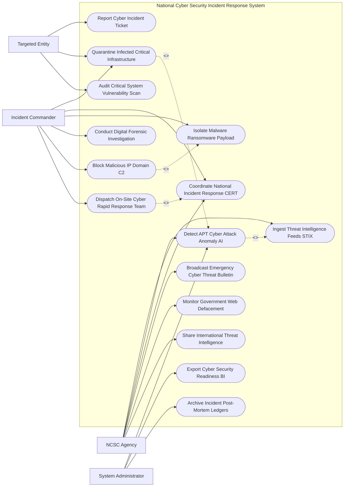

# Use Case Diagram — National Cyber Security Incident Response System

## Mermaid Code

## Actor Table | Bảng Actor

| # | Actor | Actor Type | Role Description | Related Use Cases |
|---|-------|------------|------------------|-------------------|
| 1 | Targeted Entity | Primary | Cơ quan bị tấn công mạng gửi báo cáo sự cố khẩn cấp, phối hợp cô lập và quét lỗ hổng | UC03, UC04, UC09 |
| 2 | Incident Commander | Primary | Chỉ huy trưởng sự cố phân công Đội ứng cứu CERT, ra lệnh chặn C2, cô lập mã độc và khám nghiệm chứng cứ số | UC04, UC05, UC06, UC08, UC10, UC11 |
| 3 | NCSC Agency | Primary | Trung tâm NCSC nạp dữ liệu IOC tình báo, phát cảnh báo khẩn toàn quốc, giám sát thay đổi giao diện web | UC01, UC02, UC05, UC07, UC12, UC13 |
| 4 | System Administrator | System | Quản trị viên vận hành SIEM AI, trích xuất báo cáo mức độ sẵn sàng an ninh mạng và lưu vết diễn biến | UC02, UC14, UC15 |

## Use Case Table | Bảng Use Case

| # | UC ID | Use Case Name | Primary Actor | Secondary Actor | Description | Priority |
|---|-------|---------------|---------------|-----------------|-------------|----------|
| 1 | UC01 | Ingest Threat Intelligence Feeds STIX | NCSC | ThreatIntel | Thu thập tự động các chỉ số thỏa hiệp IOC (IP, Domain, Hash) theo chuẩn STIX/TAXII | High |
| 2 | UC02 | Detect APT Cyber Attack Anomaly AI | NCSC, Admin | AI Engine | Thuật toán AI SIEM phân tích log hành vi mạng phát hiện chiến dịch tấn công APT tinh vi | High |
| 3 | UC03 | Report Cyber Incident Ticket | Entity | NCSC | Khởi tạo phiếu báo cáo sự cố tấn công mạng khẩn cấp (DDoS, Ransomware, Defacement) | High |
| 4 | UC04 | Quarantine Infected Critical Infrastructure | Commander, Entity | ISP | Ra lệnh cô lập tức thì phân đoạn mạng hoặc máy chủ bị nhiễm mã độc khỏi mạng Internet | High |
| 5 | UC05 | Coordinate National Incident Response CERT | NCSC, Commander | MilitaryCyber | Điều phối lực lượng mạng lưới ứng cứu sự cố quốc gia (CERT) xử lý sự cố quy mô lớn | High |
| 6 | UC06 | Isolate Malware Ransomware Payload | Commander | Sandbox | Phân tích tệp mã độc tống tiền (Ransomware) trong môi trường Sandbox cách ly | High |
| 7 | UC07 | Broadcast Emergency Cyber Threat Bulletin | NCSC | All Entities | Phát thông báo cảnh báo lỗ hổng bảo mật khẩn cấp (Zero-Day Bulletin) cho toàn bộ cơ quan | High |
| 8 | UC08 | Conduct Digital Forensic Investigation | Commander | ForensicLab | Thu thập chứng cứ kỹ thuật số (Memory Dump, Disk Image, Packet Captures) dựng lại đợt tấn công | High |
| 9 | UC09 | Audit Critical System Vulnerability Scan | Entity | NCSC | Quét và đánh giá mức độ lỗ hổng bảo mật hệ thống thông tin theo cấp độ an toàn | Medium |
| 10 | UC10 | Block Malicious IP Domain C2 | Commander | ISP | Phát lệnh chặn tự động các IP/Domain máy chủ điều khiển C2 của hacker trên các ISP | High |
| 11 | UC11 | Dispatch On-Site Cyber Rapid Response Team | Commander | CERT | Điều động Đội phản ứng nhanh an ninh mạng trực tiếp đến hiện trường xử lý sự cố | High |
| 12 | UC12 | Monitor Government Web Defacement | NCSC | - | Giám sát và tự động cảnh báo khi giao diện Cổng thông tin điện tử Chính phủ bị thay đổi trái phép | Medium |
| 13 | UC13 | Share International Threat Intelligence | NCSC | IntCERT | Chia sẻ và tiếp nhận chỉ số đe dọa với mạng lưới CERT quốc tế (FIRST, APCERT) | Medium |
| 14 | UC14 | Export Cyber Security Readiness BI | Admin | MIC | Trích xuất báo cáo chỉ số sẵn sàng an toàn thông tin mạng nộp Bộ Thông tin & Truyền thông | Low |
| 15 | UC15 | Archive Incident Post-Mortem Ledgers | System | Archives | Lưu trữ vĩnh viễn báo cáo diễn biến sự cố (Post-Mortem Report) và bài học kinh nghiệm | Low |

## Use Case Specification | Đặc tả Use Case

---

### UC01 — Ingest Threat Intelligence Feeds STIX

| Field | Detail |
|-------|--------|
| **UC ID** | UC01 |
| **Use Case Name** | Ingest Threat Intelligence Feeds STIX |
| **Actor(s)** | Primary: NCSC Agency / Secondary: Threat Intelligence Feed Provider |
| **Description** | Tự động thu thập, chuẩn hóa và nạp dữ liệu tình báo mối đe dọa an ninh mạng (IOCs) chuẩn STIX/TAXII từ các nguồn quốc tế. |
| **Precondition** | 1. Kết nối API TAXII với các nhà cung cấp tình báo đe dọa an toàn thông tin được thiết lập. |
| **Main Flow** | 1. System định kỳ hàng phút gửi yêu cầu truy vấn TAXII tới các nguồn tình báo an ninh mạng toàn cầu.   2. System nạp các bản ghi tình báo mối đe dọa định dạng STIX 2.1 JSON.   3. System bóc tách các Chỉ số thỏa hiệp (Indicators of Compromise - IOCs): Mã băm malware (MD5, SHA-256), IP máy chủ C2, Tên miền độc hại (Malicious Domain), Quy tắc YARA.   4. System tự động gán nhãn Tác nhân đe dọa (Threat Actor / APT Group: Ví dụ APT29, Lazarus, OceanLotus) và Kỹ thuật tấn công MITRE ATT&CK Matrix.   5. System đẩy các chỉ số IOC vào Kho CSDL Tình báo An ninh mạng Quốc gia.   6. System tự động đồng bộ quy tắc chặn lọc mới xuống hệ thống tường lửa của các nhà mạng viễn thông ISP (UC10). |
| **Alternative Flow** | **AF1** — Trích xuất IOC từ mẫu malware thu được tại hiện trường: Chuyên gia nạp tệp mã độc, System tự động phân tích và tạo quy tắc STIX IOC mới. |
| **Exception Flow** | **EX1** — Nguồn dữ liệu tình báo cung cấp các IOC hết hiệu lực (Stale Data): System tự động lọc bỏ các IP/Domain đã hết hạn sử dụng quá 90 ngày. |
| **Postcondition** | Kho dữ liệu tình báo an ninh mạng được cập nhật thời gian thực, sẵn sàng cho SIEM AI quét phát hiện tấn công (UC02). |
| **Business Rule** | **BR1**: Tần suất cập nhật chỉ số đe dọa IOC từ các nguồn quốc tế không được quá 05 phút/lần. |

---

### UC02 — Detect APT Cyber Attack Anomaly AI

| Field | Detail |
|-------|--------|
| **UC ID** | UC02 |
| **Use Case Name** | Detect APT Cyber Attack Anomaly AI |
| **Actor(s)** | Primary: NCSC Agency, System Administrator / Secondary: AI SIEM Engine |
| **Description** | Thuật toán AI SIEM phân tích tương quan luồng nhật ký mạng (Network Logs) toàn quốc để phát hiện các chiến dịch tấn công APT ẩn nấp. |
| **Precondition** | 1. Nhật ký lưu lượng mạng (Syslog, NetFlow, Firewall logs) từ các cơ quan nhà nước được truyền về CSDL SIEM Tập trung. |
| **Main Flow** | 1. AI SIEM Correlation Engine liên tục phân tích luồng nhật ký mạng thời gian thực.   2. AI so khớp dấu hiệu lưu lượng mạng vs Tập dữ liệu tình báo đe dọa IOC (UC01).   3. AI phân tích các chuỗi hành vi bất thường theo mô hình MITRE ATT&CK:   - Thâm nhập ban đầu (Initial Access): Quét dò lỗ hổng Zero-Day, Phishing email.   - Leo leo đặc quyền (Privilege Escalation): Lấy trộm chứng thư nạp lại tài khoản Admin.   - Di chuyển ngang (Lateral Movement): Kết nối SMB/RDP bất thường giữa các máy chủ trong mạng nội bộ.   - Truyền dữ liệu độc hại (Exfiltration): Đột ngột truyền tệp nén lớn ($> 5GB$) ra ngoài vào ban đêm.   4. If Phát hiện chuỗi hành vi tấn công APT ($Threat\_Score > 85\%$): AI phát cảnh báo Báo động Đỏ "Chiến dịch tấn công APT đang diễn ra".   5. System tự động dựng Sơ đồ Chuỗi tấn công (Attack Kill Chain Diagram) và khoanh vùng các máy chủ bị chiếm quyền kiểm soát.   6. System phát thông báo khẩn cho Chỉ huy trưởng ứng cứu sự cố (UC05). |
| **Alternative Flow** | **AF1** — Phát hiện đợt tấn công Từ chối Dịch vụ Tải rộng (DDoS Attack): AI phát hiện lưu lượng truy cập tăng vọt bất thường ($> 100\,Gbps$), tự động kích hoạt BGP Blackhole lọc lưu lượng. |
| **Exception Flow** | **EX1** — Cảnh báo nhầm do tiến trình sao lưu dữ liệu hợp lệ (Backup Job): Chuyên gia kiểm tra lịch trình sao lưu, bấm "Xác nhận hành vi hợp lệ". |
| **Postcondition** | Tấn công APT tinh vi được phát hiện ngay khi hacker đang nằm vùng trong hệ thống, ngăn ngừa lộ mất dữ liệu bí mật quốc gia. |
| **Business Rule** | **BR1**: Tốc độ phát hiện và cảnh báo các chiến dịch tấn công APT nguy hiểm cao không được vượt quá 01 phút kể từ khi phát sinh hành vi. |

---

### UC04 — Quarantine Infected Critical Infrastructure

| Field | Detail |
|-------|--------|
| **UC ID** | UC04 |
| **Use Case Name** | Quarantine Infected Critical Infrastructure |
| **Actor(s)** | Primary: Cyber Security Incident Commander, Targeted Entity / Secondary: Critical Telecom Operator |
| **Description** | Kích hoạt kịch bản ứng cứu khẩn cấp, ra lệnh cô lập phân đoạn mạng hoặc máy chủ bị nhiễm mã độc để ngắt kết nối lây lan. |
| **Precondition** | 1. Phát hiện hệ thống thông tin quan trọng bị lây nhiễm mã độc tống tiền (Ransomware) hoặc bị hacker khống chế (UC02, UC03). |
| **Main Flow** | 1. IncidentCommander mở Phân hệ Kích hoạt Kịch bản Ứng cứu Khẩn cấp (Playbook Execution).   2. IncidentCommander chọn phương án cô lập: Cô lập phân đoạn VLAN bị nhiễm, Ngắt đường truyền Internet của máy chủ, hoặc Chuyển sang Hạ tầng Dự phòng (Disaster Recovery Site).   3. IncidentCommander ký số lệnh cô lập khẩn cấp.   4. System truyền Lệnh ngắt mạng điện tử tự động qua API tới Hệ thống Tường lửa/Router của TargetedEntity và Nhà mạng TelecomOperator.   5. Router/Tường lửa tự động áp dụng quy tắc ngắt kết nối (Network Isolation Rule) trong 05 giây.   6. System ngắt toàn bộ luồng giao tiếp mạng của các máy chủ bị nhiễm, chỉ giữ lại luồng mạng bảo mật dành riêng cho Đội điều tra dấu vết độc hại (UC08).   7. System gửi thông báo trạng thái "Hệ thống đã được cô lập an toàn, đã chặn đứng lây lan" cho Chỉ huy trưởng. |
| **Alternative Flow** | **AF1** — Cô lập thủ công bằng cách rút dây mạng: Trường hợp tường lửa không có kết nối API, Kỹ thuật viên hiện trường rút dây cáp mạng khỏi switch theo hướng dẫn. |
| **Exception Flow** | **EX1** — Ngắt mạng gây gián đoạn hệ thống phục vụ thiết yếu (Hệ thống điều khiển điện lưới Smart Grid): System yêu cầu xác nhận 2 lớp từ Thứ trưởng Bộ TTTT trước khi thực thi ngắt mạng. |
| **Postcondition** | Mã độc bị nhốt hoàn toàn trong vùng cô lập, ngăn chặn 100% rủi ro lây lan sang toàn bộ hạ tầng mạng quốc gia. |
| **Business Rule** | **BR1**: Thời gian thực thi lệnh cô lập hạ tầng mạng bị lây nhiễm mã độc nguy hiểm không vượt quá 30 giây kể từ khi phát lệnh. |

---

### UC05 — Coordinate National Incident Response CERT

| Field | Detail |
|-------|--------|
| **UC ID** | UC05 |
| **Use Case Name** | Coordinate National Incident Response CERT |
| **Actor(s)** | Primary: NCSC Agency, Cyber Security Incident Commander / Secondary: Military Cyber Command |
| **Description** | Điều phối và phát lệnh huy động lực lượng Mạng lưới Ứng cứu Sự cố An toàn Thông tin Mạng Quốc gia (CERT) xử lý sự cố diện rộng. |
| **Precondition** | 1. Sự cố tấn công mạng có quy mô lớn (Cấp độ 3 hoặc Cấp độ 4 thảm họa an ninh mạng). |
| **Main Flow** | 1. NCSC mở Phân hệ Điều phối Lực lượng Ứng cứu Sự cố Quốc gia.   2. NCSC đánh giá cấp độ sự cố: Sự cố thảm họa quốc gia ảnh hưởng đến nhiều Bộ/Ngành/Tỉnh.   3. NCSC phát Lệnh huy động Mạng lưới Ứng cứu Sự cố Quốc gia (National CERT Activation Order).   4. System gửi thông báo điều động khẩn cấp tới hơn 200 Thành viên Mạng lưới CERT (Các tập đoàn Viettel, VNPT, FPT, BKAV, các Sở TTTT, Bộ Tư lệnh 86).   5. System thiết lập Phòng điều hành tác chiến ảo (Virtual Cyber War Room) bảo mật mã hóa.   6. IncidentCommander phân công nhiệm vụ cho các Đội CERT: Đội cô lập hạ tầng, Đội bóc tách mã độc, Đội khôi phục dữ liệu, Đội chặn lọc đường truyền.   7. Các Đội CERT nạp nhật ký tiến độ xử lý thời gian thực lên war room.   8. When Sự cố được khắc phục hoàn toàn: IncidentCommander tuyên bố kết thúc chiến dịch ứng cứu khẩn cấp. |
| **Alternative Flow** | **AF1** — Huy động Chuyên gia An ninh mạng Quốc tế: NCSC kích hoạt kênh hợp tác quốc tế (UC13), yêu cầu chuyên gia FIRST / APCERT hỗ trợ xử lý mã độc mới. |
| **Exception Flow** | **EX1** — Đội CERT thành viên không chấp hành lệnh điều động: System ghi nhận vi phạm, tự động xuất báo cáo đề xuất Bộ TTTT thu hồi chứng nhận thành viên. |
| **Postcondition** | Toàn bộ lực lượng an ninh mạng quốc gia được tập hợp xử lý đồng bộ, dập tắt sự cố trong thời gian ngắn nhất. |
| **Business Rule** | **BR1**: Lực lượng ứng cứu sự cố CERT quốc gia phải sẵn sàng tiếp nhận lệnh tác chiến 24/7/365. |

---

### UC08 — Conduct Digital Forensic Investigation

| Field | Detail |
|-------|--------|
| **UC ID** | UC08 |
| **Use Case Name** | Conduct Digital Forensic Investigation |
| **Actor(s)** | Primary: Cyber Security Incident Commander / Secondary: Digital Forensic Lab |
| **Description** | Thu thập chứng cứ kỹ thuật số, phân tích Memory Dump, đĩa cứng và nhật ký mạng để dựng lại toàn bộ kịch bản tấn công của hacker. |
| **Precondition** | 1. Hệ thống bị tấn công đã được cô lập an toàn khỏi mạng (UC04). |
| **Main Flow** | 1. Chuyên gia khám nghiệm số kết nối thiết bị sao chụp chứng cứ chuẩn (Forensic Write Blocker) vào máy chủ bị tấn công.   2. Chuyên gia thực hiện sao chụp bộ nhớ RAM (Live Memory Dump) và trích xuất ảnh đĩa cứng (Bit-stream Disk Image).   3. System tự động tính Mã băm SHA-256 của tệp chứng cứ số để đảm bảo tính nguyên vẹn pháp lý (Chain of Custody).   4. Chuyên gia đưa tệp chứng cứ vào Phần mềm Khám nghiệm Số chuyên dụng (EnCase / FTK Imager / Volatility Framework).   5. Chuyên gia trích xuất: Các tiến trình chạy ngầm ẩn nấp, file mã độc đã bị xóa, registry key khởi động cùng hệ thống, log kết nối IP hacker.   6. System tự động tái dựng Dòng thời gian sự cố (Incident Timeline Analysis) từ giây đầu tiên hacker đột nhập.   7. Chuyên gia lập Báo cáo Khám nghiệm Chứng cứ Số (Digital Forensic Report) gửi cho Cơ quan An ninh Điều tra Bộ Công an để phục vụ xử lý hình sự. |
| **Alternative Flow** | **AF1** — Khám nghiệm sự cố lộ mất dữ liệu (Data Leakage): Chuyên gia bóc tách nhật ký CSDL để xác định chính xác danh mục và số lượng bản ghi dữ liệu cá nhân bị trộm. |
| **Exception Flow** | **EX1** — Hacker sử dụng công cụ xóa vết (Anti-Forensic Utility - Wiping RAM): Chuyên gia áp dụng kỹ thuật khôi phục dữ liệu ô nhớ nâng cao để khôi phục các mảnh vỡ chứng cứ. |
| **Postcondition** | Chứng cứ số được thu thập hợp pháp, làm sáng tỏ nguyên nhân và danh tính nhóm hacker đứng sau vụ tấn công. |
| **Business Rule** | **BR1**: Việc thu thập chứng cứ số phải bảo đảm tính nguyên vẹn mã băm SHA-256 để có giá trị chứng cứ trước Tòa án. |
