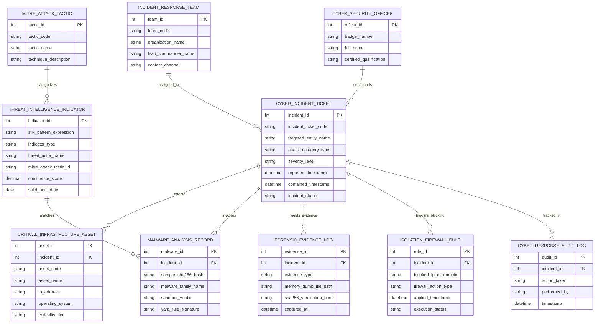

# Conceptual ERD — National Cyber Security Incident Response System

## Mermaid Code

## Entity Description Table | Bảng mô tả Entity

| # | Entity Name | Vietnamese Name | Description | Key Attributes | Main Relationships |
|---|-------------|-----------------|-------------|----------------|-------------------|
| 1 | CYBER_INCIDENT_TICKET | Phiếu Sự cố An ninh mạng | Thông tin phiếu báo cáo sự cố tấn công mạng (mã phiếu, loại tấn công, mức độ nghiêm trọng) | incident_id, incident_ticket_code, targeted_entity_name, attack_category_type, incident_status | Affects ASSET, assigned to RESPONSE_TEAM |
| 2 | CRITICAL_INFRASTRUCTURE_ASSET | Tài sản Hạ tầng Quan trọng | Máy chủ, cơ sở dữ liệu, thiết bị mạng bị tấn công hoặc nguy cơ lây nhiễm | asset_id, asset_code, ip_address, operating_system, criticality_tier | Belongs to CYBER_INCIDENT_TICKET |
| 3 | THREAT_INTELLIGENCE_INDICATOR | Chỉ số Tình báo Mối Đe dọa | Các bản ghi chỉ số thỏa hiệp IOC (STIX pattern, IP, Domain, mã băm, tên nhóm APT) | indicator_id, stix_pattern_expression, threat_actor_name, mitre_attack_tactic_id | Matches MALWARE_RECORD |
| 4 | MALWARE_ANALYSIS_RECORD | Mẫu Mã độc Phân tích | Kết quả phân tích mẫu mã độc thu được trong môi trường Sandbox cách ly (SHA256, YARA rule) | malware_id, sample_sha256_hash, malware_family_name, sandbox_verdict | Belongs to CYBER_INCIDENT_TICKET |
| 5 | INCIDENT_RESPONSE_TEAM | Đội Phản ứng Nhanh CERT | Thông tin các Đội ứng cứu sự cố an toàn thông tin mạng thuộc Mạng lưới CERT Quốc gia | team_id, team_code, organization_name, lead_commander_name | Assigned to CYBER_INCIDENT_TICKET |
| 6 | MITRE_ATTACK_TACTIC | Kỹ thuật Tấn công MITRE | Danh mục kỹ thuật tấn công theo khung chuẩn MITRE ATT&CK Matrix | tactic_id, tactic_code, tactic_name, technique_description | Categorizes THREAT_INDICATOR |
| 7 | FORENSIC_EVIDENCE_LOG | Nhật ký Chứng cứ Số | Hồ sơ sao chụp bộ nhớ RAM, ảnh đĩa cứng và mã băm SHA-256 phục vụ điều tra | evidence_id, evidence_type, memory_dump_file_path, sha256_verification_hash | Belongs to CYBER_INCIDENT_TICKET |
| 8 | CYBER_SECURITY_OFFICER | Chuyên gia An toàn Thông tin | Thông tin chuyên gia, chỉ huy trưởng phụ trách điều phối dập tắt sự cố mạng | officer_id, badge_number, full_name, certified_qualification | Commands CYBER_INCIDENT_TICKET |
| 9 | ISOLATION_FIREWALL_RULE | Quy tắc Chặn Lọc Tường lửa | Các quy tắc ngắt mạng, chặn IP/Domain C2 gửi xuống hệ thống tường lửa nhà mạng | rule_id, blocked_ip_or_domain, firewall_action_type, applied_timestamp | Triggered by CYBER_INCIDENT_TICKET |
| 10 | CYBER_RESPONSE_AUDIT_LOG | Nhật ký Kiểm toán Sự cố | Lưu toàn bộ vết thu thập SIEM, lệnh cô lập mạng, chặn C2, khám nghiệm và khôi phục | audit_id, action_taken, performed_by, timestamp | Belongs to CYBER_INCIDENT_TICKET |

## Relationship Description | Mô tả Quan hệ

| # | From Entity | Cardinality | To Entity | Relationship Label | Business Explanation |
|---|-------------|-------------|-----------|-------------------|----------------------|
| 1 | CYBER_INCIDENT_TICKET | one-to-many | CRITICAL_INFRASTRUCTURE_ASSET | affects | Một sự cố an ninh mạng có thể gây ảnh hưởng đến nhiều máy chủ/tài sản hạ tầng |
| 2 | CYBER_INCIDENT_TICKET | one-to-many | MALWARE_ANALYSIS_RECORD | involves | Một sự cố tấn công mạng có thể liên quan đến nhiều mẫu mã độc khác nhau |
| 3 | CYBER_INCIDENT_TICKET | one-to-many | FORENSIC_EVIDENCE_LOG | yields_evidence | Một sự cố thu thập được các tệp chứng cứ kỹ thuật số phục vụ điều tra số |
| 4 | CYBER_INCIDENT_TICKET | one-to-many | ISOLATION_FIREWALL_RULE | triggers_blocking | Một sự cố phát hành các quy tắc chặn IP/Domain C2 tới tường lửa các nhà mạng |
| 5 | INCIDENT_RESPONSE_TEAM | one-to-many | CYBER_INCIDENT_TICKET | assigned_to | Một Đội ứng cứu sự cố CERT được điều động xử lý nhiều sự cố an ninh mạng |
| 6 | CYBER_SECURITY_OFFICER | one-to-many | CYBER_INCIDENT_TICKET | commands | Một chỉ huy trưởng an ninh mạng trực tiếp chỉ đạo xử lý nhiều sự cố |
| 7 | THREAT_INTELLIGENCE_INDICATOR | one-to-many | MALWARE_ANALYSIS_RECORD | matches | Một chỉ số tình báo IOC đối soát khớp với các mẫu mã độc thu thập tại hiện trường |
| 8 | MITRE_ATTACK_TACTIC | one-to-many | THREAT_INTELLIGENCE_INDICATOR | categorizes | Khung MITRE ATT&CK phân loại các chỉ số hành vi đe dọa an ninh mạng |
| 9 | CYBER_INCIDENT_TICKET | one-to-many | CYBER_RESPONSE_AUDIT_LOG | tracked_in | Mọi thao tác ứng cứu sự cố an ninh mạng được ghi lại nhật ký kiểm toán bất biến |
