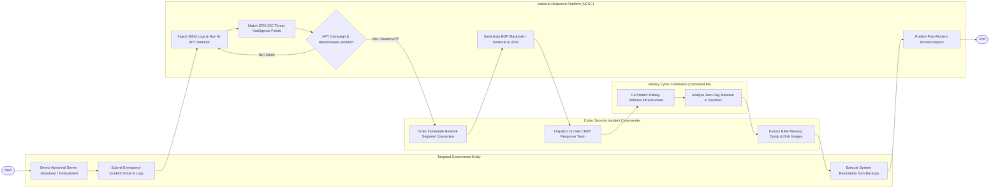

# Swimlane Diagram — National Cyber Security Incident Response System

## Mermaid Code

## Flow Description | Mô tả luồng

| Lane | Actor | Role in Flow |
|------|-------|-------------|
| 1 | Targeted Government Entity | Phát hiện dấu hiệu bất thường trên hệ thống, nộp báo cáo sự cố khẩn cấp đính kèm log và thực hiện khôi phục từ bản sao lưu. |
| 2 | National Response Platform (NCSC) | Thu thập SIEM log, đối soát chỉ số IOC tình báo đe dọa, chạy AI phát hiện APT và tự động gửi lệnh chặn C2 tới các nhà mạng. |
| 3 | Cyber Security Incident Commander | Ra lệnh cô lập khẩn cấp phân đoạn mạng bị nhiễm mã độc, điều động Đội CERT ứng cứu và thu thập chứng cứ kỹ thuật số. |
| 4 | Military Cyber Command (Command 86) | Phối hợp bảo vệ hạ tầng thông tin quốc phòng khẩn cấp và phân tích mẫu mã độc Zero-Day trong môi trường Sandbox. |
