# Action Tree — National Cyber Security Incident Response System

## Mermaid Code

```mermaid
graph TD
    Root["National Cyber Security Incident Response System"]

    Root --> M1["Threat Intelligence Ingestion & STIX/TAXII"]
    Root --> M2["APT Cyber Attack Detection AI & SIEM"]
    Root --> M3["Incident Intake & Rapid Quarantine Response"]
    Root --> M4["Malware Sandbox & Digital Forensics"]
    Root --> M5["International CERT & Threat Sharing"]
    Root --> M6["National Cyber BI & Post-Mortem Audit"]

    M1 --> A11["Ingest Threat Intelligence Feeds STIX"]
    M1 --> A12["Match Malicious IP Domain C2 IOCs"]
    M1 --> A13["Manage YARA Signature Rules"]
    M1 --> A14["Map Threat Actor Groups MITRE ATT&CK"]

    M2 --> A21["Detect APT Cyber Attack Anomaly AI"]
    M2 --> A22["Monitor Government Web Defacement"]
    M2 --> A23["Analyze SIEM Network Traffic Correlator"]
    M2 --> A24["Detect Ransomware Encryption Behaviors"]

    M3 --> A31["Report Cyber Incident Tickets"]
    M3 --> A32["Quarantine Infected Critical Infrastructure"]
    M3 --> A33["Dispatch On-Site Cyber Rapid Response Teams"]
    M3 --> A34["Block Malicious IP Domain C2 BGP"]

    M4 --> A41["Isolate Malware Ransomware Payload Sandbox"]
    M4 --> A42["Conduct Digital Forensic Investigations"]
    M4 --> A43["Capture RAM Live Memory Dumps"]
    M4 --> A44["Calculate SHA256 Evidence Hashes"]

    M5 --> A51["Coordinate National Incident Response CERT"]
    M5 --> A52["Broadcast Emergency Cyber Threat Bulletins"]
    M5 --> A53["Share International Threat Intelligence FIRST"]
    M5 --> A54["Audit Critical System Vulnerability Scans"]

    M6 --> A61["Export Cyber Security Readiness BI"]
    M6 --> A62["Calculate National Cyber Posture Index"]
    M6 --> A63["Log System Immutable Incident Audits"]
    M6 --> A64["Archive Incident Post-Mortem Ledgers"]
```

## Module Description | Mô tả Module

| # | Module | Description | Actions |
|---|--------|-------------|---------|
| 1 | Threat Intelligence Ingestion & STIX/TAXII | Thu thập chỉ số đe dọa IOC (IP, Domain, Hash) theo chuẩn STIX/TAXII, quản lý quy tắc YARA và gạch nhóm APT | Ingest Threat Intelligence Feeds STIX, Match Malicious IP Domain C2 IOCs, Manage YARA Signature Rules, Map Threat Actor Groups MITRE ATT&CK |
| 2 | APT Cyber Attack Detection AI & SIEM | Thuật toán AI SIEM phân tích nhật ký mạng phát hiện chiến dịch APT, giám sát thay đổi giao diện web và phát hiện mã độc | Detect APT Cyber Attack Anomaly AI, Monitor Government Web Defacement, Analyze SIEM Network Traffic Correlator, Detect Ransomware Encryption Behaviors |
| 3 | Incident Intake & Rapid Quarantine Response | Tiếp nhận báo cáo sự cố khẩn cấp, ra lệnh cô lập hạ tầng mạng bị nhiễm mã độc, chặn C2 trên nhà mạng và điều động CERT | Report Cyber Incident Tickets, Quarantine Infected Critical Infrastructure, Dispatch On-Site Cyber Rapid Response Teams, Block Malicious IP Domain C2 BGP |
| 4 | Malware Sandbox & Digital Forensics | Phân tích tệp mã độc tống tiền trong Sandbox cách ly, trích xuất RAM/ổ cứng, khám nghiệm số và bảo toàn mã băm SHA-256 | Isolate Malware Ransomware Payload Sandbox, Conduct Digital Forensic Investigations, Capture RAM Live Memory Dumps, Calculate SHA256 Evidence Hashes |
| 5 | International CERT & Threat Sharing | Điều phối Mạng lưới CERT Quốc gia, phát cảnh báo lỗ hổng Zero-Day, chia sẻ tình báo quốc tế và quét lỗ hổng hệ thống | Coordinate National Incident Response CERT, Broadcast Emergency Cyber Threat Bulletins, Share International Threat Intelligence FIRST, Audit Critical System Vulnerability Scans |
| 6 | National Cyber BI & Post-Mortem Audit | Trích xuất báo cáo chỉ số sẵn sàng an toàn thông tin nộp Bộ TTTT, lưu vết diễn biến sự cố và rút ra bài học kinh nghiệm | Export Cyber Security Readiness BI, Calculate National Cyber Posture Index, Log System Immutable Incident Audits, Archive Incident Post-Mortem Ledgers |
