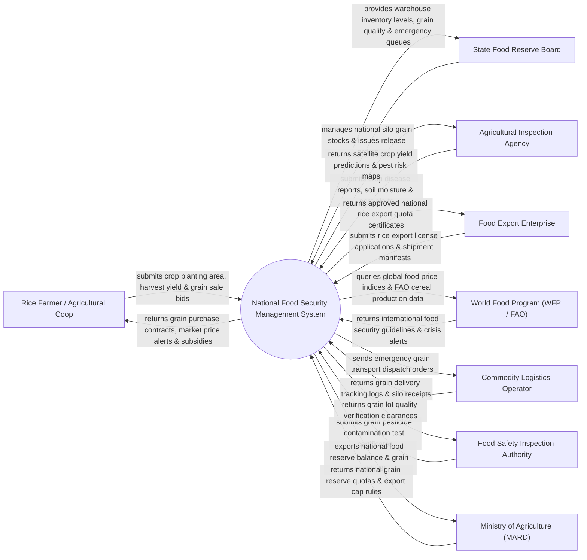

# Context Diagram — National Food Security Management System

## Mermaid Code

## Actor & Interaction Table | Bảng Actor & Tương tác

| # | Actor | Actor Type | Data Sent TO System | Data Received FROM System | Notes |
|---|-------|------------|---------------------|---------------------------|-------|
| 1 | Rice Farmer / Agricultural Coop | Primary | Crop planting area, harvest yield logs, grain sale bids | Grain purchase contracts, market price alerts, subsidies | Nông dân và Hợp tác xã Nông nghiệp trồng lúa gạo |
| 2 | State Food Reserve Board | Primary | National silo grain stock reports, emergency release orders | Warehouse inventory levels, grain quality logs, emergency queues | Cục Dự trữ Quốc gia / Tổng công ty Lương thực Miền Bắc/Nam |
| 3 | Agricultural Inspection Agency | Primary | Crop disease reports, soil moisture logs, pest alerts | Satellite crop yield predictions, pest risk heatmaps | Cục Trồng trọt & Cục Bảo vệ Thực vật (Bộ NN&PTNT) |
| 4 | Food Export Enterprise | Supporting | Rice export license applications, shipment manifests | Approved national rice export quota certificates | Các doanh nghiệp xuất khẩu gạo quốc tế |
| 5 | Commodity Logistics Operator | Supporting | Grain delivery tracking logs, silo receipt manifests | Emergency grain transport dispatch orders | Các doanh nghiệp vận tải kho vận lương thực |
| 6 | Food Safety Inspection Authority | Supporting | Grain pesticide contamination test certificates, lab results | Grain lot quality verification clearances | Cục An toàn Thực phẩm kiểm nghiệm dư lượng thuốc BVTV |
| 7 | World Food Program (WFP / FAO) | Supporting | International food security guidelines, crisis alerts | Global food price indices query, cereal production BI | Tổ chức Lương thực và Nông nghiệp Liên Hợp Quốc (FAO/WFP) |
| 8 | Ministry of Agriculture (MARD) | Regulatory | National grain reserve quotas, export cap regulations | National food reserve balance, grain supply BI dashboards | Bộ Nông nghiệp và Phát triển Nông thôn điều hành an ninh lương thực |

## System Boundary Description | Mô tả Phạm vi Hệ thống

Hệ thống National Food Security Management System (Hệ thống Quản lý An ninh Lương thực Quốc gia / Food Security System) chịu trách nhiệm tự động hóa quy trình giám sát và bảo đảm an ninh lương thực quốc gia: Quản lý kho dự trữ lương thực quốc gia (lúa, gạo, ngô), dự báo sản lượng thu hoạch lúa gạo bằng ảnh vệ tinh Sentinel/Landsat, sử dụng thuật toán AI dự báo nguy cơ hạn hán/xâm nhập mặn và thiếu hụt lương thực, điều hành hạn ngạch xuất khẩu gạo quốc tế (Export Quotas), phát lệnh xuất kho lương thực dự trữ khẩn cấp cứu trợ thiên tai bão lũ và kiểm soát chất lượng an toàn thực phẩm. Tuy nhiên, hệ thống KHÔNG trực tiếp vận hành máy gặt đập liên hợp và KHÔNG thay thế việc bốc xếp bao lúa tại kho hàng.
