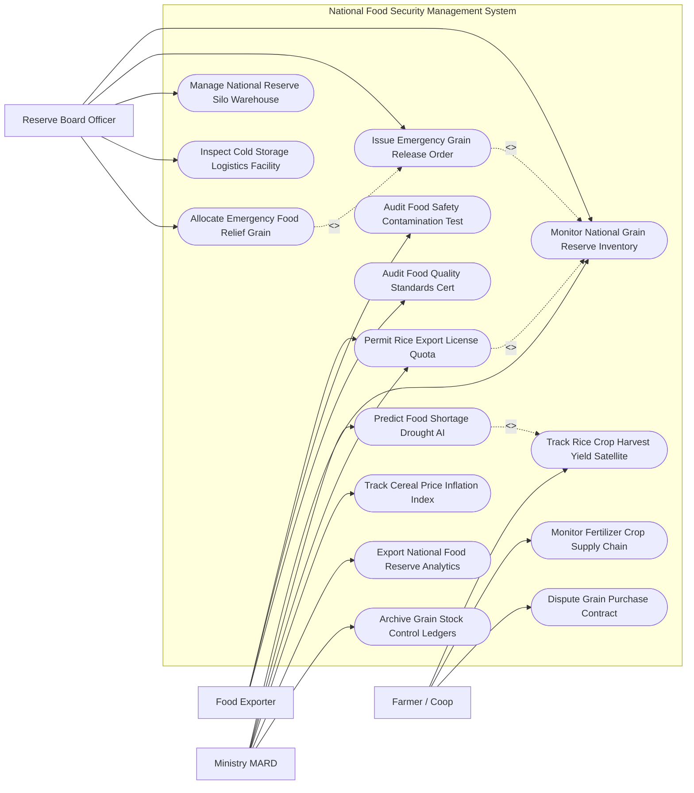

# Use Case Diagram — National Food Security Management System

## Mermaid Code

## Actor Table | Bảng Actor

| # | Actor | Actor Type | Role Description | Related Use Cases |
|---|-------|------------|------------------|-------------------|
| 1 | Farmer / Coop | Primary | Hợp tác xã/Nông dân theo dõi sản lượng thu hoạch, vật tư phân bón và ký hợp đồng bán lúa gạo | UC02, UC09, UC13 |
| 2 | Reserve Board Officer | Primary | Cán bộ Cục Dự trữ Quốc gia quản lý kho silo, theo dõi tồn kho lúa gạo và thực hiện xuất kho cứu trợ | UC01, UC04, UC07, UC10, UC11 |
| 3 | Food Exporter | Primary | Doanh nghiệp nộp đơn xin cấp hạn ngạch xuất khẩu gạo, nộp chứng nhận an toàn thực phẩm kiểm nghiệm | UC05, UC06, UC12 |
| 4 | Ministry MARD | Regulatory | Bộ NN&PTNT theo dõi chỉ số an toàn lương thực, chạy AI dự báo thiếu hụt, điều tiết quota xuất khẩu | UC01, UC03, UC05, UC08, UC14, UC15 |

## Use Case Table | Bảng Use Case

| # | UC ID | Use Case Name | Primary Actor | Secondary Actor | Description | Priority |
|---|-------|---------------|---------------|-----------------|-------------|----------|
| 1 | UC01 | Monitor National Grain Reserve Inventory | Board, MARD | IoT Sensor | Giám sát tồn kho dự trữ gạo, lúa, ngô quốc gia thời gian thực tại các kho Silo | High |
| 2 | UC02 | Track Rice Crop Harvest Yield Satellite | Farmer, MARD | GIS Satellite | Sử dụng ảnh vệ tinh Sentinel/Landsat phân tích diện tích gieo trồng và dự báo sản lượng lúa | High |
| 3 | UC03 | Predict Food Shortage Drought AI | MARD | AI Engine | Thuật toán AI phân tích thời tiết, hạn hán, xâm nhập mặn để dự báo nguy cơ thiếu hụt lương thực | High |
| 4 | UC04 | Issue Emergency Grain Release Order | Board | DisasterGov | Ban hành Quyết định xuất kho gạo dự trữ quốc gia cứu trợ khẩn cấp thiên tai bão lũ | High |
| 5 | UC05 | Permit Rice Export License Quota | Exporter, MARD | Customs | Cấp Giấy phép hạn ngạch xuất khẩu gạo (Rice Export Quota) dựa trên ngưỡng an toàn lương thực | High |
| 6 | UC06 | Audit Food Safety Contamination Test | Exporter | LabAgency | Thẩm định chứng nhận kiểm nghiệm dư lượng thuốc bảo vệ thực vật, kim loại nặng trong gạo | High |
| 7 | UC07 | Manage National Reserve Silo Warehouse | Board | - | Quản lý hệ thống kho Silo dự trữ, theo dõi nhiệt độ, độ ẩm và thông gió bảo quản hạt | High |
| 8 | UC08 | Track Cereal Price Inflation Index | MARD | FAO | Theo dõi biến động chỉ số giá lúa gạo thị trường trong nước và thế giới (FAO Food Price Index) | Medium |
| 9 | UC09 | Monitor Fertilizer Crop Supply Chain | Farmer | Supplier | Giám sát nguồn cung và giá cả phân bón, thuốc bảo vệ thực vật phục vụ sản xuất nông nghiệp | Medium |
| 10 | UC10 | Inspect Cold Storage Logistics Facility | Board | Logistics | Kiểm tra điều kiện hạ tầng kho lạnh, phương tiện vận tải lương thực quy mô lớn | Medium |
| 11 | UC11 | Allocate Emergency Food Relief Grain | Board | RedCross | Phân bổ số lượng gạo cứu trợ nhân đạo cho từng Tỉnh/Huyện bị ảnh hưởng thiên tai | High |
| 12 | UC12 | Audit Food Quality Standards Cert | Exporter | ISO Agency | Kiểm tra các chứng nhận chất lượng gạo xuất khẩu (VietGAP, GlobalGAP, Organic, Jasmine) | Medium |
| 13 | UC13 | Dispute Grain Purchase Contract | Farmer | Board | Giải quyết khiếu nại mâu thuẫn hợp đồng thu mua lúa gạo giữa hợp tác xã và doanh nghiệp | Low |
| 14 | UC14 | Export National Food Reserve Analytics | MARD | Executive | Trích xuất báo cáo cân đối an ninh lương thực quốc gia nộp Thủ tướng Chính phủ | Low |
| 15 | UC15 | Archive Grain Stock Control Ledgers | System | Archives | Lưu trữ vĩnh viễn sổ sách xuất nhập kho dự trữ lương thực quốc gia phục vụ kiểm toán | Low |

## Use Case Specification | Đặc tả Use Case

---

### UC01 — Monitor National Grain Reserve Inventory

| Field | Detail |
|-------|--------|
| **UC ID** | UC01 |
| **Use Case Name** | Monitor National Grain Reserve Inventory |
| **Actor(s)** | Primary: State Food Reserve Board Officer, Ministry MARD / Secondary: IoT Warehouse Sensors |
| **Description** | Giám sát khối lượng tồn kho gạo, lúa, ngô dự trữ quốc gia thời gian thực tại các kho Silo trên toàn quốc. |
| **Precondition** | 1. Cảm biến cân khối lượng tự động và cảm biến IoT được lắp đặt tại hệ thống kho Silo dự trữ quốc gia. |
| **Main Flow** | 1. System định kỳ hàng giờ kết nối các cảm biến IoT Silo (Ultrasonic Level Sensor & Weighing Load Cells).   2. System trích xuất số liệu tồn kho: Tổng khối lượng gạo dự trữ ($Tấn$), Khối lượng lúa khô ($Tấn$), Khối lượng ngô hạt ($Tấn$).   3. System phân loại tồn kho theo Cấp độ bảo quản: Gạo mới nhập kho ($< 6\,tháng$), Gạo bảo quản trung hạn ($6-18\,tháng$), Gạo sắp hết hạn bảo quản cần xoay vòng ($> 18\,tháng$).   4. System kiểm tra Ngưỡng An toàn Lương thực Quốc gia (National Food Reserve Threshold): Tổng tồn kho gạo phải lớn hơn $2,000,000\,tấn$ (Đủ đáp ứng tiêu dùng toàn quốc trong 03 tháng).   5. If Tồn kho xuống dưới ngưỡng an toàn ($< 2,000,000\,tấn$): System bật cảnh báo Đỏ "Nguy cơ dưới ngưỡng an toàn lương thực quốc gia".   6. System tự động phát lệnh ngắt cấp hạn ngạch xuất khẩu gạo (UC05) và phát lệnh mua bổ sung gạo dự trữ vào kho.   7. ReserveBoardOfficer xuất Báo cáo Tồn kho Dự trữ Quốc gia gửi Bộ NN&PTNT. |
| **Alternative Flow** | **AF1** — Kiểm kê thực tế thủ công tại kho: Cán bộ kho nhập kết quả cân thực tế tại hiện trường, System đối soát với số liệu cảm biến IoT (Sai số cho phép $< 1\%$). |
| **Exception Flow** | **EX1** — Cảm biến Silo bị hỏng hóc mất kết nối: System phát thông báo cảnh báo lỗi thiết bị, yêu cầu kỹ thuật viên đến bảo trì cảm biến. |
| **Postcondition** | Khối lượng tồn kho dự trữ lương thực được quản lý chính xác, bảo đảm nguồn cung khẩn cấp cho quốc gia. |
| **Business Rule** | **BR1**: Tổng khối lượng gạo dự trữ quốc gia luôn luôn phải được duy trì ở mức tối thiểu đủ cho tiêu dùng toàn quốc trong 03 tháng. |

---

### UC02 — Track Rice Crop Harvest Yield Satellite

| Field | Detail |
|-------|--------|
| **UC ID** | UC02 |
| **Use Case Name** | Track Rice Crop Harvest Yield Satellite |
| **Actor(s)** | Primary: Rice Farmer / Coop, Ministry MARD / Secondary: GIS Satellite Service |
| **Description** | Phân tích ảnh vệ tinh địa không gian (Sentinel-2 / Landsat) để theo dõi diện tích gieo trồng và dự báo sản lượng lúa thu hoạch. |
| **Precondition** | 1. Dữ liệu ảnh vệ tinh vùng trồng lúa (Đồng bằng Sông Cửu Long, Đồng bằng Sông Hồng) được cập nhật định kỳ. |
| **Main Flow** | 1. System tự động nạp dữ liệu ảnh vệ tinh multispectral từ vệ tinh Sentinel-2.   2. AI Remote Sensing Engine chạy thuật toán tính chỉ số thực vật NDVI (Normalized Difference Vegetation Index) và chỉ số nước LSWI.   3. AI bóc tách diện tích gieo trồng lúa thực tế ($Hécta$) theo từng giai đoạn phát triển: Giai đoạn mạ, Giai đoạn đẻ nhánh, Giai đoạn trỗ bông, Giai đoạn chín vàng chuẩn bị thu hoạch.   4. System kết nối dữ liệu thời tiết và năng suất lịch sử để tính toán Sản lượng thu hoạch dự báo ($Tổng\_sản\_lượng = Diện\_tích \times Năng\_suất\_dự\_báo$).   5. System hiển thị Bản đồ Nhiệt vùng trồng lúa (Rice Crop Spatial Map) và tiến độ thu hoạch từng Tỉnh.   6. System phát thông báo dự báo sản lượng thu hoạch cho FarmerCoop và doanh nghiệp thu mua để chuẩn bị kho xưởng, bến bãi.   7. System chuyển số liệu sản lượng thu hoạch sang Phân hệ Cân đối An ninh Lương thực (UC03). |
| **Alternative Flow** | **AF1** — Phát hiện vùng trồng lúa bị ngập lụt/sâu bệnh qua ảnh vệ tinh: AI bóc tách diện tích lúa bị thiệt hại, tính toán số lượng sản lượng sụt giảm để điều chỉnh dự báo. |
| **Exception Flow** | **EX1** — Ảnh vệ tinh bị mây che phủ quá $70\%$: System chuyển sang sử dụng dữ liệu ảnh vệ tinh radar SAR (Sentinel-1) có khả năng xuyên mây. |
| **Postcondition** | Sản lượng lúa thu hoạch toàn quốc được dự báo chính xác khoa học, làm căn cứ điều hành xuất khẩu gạo (UC05). |
| **Business Rule** | **BR1**: Bản đồ dự báo sản lượng lúa thu hoạch từ ảnh vệ tinh phải được cập nhật định kỳ 15 ngày/lần trong suốt vụ mùa. |

---

### UC03 — Predict Food Shortage Drought AI

| Field | Detail |
|-------|--------|
| **UC ID** | UC03 |
| **Use Case Name** | Predict Food Shortage Drought AI |
| **Actor(s)** | Primary: Ministry MARD / Secondary: AI Predictive Engine |
| **Description** | Thuật toán AI phân tích dữ liệu thời tiết, hạn hán, xâm nhập mặn và biến động giá để dự báo nguy cơ thiếu hụt lương thực. |
| **Precondition** | 1. Dữ liệu thời tiết, độ mặn nguồn nước, sản lượng lúa dự báo (UC02) và chỉ số giá (UC08) được nạp liên tục. |
| **Main Flow** | 1. AI Predictive Engine chạy mô hình dự báo rủi ro an ninh lương thực (Food Insecurity Early Warning Model).   2. AI phân tích các biến số nguy cơ:   - Mức độ xâm nhập mặn vùng Đồng bằng Sông Cửu Long ($> 4\,g/lít$).   - Tình trạng hạn hán kéo dài tại Tây Nguyên và Nam Trung Bộ.   - Mức độ sụt giảm sản lượng lúa thu hoạch dự báo (UC02).   - Tỷ lệ lạm phát chỉ số giá lương thực thực phẩm (UC08).   3. If Phát hiện rủi ro thiếu hụt lương thực trong 06 tháng tới ($Risk\_Score > 75\%$): AI bật Cảnh báo Khẩn "Nguy cơ thiếu hụt lương thực cục bộ/diện rộng".   4. System lập Báo cáo Đánh giá Rủi ro An ninh Lương thực đính kèm bản đồ các vùng có nguy cơ cao.   5. System đề xuất các giải pháp ứng phó: Tạm dừng cấp phép xuất khẩu gạo (UC05), Mua bổ sung lúa gạo dự trữ, Phát lệnh xuất kho cứu trợ (UC04).   6. MARD Ministry ký số phát hành Công điện khẩn gửi UBND các Tỉnh/Thành phố triển khai giải pháp phòng chống hạn mặn. |
| **Alternative Flow** | **AF1** — Cảnh báo khủng hoảng lương thực toàn cầu: AI phát hiện giá gạo thế giới tăng vọt $> 50\%$, đề xuất SIẾT CHẶT hạn ngạch xuất khẩu để bảo vệ nguồn cung trong nước. |
| **Exception Flow** | **EX1** — Cảnh báo nhầm do số liệu đo đếm mặn bị lỗi: Chuyên gia kiểm tra lại số liệu trạm quan trắc, bấm "Xác nhận chỉ số bình thường". |
| **Postcondition** | Nguy cơ khủng hoảng thiếu hụt lương thực được phát hiện sớm từ 3-6 tháng, giúp Chính phủ chủ động ứng phó. |
| **Business Rule** | **BR1**: Khi AI cảnh báo nguy cơ thiếu hụt lương thực vượt ngưỡng $75\%$, Bộ NN&PTNT bắt buộc phải trình Thủ tướng phương án điều hành hạn ngạch. |

---

### UC05 — Permit Rice Export License Quota

| Field | Detail |
|-------|--------|
| **UC ID** | UC05 |
| **Use Case Name** | Permit Rice Export License Quota |
| **Actor(s)** | Primary: Food Export Enterprise, Ministry MARD / Secondary: General Department of Customs |
| **Description** | Cấp Giấy phép và Quản lý Hạn ngạch Xuất khẩu Gạo (Rice Export Quota) dựa trên cân đối sản lượng và tồn kho dự trữ quốc gia. |
| **Precondition** | 1. Doanh nghiệp nộp đơn xin cấp hạn ngạch xuất khẩu gạo và có hợp đồng xuất khẩu hợp lệ. |
| **Main Flow** | 1. FoodExporter đăng nhập Cổng Quản lý Hạn ngạch Xuất khẩu Gạo Quốc gia.   2. FoodExporter nộp Đơn xin cấp Hạn ngạch xuất khẩu gạo (gồm Khối lượng xuất khẩu $Tấn$, Chủng loại gạo, Thị trường nhập khẩu, Hợp đồng xuất khẩu).   3. System tự động kiểm tra Cân đối An ninh Lương thực Quốc gia:   - $Hạn\_ngạch\_cho\_phép = Tổng\_sản\_lượng - Tiêu\_dùng\_trong\_nước - Tồn\_kho\_dự\_trữ\_tối\_thiểu$.   4. System kiểm tra điều kiện doanh nghiệp: Có kho chứa tối thiểu $5,000\,tấn$ và cơ sở mỏi/lau bóng gạo theo quy định.   5. If Thỏa mãn điều kiện an toàn: MARD Ministry ký số phát hành Giấy phép Hạn ngạch Xuất khẩu Gạo điện tử.   6. System tự động trừ số lượng xuất khẩu vào Tổng Hạn ngạch Xuất khẩu Gạo Toàn quốc trong kỳ.   7. System truyền Giấy phép xuất khẩu điện tử sang Cổng Thông tin Một cửa Quốc gia Hải quan (Customs) để làm thủ tục thông quan tàu hàng. |
| **Alternative Flow** | **AF1** — Tạm dừng xuất khẩu gạo khi có nguy cơ thiếu hụt lương thực (UC03): System tự động khóa tính năng cấp phép xuất khẩu, từ chối toàn bộ đơn xin hạn ngạch mới. |
| **Exception Flow** | **EX1** — Doanh nghiệp xuất khẩu quá số lượng hạn ngạch được cấp: Hải quan quét mã phép phát hiện vượt hạn ngạch, tự động dừng thông quan lô hàng. |
| **Postcondition** | Xuất khẩu gạo được kiểm soát chặt chẽ, vừa mang lại doanh thu ngoại tệ vừa bảo đảm an toàn lương thực tuyệt đối cho đất nước. |
| **Business Rule** | **BR1**: Việc cấp hạn ngạch xuất khẩu gạo bắt buộc phải tự động tạm dừng ngay lập tức khi tồn kho dự trữ quốc gia rơi vào mức báo động. |
