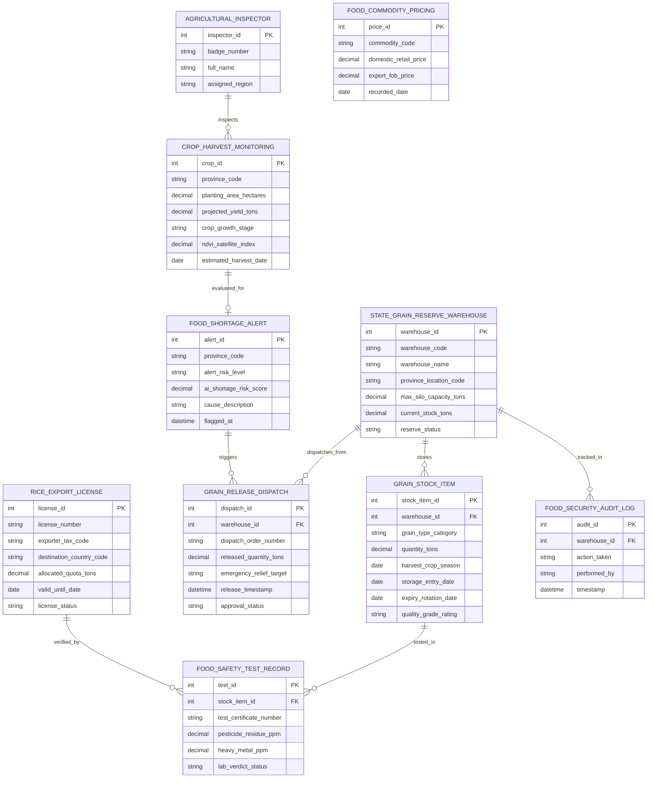

# Conceptual ERD — National Food Security Management System

## Mermaid Code

## Entity Description Table | Bảng mô tả Entity

| # | Entity Name | Vietnamese Name | Description | Key Attributes | Main Relationships |
|---|-------------|-----------------|-------------|----------------|-------------------|
| 1 | STATE_GRAIN_RESERVE_WAREHOUSE | Kho Dự trữ Lương thực Quốc gia | Thông tin hệ thống kho Silo dự trữ lúa gạo quốc gia (sức chứa, lượng tồn kho hiện tại) | warehouse_id, warehouse_code, max_silo_capacity_tons, current_stock_tons, reserve_status | Stores GRAIN_STOCK_ITEM, dispatches GRAIN_RELEASE |
| 2 | GRAIN_STOCK_ITEM | Lô Hàng Lương thực Dự trữ | Chi tiết các lô lúa, gạo, ngô dự trữ (chủng loại, khối lượng, vụ mùa, hạn xoay vòng) | stock_item_id, grain_type_category, quantity_tons, storage_entry_date, expiry_rotation_date | Belongs to WAREHOUSE, tested in SAFETY_TEST |
| 3 | CROP_HARVEST_MONITORING | Theo dõi Sản lượng Lúa Vệ tinh | Dữ liệu diện tích gieo trồng, chỉ số NDVI mây vệ tinh và sản lượng thu hoạch dự báo | crop_id, province_code, planting_area_hectares, projected_yield_tons, ndvi_satellite_index | Evaluated for SHORTAGE_ALERT |
| 4 | FOOD_SHORTAGE_ALERT | Cảnh báo AI Thiếu hụt Lương thực | Cảnh báo AI phát hiện rủi ro thiếu hụt lương thực do hạn hán, xâm nhập mặn | alert_id, alert_risk_level, ai_shortage_risk_score, cause_description | Triggers GRAIN_RELEASE_DISPATCH |
| 5 | GRAIN_RELEASE_DISPATCH | Lệnh Xuất kho Cứu trợ | Quyết định xuất kho gạo dự trữ quốc gia cứu trợ thiên tai bão lũ khẩn cấp | dispatch_id, dispatch_order_number, released_quantity_tons, emergency_relief_target | Dispatched from WAREHOUSE |
| 6 | RICE_EXPORT_LICENSE | Giấy phép Hạn ngạch Xuất khẩu | Giấy phép cấp hạn ngạch xuất khẩu gạo cho doanh nghiệp dựa trên cân đối an toàn | license_id, license_number, exporter_tax_code, allocated_quota_tons, license_status | Verified by FOOD_SAFETY_TEST |
| 7 | FOOD_SAFETY_TEST_RECORD | Kiểm nghiệm An toàn Thực phẩm | Kết quả kiểm nghiệm dư lượng thuốc bảo vệ thực vật, kim loại nặng trong gạo | test_id, test_certificate_number, pesticide_residue_ppm, lab_verdict_status | Belongs to GRAIN_STOCK_ITEM |
| 8 | AGRICULTURAL_INSPECTOR | Cán bộ Kiểm tra Nông nghiệp | Thông tin thanh tra viên nông nghiệp kiểm tra tình hình sản xuất và kho dự trữ | inspector_id, badge_number, full_name, assigned_region | Inspects CROP_HARVEST_MONITORING |
| 9 | FOOD_COMMODITY_PRICING | Chỉ số Giá Lương thực | Theo dõi biến động giá lúa gạo thị trường trong nước và giá xuất khẩu FOB | price_id, commodity_code, domestic_retail_price, export_fob_price, recorded_date | Standalone Reference Data |
| 10 | FOOD_SECURITY_AUDIT_LOG | Nhật ký Kiểm toán Lương thực | Lưu toàn bộ vết nhập xuất kho silo, cấp phép quota, cứu trợ và kiểm tra an toàn | audit_id, action_taken, performed_by, timestamp | Belongs to WAREHOUSE |

## Relationship Description | Mô tả Quan hệ

| # | From Entity | Cardinality | To Entity | Relationship Label | Business Explanation |
|---|-------------|-------------|-----------|-------------------|----------------------|
| 1 | STATE_GRAIN_RESERVE_WAREHOUSE | one-to-many | GRAIN_STOCK_ITEM | stores | Một kho Silo dự trữ quốc gia lưu giữ nhiều lô hàng lúa gạo khác nhau |
| 2 | STATE_GRAIN_RESERVE_WAREHOUSE | one-to-many | GRAIN_RELEASE_DISPATCH | dispatches_from | Một kho dự trữ thực hiện các Lệnh xuất kho gạo cứu trợ khẩn cấp |
| 3 | GRAIN_STOCK_ITEM | one-to-many | FOOD_SAFETY_TEST_RECORD | tested_in | Một lô lương thực dự trữ được lấy mẫu kiểm nghiệm an toàn thực phẩm định kỳ |
| 4 | AGRICULTURAL_INSPECTOR | one-to-many | CROP_HARVEST_MONITORING | inspects | Một cán bộ kiểm tra nông nghiệp giám sát dữ liệu gieo trồng tại các địa phương |
| 5 | RICE_EXPORT_LICENSE | one-to-many | FOOD_SAFETY_TEST_RECORD | verified_by | Giấy phép xuất khẩu gạo được xác thực bởi các chứng nhận an toàn thực phẩm |
| 6 | STATE_GRAIN_RESERVE_WAREHOUSE | one-to-many | FOOD_SECURITY_AUDIT_LOG | tracked_in | Mọi thao tác xuất nhập kho dự trữ được ghi lại nhật ký kiểm toán bất biến |
| 7 | CROP_HARVEST_MONITORING | one-to-one | FOOD_SHORTAGE_ALERT | evaluated_for | Dữ liệu sản lượng lúa thu hoạch được đánh giá để phát hiện Cảnh báo thiếu hụt AI |
| 8 | FOOD_SHORTAGE_ALERT | one-to-many | GRAIN_RELEASE_DISPATCH | triggers | Cảnh báo thiếu hụt lương thực kích hoạt các Lệnh xuất kho gạo cứu trợ khẩn cấp |
